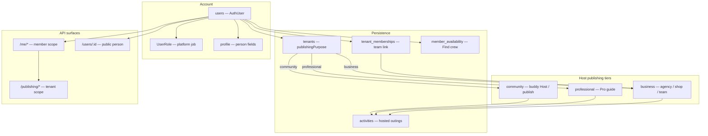

# Member model — users, roles, tiers, routes

**Canonical map** for how one **person account** connects to capabilities, storage, and HTTP. Doc index: [`DOCS_INDEX.md`](./DOCS_INDEX.md). Product voice: [`NORTHSTAR.md`](./NORTHSTAR.md). Domain entities: [`DOMAIN.md`](./DOMAIN.md). HTTP prefixes: [`API_ROUTING.md`](./API_ROUTING.md). Coherence program: [`SYSTEM_COHERENCE.md`](./SYSTEM_COHERENCE.md) §8.8.

Do **not** re-implement tier logic in React hooks — consume **`GET /me/status`** (`MemberStatusDTO`; profile at root, publish/workspace under **`publish`** only).

**Capabilities ≠ viewer access:** `status.publish.canPublish` / `canAccessPublishingWorkspace` answer whether this member may **host or publish** outings and open the **operator desk**. They do **not** gate whether someone may **read** full activity detail or a member profile. That is **`buildActivityViewerAccess`** / **`resolveProfileViewerAccess`** ([`DOMAIN_CANONICALS.md`](./DOMAIN_CANONICALS.md) §15; `resolveActivityViewerAccess` remains a compatibility alias). Guest sign-in sheets (`guestBrowseGateCopy`) are presentation when `gateReason === sign_in` only.

**Participate ≠ publish:** Joining an outing (RSVP, request to join, looking for company) requires a **signed-in member** with a complete **safety profile** (`medicalSafetyProfileComplete` on `GET /me/status` — blood group, conditions or `N/A`, emergency contact). It does **not** require `profileComplete`. **Host / publish** requires **`profileComplete`** (member details on `/welcome`) plus **`canPublish`** (activity-capable tenant). Rideshare hosts pick a car from **`/me/vehicles`** (`/profile/vehicles`); listings show make, model, color, and year. The **number plate** is only on **`GET /activities/:id`** for **ride crew** (host + confirmed participants), not on **`/member/:userId`** upcoming-activities or other public profile reads.

**My Plans surface vs `/me/*`:** Consumer **My Plans** lives at **`/plan`** (`PLAN_PATH`, `src/plan/planRouting.ts`) — **forward-looking only**: upcoming joined/hosting (list or calendar), coordination strip, wishlist/saved, goals (`planSheet`); **mark availability** → explore `compose=intent:open` — **not** outing history or journey map. **`/profile`** is identity and settings; **operator schedule** → **`/operator/overview`** (`planHostedSchedulePath()`). **`/profile/history`** is **past** inventory. HTTP **`GET/PUT /me/goals`**, **`/me/availability`**, **`/me/coordination-attention`** back the Plan page. Explore/list tab FABs use **`activity` · `place` · `intent`** compose — separate from the Plan sheet ([`NAVIGATION.md`](./NAVIGATION.md) § Plan disambiguation).

**Plan is a UI hub, not a domain entity:** There is no `Plan` collection, `PlanDTO`, or `GET /plans/:id`. The middle tab is a **read-model shell** over real objects — primarily **`activities`** (joined upcoming, **hosted** / hosting filter), **`member_goals`**, **`member_availability`** (Find crew / calendar — not activities), wishlist saves, and **`coordination-attention`** (join queues, invites). **Hosting an outing** = create/publish an **`Activity`** (tenant-scoped publish, map discovery) — not “creating a Plan.” In code, prefer **activity / hosted / joined / goals / availability** in API and store names; FE hub helpers: `memberCommitmentHubApi` (`goals` + `availability` only). Reserve **Plan** for routes (`/plan`), tab chrome, and inbox grouping copy where noted in [`DOMAIN_CANONICALS.md`](./DOMAIN_CANONICALS.md) (activity detail tab label **Plan** = outing facts on L3 — still not a Plan entity).

**FE file naming:** Two patterns — pick by **surface**, not by parsing every word in a component name.

| Where | Folder | Names | Meaning |
|--------|--------|--------|---------|
| **`/plan` tab** | `src/plan/PlanPage.tsx` + `src/components/plan/*` | `PlanPage` (route shell), `PlanUpcomingView`, `PlanJoinedUpcoming`, … | **Feature module** for the My Plans hub. `Plan*` is a **namespace** for the surface, not a domain entity. Data: activities/join hooks + `memberGoalsApi` / `memberAvailabilityApi` / `memberCoordinationApi` — aggregate catalog `memberCommitmentHubApi` (`goals` + `availability` only). |
| **Profile history / activity domain** | `components/activity/*`, `profile-history/*` | `JoinedSection`, `HostedActivitiesSection`, availability on profile | **Relationship or entity** (joined, hosted, availability) without `Plan` prefix. |

`src/plan/planRouting.ts` + `planTab.ts` = URL/helpers for `/plan`. SN-6 allows `Plan*` under `src/plan/`, `src/components/plan/`, `src/member-plan/` only. **Do not** split the same upcoming list across `plan/` and `activity/` — that duplicates ownership.

**Activity detail — Pro vs host vs crew:** **Community host** = profile-complete member who may **Host / publish** (`canPublish`). **Pro membership** = paid tier for **social depth** on outings (e.g. view host profile before join, full **Crew** roster after join) — applied in **`applyActivityViewEntitlements`** after social `viewerAccess`. **`canOfferTransport` / `canAddLinkedRide`** = confirmed **participant** or **host** on this outing (create/link a ride; publish gate still applies when creating). **`canAccessCrewSurfaces`** is **not** Pro and **not** publishing tier: confirmed **participant** or **host** on **this** outing (meeting precision, roster, group chat). Pending joiners stay on **Plan** + join CTAs only. Do not use `UserRole` or `canPublish` for consumer Friends/Place gates.

**Publishing actor = always a user:** Every publish action has a `userId` actor. A **business** is a **tenant** the user may represent; use **publish as self / {business}** when the member has multiple activity-capable tenants (`GET /me/status` → `publish.ownedProfiles[].publishingProfileKind`; Host publish step `HostingPublishAsField`). Workspace publish-as: TBD.

**Storefront kinds (`PublishingProfileKind`):** See [`DOMAIN_CANONICALS.md`](./DOMAIN_CANONICALS.md) §1.3 — `community`, `pro_guide`, `agency`, `shop`, `ecommerce`, `hospitality`, `partner`. Wire `EntityKind.tenant` is the agency/partner storefront slug URL, not product copy.

**Product vocabulary (UI):** **`src/content/workspaceVocabulary.ts`** — **Host** = individual leading **this outing** (joiner-facing); **Guide / Pro host** = profile-complete member with **individual Pro** — public face is **`/member/:userId`** (no separate guide storefront); **Operator** = **any publishing identity** (community host, guide, shop, agency, partner) with a shared **desk** at **`/operator/*`** (kind-specific modules); **Host / publish** = capabilities under **`GET /me/status`** → **`publish`**. **Architecture:** SPA **`/operator/*`**; tenant HTTP **`/publishing/*`** + `x-tenant-id`. **Member capabilities:** **`GET /me/status`** · **`useMemberStatus`**.

### One stack (person · community · Pro · tenant)

| Concept | What it is | Product entry |
|---------|------------|---------------|
| **Member (user)** | One human account | Sign up · `/profile` |
| **Community host** | Same user, profile complete — free **Host** on the map | No Pro; auto **community** tenant |
| **Pro membership** | Upgrade path for **individual** (pro guide) or **business** (shop, tour agency, e-commerce, hospitality, …) | `/profile/pro-membership` |
| **Tenant** | Single persistence row for every storefront (`tenants`); wire name **organisation** in headers/API | `x-tenant-id`, `GET /publishing/*` when managing |
| **Business subtype** | Which Pro business flavor (location-bound shop vs remote agency vs online e-commerce, etc.) | Chosen in Pro application — maps to `PublishingProfileKind` |

There is **not** a second “organisation entity” beside tenants: shops, agencies, and e-commerce brands are **tenants** with different `PublishingProfileKind` / purpose. **Organisation** in code means **tenant scope** (storefront + workspace), not a parallel user type.

**Naming (organizer vs operator vs join vs buddy):** § [Naming vocabulary](#naming-vocabulary) below · Cursor: `.cursor/rules/host-member-model.mdc` · verify: `npm run verify:host-member`.

---

## Spider map

---

## Follow · Wishlist · Goal (not “favorites”)

| Product | Meaning | API |
|---------|---------|-----|
| **Follow (people)** | Host/crew updates in Social | `POST /me/following/:userId` — **buddies auto-follow** on accept |
| **Follow (venue / brand)** | Alerts when something is published at a place or storefront | `POST /me/entity-follows` |
| **Wishlist** | Private save — **venues + activities** to join later | `GET/POST /me/wishlist` (Mongo `user_wishlist`) |
| **Goal** | Time-bounded count (e.g. N hikes by date) | `GET/POST /me/goals` — progress from outings + visited map pins |

Detail: [`DOMAIN_CANONICALS.md`](./DOMAIN_CANONICALS.md) §1.6.

---

## Layers (do not confuse)

| Layer | What it is | Examples |
|-------|------------|----------|
| **HTTP surface** | Which API prefix and registrar owns the call — **not** inferred from profile alone | Public `GET /places/:id` · member `POST /me/places` · admin `PATCH /admin/places` · operator `POST /publishing/activities` ([`SYSTEM_COHERENCE.md`](./SYSTEM_COHERENCE.md) §5.1) |
| **Person / member** | Human using the app | `users`, `/profile`, `/member/:id` |
| **UserRole** | Legacy platform job on the user row | `PARTICIPANT`, `TENANT_GUIDE`, `PLATFORM_ADMIN` |
| **Host publishing tier** | How they publish on the map | `community`, `professional`, `business` |
| **Tenant** | Publishing organisation row | `tenants.publishingPurpose`, `x-tenant-id` |
| **MembershipRole** | Person ↔ tenant (team) | `TENANT_OWNER`, `TENANT_GUIDE` |
| **Public person profile** | Every member (incl. Pro guide) | `/member/:userId` |
| **Public operator profile** | Agency or shop **business** | `/agency/:slug`, `/shop/:id` (+ shop map pin) |

**UserRole ≠ host tier.** A `PARTICIPANT` can be a **community** host (`canPublish` + community tenant). A **business** guide is often `TENANT_GUIDE` with no owned tenant.

**Platform admin staff:** `PLATFORM_ADMIN` may use `/admin/*`. Admin console nav includes **Users** (`/admin/users`) for search, suspend/activate, and (master only) grant/revoke platform staff. New platform admins are **not** self-registered — only a **master admin** (`profile.platformMasterAdmin` or `PLATFORM_MASTER_ADMIN_EMAILS`) may call `POST /admin/platform-admins` (grant) or `DELETE /admin/platform-admins/:userId` (revoke). Demo seed sets master on `admin@uaetrails.app`.

---

## Host publishing tiers

| Tier | Who | Tenant `publishingPurpose` | Paid Organize? | Entry |
|------|-----|------------------------------|----------------|-------|
| **Community** | Individual member | `community` | No (free / shared) | Profile complete → auto tenant (`ensureBuddyHostTenant`) |
| **Professional** | Pro guide | `professional` | No — free + shared only | `/profile/pro-membership` → host application (`individual`) |
| **Business** | Agency / shop owner or **employee** | `business` | Yes (agency; shop per product) | Pro membership application or team invite → `tenant_memberships` |

**Profile badge (`profileRoleLabel`):**

| Key | When |
|-----|------|
| `community_member` | Signed in; profile incomplete (no community tier) |
| `host` (wire) | UI **Host** — community publish tier (`hostTiers.community`) and/or `isCommunityHost` after first activity **or** seeking on map |
| `professional_guide` | Professional tier tenant |
| `agency` | Agency tenant or business tier operator |
| `shop_owner` | Shop tenant |

Wire: `HostStatusDTO.hostTiers`, `HostStatusDTO.profileRoleLabel`, `HostStatusDTO.isCommunityHost`.

---

## Pro membership ladder (product)

All paths require a **signed-in user**. Upgrade entry: **`/profile/pro-membership`** (`PRO_MEMBERSHIP_PATH`).

| Pro path | Who | Required choice | Storefront / capabilities (high level) |
|----------|-----|-----------------|----------------------------------------|
| **Individual** | Member with Pro membership | — | Public face **`/member/:userId`**; manage in **`/publishing`**. Host **free + shared-cost** outings (not paid) |
| **Business** | Company / brand | **Subtype required:** Shop · Tour agency · … | **Shop** → `/shop/:id` + shop details in console; **Agency** → `/agency/:slug` + agency profile; paid commercial trips where product allows |
| **Partner** | Hotel / campaign partner | Detail later | Partner storefront + “What’s happening” campaigns (future) |

**Business subtype** is **not** interchangeable: a **shop** is map/directions retail; a **tour agency** is trip operator without requiring a visit pin; **Partner** is a separate Pro path from generic business (see product split in `DOMAIN.md`).

Billing / `PaidMembershipSku` enforcement: layer **7** in `member-entitlements.ts` (stub until billing ships).

---

## Profile visibility (person — not host tier)

| `profileVisibility` | Guests | Other signed-in members (no relationship) |
|---------------------|--------|-------------------------------------------|
| `public` | Sign-in only — **no** member card (target policy P3) | **Public member card** on `/member/:id` |
| `group_members` | Sign-in only | Denied unless group / allowed relationship |
| `private` | Sign-in only | Denied unless buddy, co-participant, host-of-activity, etc. |

Trusted fields (year goal, upcoming list, etc.) appear only on **trusted** exposure, not on the public card.

**Per-field visibility (`profile.fieldPrivacy` + `dateOfBirthShare`):** After the global `profileVisibility` gate, each card block uses `hidden` | `friends` (trusted exposure) | `friends_of_friends` (network one hop) | `public` (signed-in public card). Date of birth on the card is `dateOfBirthShare` (`hidden` | birth year | full date × friends / friends of friends / public). Includes bio, city, languages, stats, badges, trip history, year goal, availability, upcoming outings, cars, and optional plates. **City / start area** hidden also redacts directory city labels and availability `destinationId` / region, and blocks area-filtered Find crew matching (others will not see you as going from their area). Hosts still receive gender/DOB on join requests when the outing has women-only or age rules — separate from card privacy. Settings: `/settings` (privacy sections) → **Field visibility** + **Friends list on profile** (`friendsListShare`: Only me · Friends & crew · Friends of friends · Mutual friends) + **Find crew** (`findCrewVisibility`: Friends only · Friends of friends · Hidden; default friends of friends) for Looking / Free / Everyone / seeking map pins; API `PATCH /me/profile/field-privacy`. **Common follows** on `/member/:id` are shown to signed-in visitors regardless of friends-list setting (`GET /member/:userId/social-graph`, optional `?parts=friends` or `?parts=commonFollows`). **Bundled profile:** `GET /member/:userId/profile?include=socialGraph,upcoming,past` returns profile `data`, `viewerAccess`, and optional `socialGraph`, `upcomingActivities`, `pastActivities` in one response (legacy `?socialGraph=1` still supported). Adjacency lists cache in-process and in Redis when `REDIS_URL` is set.

**One profile page:** Every link to another member uses **`/member/:userId`** (`MemberProfile`) — friends list (`/crews`), find-crew discover rows, activity roster, chat. Browse entry may add `source=` / `discover=1` for quota and analytics; **layout is the same**. Lens × who may open: [`DOMAIN_CANONICALS.md`](./DOMAIN_CANONICALS.md) §3.2.2.

**Naming (code vs UI — pick one term per layer, do not synonym-swap in types):**

| Layer | Use in code / API | UI copy may say |
|-------|-------------------|-----------------|
| Account | **member**, `userId`, `/users/:id` | Member, host name on card |
| Public card page | **profile**, `MemberProfile`, `memberProfilePath`, `GET …/public-profile` | Profile, “View profile” |
| Find crew discover | **`crew-discovery`**, `crewBrowseLane`, `peopleTab` / `peopleFacet` URL params | Lanes **People** · **Professional** · **Community**; People facets **Friends** (default) · Available · Everyone (legacy `recommended` → Friends) |
| List category handoff | `listCat=people` | **Crews** (triad pill / list category) |
| My crew (social) | **`/crews`**, **`/groups`**, `social_graph`, wire `/me/friends` | My Crews, Friends, Teams |
| Relationship | **buddy** / `accepted_friend` (wire) | Friends |
| Directory quota | **member discovery**, `discover=1`, `memberDiscoverProfilePath` | Connect / discover |

**Find crew browse (discover — not My Crews):** Primary surface = **list search** (`/list?listCat=people`, desktop drawer `list=1&listCat=people`). Top split: `crewSurface=find` (default) vs `crewSurface=my` — wire `packages/shared-types/src/crew-people-surfaces.ts`. State spine: `src/crew-discovery/crewBrowseState.ts` (`CrewBrowseLane` + `CrewPeopleFacet`). **My Crews** (`/crews`, `/groups`, or list `crewSurface=my`) is the **social hub** — requests, following, teams; it must **not** host `GET /me/member-discovery/browse` as primary body (guard `PVOC-03a`).

| Param | Values | Default (omit from URL) |
|-------|--------|-------------------------|
| `peopleTab` | `people` · `professional` · `community` | `people` |
| `peopleFacet` | `recommended` · `friends` · `available` · `everyone` | `recommended` (People lane only) |
| `proKind` | `guide` · `porter` · `agency` | `all` (Professional lane only; omit param) |

| Lane | Facet | Data |
|------|-------|------|
| People | Recommended | **`GET /discover/recommendations?surface=crew`** (server rank) + list projection; map teaser from catalog |
| People | Friends | **`GET /discover/crew`** (friends going + hosts in federated feed) |
| People | Available | Member availability + fixed intent catalog; sub-lens `open=` |
| People | Everyone | `GET /me/member-discovery/browse` + quota |
| Professional | — | Guide/porter directory + agency rows (`source: agency`) |
| Community | — | `GET /explore/communities`, `GET/POST /me/communities`, `/clubs/:slug`; `FEATURE_FLAGS.communityDiscover` (default on) |

Legacy inbound `peopleTab=hub|buddies|going|connect|available|looking` maps to lane + facet in `productUrlInbound` — **never emit** `hub`. Profile opens `GET /member/:userId/profile?from=discover` (**3 unique profiles / 30d**; Pro unlimited). **Chat** is [`COMMUNICATION.md`](./COMMUNICATION.md) (`/chat/*`). **Join me (participation):** `GET/POST /activities/:id/invites`. See [`NAVIGATION.md`](./NAVIGATION.md) § Browse — people & crew and [`API_ROUTING.md`](./API_ROUTING.md).

**Profile view analytics (shipped):** views recorded on `GET /member/:userId/profile`; owners with host Pro/business see `GET /me/profile-view-stats`.

---

## Capabilities (`GET /me/status` — prefer `publish` + `profileComplete`)

| Field | Meaning |
|------|---------|
| `profileComplete` | Member details on `/welcome` done — **host/publish** gate (`signupProfileComplete` on `GET /me/profile` only) |
| `publish.canPublish` | May run Host / publish (activity-capable tenant) |
| `publish.canAccessPublishingWorkspace` | May use operator desk (SPA `/operator/*`; HTTP `/publishing/*`) |
| `publish.canHostPaidActivities` | Linked **business** tenant; paid pricing when publishing as agency / shop / partner |
| `publish.isCommunityHost` | Map footprint badge — first activity or seeking post (not the same as `profileComplete`) |

**Participate (join, RSVP, looking for company):** signed-in member only — **not** `profileComplete` or `canPublish`.

---

## Member audience ladder

Product-facing **who is viewing** for **capabilities** (Host / publish, console, future paid SKUs). Orthogonal to **social** activity/profile detail ([`DOMAIN_CANONICALS.md`](./DOMAIN_CANONICALS.md) §15).

| Audience (`MemberAudience`) | Who | Typical gates |
|-----------------------------|-----|----------------|
| `guest` | Not signed in | `gateReason: sign_in` — copy from `guestBrowseGateCopy` |
| `member_incomplete` | Signed in; `profileComplete === false` | `profile_required` → `/welcome` (host/publish only) |
| `member_basic` | Profile complete; community / buddy path | Host / publish when `canPublish`; map **Host** badge is separate (`isCommunityHost`) |
| `member_professional` | Pro guide tenant (`hostTiers.professional`) | Console + Pro flows |
| `member_business` | Agency / shop / team (`hostTiers.business`) | Console + `x-tenant-id` |

**Vocabulary (do not conflate):**

| User says | Code |
|-----------|------|
| Guest | `guest` |
| Signed-in, incomplete profile | `member_incomplete` — not “basic” |
| “Host” = can buddy Host / publish | `member_basic` + `canPublish` (profile complete + tenant) |
| “Host” badge on profile | `isCommunityHost` — first activity or seeking on map |
| Paid membership (future) | `PaidMembershipSku` + layer **7** entitlements — **not** inferred from `hostTiers` alone |

**Resolver:** `resolveMemberAudience({ viewerUserId, hostStatus })` in `packages/shared-types/src/member-access.ts`. **Host FAB denial:** `hostPublishEntitlementDenial` (sign-in → welcome → publish capability). Client redirects: `memberPublishGateHref` + `memberPublishGateInputFromMemberStatus` in `src/utils/memberPublishGate.ts` (maps denial → routes).

**Paid tiers:** stub `resolvePaidMembershipSku` → `'none'` until billing ships; enforce in `apps/api/src/services/member-entitlements.ts` **after** `resolveActivityViewerAccess` / social exposure.

---

## HTTP routing (member vs host)

| Intent | Auth | Route family |
|--------|------|----------------|
| Browse map | Guest catalog; member overlay | `GET /explore/map`, `GET /me/discover/overlay`, `GET /activities/:id` |
| Profile, seeking, inbox | Member | `GET/PATCH /me/*` |
| Publish / manage outing | Member + tenant | `POST /host/activities`, `x-tenant-id` |
| Public person | Optional | `GET /users/:id` (or member public profile) |
| Pro application | Member | `POST /me/pro-application` (alias `/me/host-application`) |

---

## Code map

| Concern | Location |
|---------|----------|
| Tier enum (wire) | `packages/shared-types/src/host-publishing-tier.ts` |
| Tenant purpose (DB) | `apps/api/src/domain/tenant-publishing.ts`, `tenants.publishingPurpose` |
| **Single resolver** | `apps/api/src/services/member-status.ts` (`resolveMemberStatus`) → **`GET /me/status`** (**removed** `/me/host-status`, `/me/operator-status`) |
| Member audience ladder | `packages/shared-types/src/member-access.ts` |
| Paid / Pro detail (layer 7) | `apps/api/src/services/member-entitlements.ts` |
| Community footprint | `apps/api/src/lib/community-host.ts` |
| Buddy tenant | `apps/api/src/lib/buddy-host-tenant.ts` |
| Client display strings | `src/member/memberProfileRoleLabel.ts` |
| Client hook (thin) | **`useMemberStatus`** (`status.publish.*`, `canPublish`, `canAccessPublishingWorkspace`) |
| Operator console hub data | `src/operator/desk/useHubData.ts` → `useConsoleHubData` (`/publishing/*` activities + join queue) |

---

## Member availability (Find crew — not Activity)

**Compose `intent:*` is the create wire for availability** — it does not mean “intent nested under Activity.” Hosting stays **`activity:*`** → `activities`; Find crew stays **`intent:*`** → `PUT /me/availability`.

| Concern | Rule |
|---------|------|
| **Storage** | `member_availability` — one row per user with `slots[]` (derived `kinds[]` index only), optional `destinationId` / `region` |
| **Slot shape** | `capacity` (`participant` \| `guide`) · `modalities[]` (no `guide` modality) · optional `engagementTerms` on guide blocks (`free` \| `paid` \| `upon_request` — paid requires Pro / business) |
| **Edit** | **`AvailabilitySlotEditor`** via Plan, **`compose=intent:open`**, or **`intent:fixed:*`** · `PUT /me/availability` |
| **Discover** | `GET /explore/people/availability` · Guides lane = `capacity: guide` · map pins `source: availability` |
| **Visibility** | `public` · `friends` · `hidden` — enforced on index and public profile `availability` slice |
| **vs join on Activity** | Join / RSVP / request → **`activity_requests`** on a **hosted** `activityId`. Availability peek → message / profile — not activity join. |
| **vs retired seeking** | No `activityMode: seeking`, `/me/seeking-posts`, or `participantIntentId` on product wire. Ops: [`SEEKING_STORAGE_RUNBOOK.md`](./operations/SEEKING_STORAGE_RUNBOOK.md) · `npm run purge:seeking-legacy`. |
| **Guide ladder** | `guideProfileComplete` (`/profile/guide`) before `capacity: guide` writes · commercial **`guides_operators`** + hosted activities remain separate |

---

## Naming vocabulary

UI labels vs capabilities vs wire — **host/join/buddy slice only**; entity + route vocabulary: [`DOMAIN_CANONICALS.md`](./DOMAIN_CANONICALS.md) §1 · full spine: [`DOCS_GOVERNANCE.md`](./DOCS_GOVERNANCE.md) § Terminology spine. UI strings: **`src/content/workspaceVocabulary.ts`**.

### Account ladder

| Stage | Product | Gates / signals |
|-------|---------|-------------------|
| **Guest** | Browse within guest rules | No session |
| **Auth user** | Signed in; buddies, join, settings | Session; **`profileComplete: false`** → **hosting not enabled** |
| **Profile-complete member** | **Hosting enabled** — community Host / publish | `profileComplete` + `publish.canPublish` (community tenant) |
| **Pro host / Guide** | Individual Pro — richer **member profile** | Pro membership + `pro_guide` tenant; still **`/member/:userId`** |
| **User + operator** | Person linked to a publishing tenant (shop, agency, …) | `tenant_memberships` / ownership; ≥1 user per operator tenant |

### Map vs discovery

| | On explore map as its own pin? | Found via |
|--|-------------------------------|-----------|
| **Member / Pro guide** | **No** | People search, buddies, **`/member/:userId`** |
| **Agency (operator)** | **No** | Search, activity peek/detail host row, **link from member profile** |
| **Shop (operator)** | **Yes** (shop pin) | Shops lens, search, member profile link, activities |
| **Activities** | **Yes** | Map — host row links to member and/or operator profile as published |

### Terms

| Term | Means | Storage / route |
|------|--------|-----------------|
| **Host (UI)** | **Individual** leading **this outing** on the map | Copy; wire `hostUserId`; not a `/me/*` resource |
| **Guide / Pro host (UI)** | Pro **individual** — same person card, not a second storefront product | `/member/:userId`; Pro fields on profile |
| **Operator (UI)** | **Publishing identity** (any kind) + shared desk, always tied to ≥1 **user** | SPA **`/operator/*`**; public **agency / shop / partner** storefronts; HTTP `/publishing/*` |
| **Operator on member profile** | When a user is linked to a shop/agency, their **`/member/:userId`** shows the **operator display name** as a link → operator profile | API: `linkedOperatorName` + `operatorProfilePath` on `GET /member/:userId/profile` |
| **Host / publish (capability)** | Member may create/publish outings | `GET /me/status` → `profileComplete` + `publish.canPublish` |
| **Profile complete** | DOB, gender, based-in on `/welcome` | `profileComplete` on `/me/status`; `signupProfileComplete` on `/me/profile` only |
| **Participate** | Join outings as attendee | Auth only; `activity_requests`, `/activities/:id/requests` |
| **Community tenant (friend)** | Free individual publish path | `publishingPurpose: community`, auto tenant after profile complete |
| **Operator desk** | Tenant-scoped publish/manage UI (kind-specific modules) | SPA `/operator/*`; wire HTTP `/publishing/*`, `x-tenant-id`, `src/operator/desk/*` — shell title from `workspaceConsoleLabel(kind)` |
| **Pro / business publishing** | Agency, shop, professional guide onboarding | `/profile/pro-membership`, HTTP `/me/pro-application` (collection `host_applications` until rename) |
| **Activity join request** | Join a **published activity** (approval) | `activity_requests` (`note` joiner → host, `hostNote` host decision); `/publishing/requests` |
| **Find crew (fixed)** | Connect before a hosted outing exists | Message + profile from map peek; **no** `activity_requests` on availability pins |
| **Pro membership (apply)** | Pro/agency/shop onboarding | HTTP `/me/pro-application`; collection `host_applications` (target `pro_applications`) |
| **Buddy connection (friends)** | Mutual link between **member accounts**; accept also creates **mutual follow** (`user_follows`, no separate follow notification) | `BuddySummaryDTO.userId` = other person’s user id (no “buddy id”) |
| **`actorUserId` (notifications)** | Who triggered the action | Always a **user** id — see `DOMAIN_CANONICALS.md` §11 |

| Do not | Use instead |
|--------|-------------|
| `registerHostJoinRequestRoutes` | `registerHostActivityRequestRoutes` |
| “Join request” without **activity** or **seeking** | Qualified phrase |
| `organizerNote` | `hostNote` |
| `isHostRole` for Host / publish gates | `publish.canPublish`, `canAccessPublishingWorkspace` from **`useMemberStatus`** |
| `/become-host` in new UI | `PRO_MEMBERSHIP_PATH` or `/welcome` |
| `OrganisationHubSections` / `useHostGate` | `ConsoleHubSections` (`src/operator/desk`), **`useMemberStatus`** |
| New `/me/host-status` or “host status” product APIs | **`GET /me/status`** only |
| “Host” as architecture (routes, hooks, `/me/*`) | SPA **`/operator/*`**, HTTP **`/publishing/*`**, **`useMemberStatus`**, UI **Host** = person on this outing |
| `api.listActivities` / `listOrganisationActivities` | Tenant-scoped **`listActivities(tenantId)`** (SN-3); consumer browse: `getPublicActivities` / `getMeActivities` |
| `createOrganisationActivity` / `*OrganisationActivity*` / `*HostActivity*` / `*OperatorActivity*` (client) | Tenant-scoped **`createActivity`**, `publishActivity`, … — see §13.2.1 in `DOMAIN_CANONICALS.md` |
| `OrganisationActivityCheckInPanel`, `OrganisationActivities` page | `ActivityParticipantsPanel`, `ActivityManageSheet`, `src/operator/desk/Activities.tsx` |
| `actorUserId` in meta/API | `actorUserId` or `otherMemberUserId` |

Operator route registrars (legacy `registerHost*` filenames): under `routes/publishing/`. Member status: `registerMemberStatusRoutes` (`routes/user/`).

### Organisation in filenames (keep vs retire)

| Keep `Organisation*` | Why |
|----------------------|-----|
| `src/api/domains/operatorPublic.ts`, `tenantScopeHeaders.ts`, `getPublishing\*` | Wire: tenant scope, `x-tenant-id` |
| `src/operator/public/TenantStorefrontPage.tsx` | Public storefront `/agency` · `/partner` |
| `src/operator/desk/ShopDeskProfilePanel.tsx`, `operatorShopStorefrontClientApi` | Shop desk storefront (`/publishing/shop-profile`) |
| `src/operator/apply/` + `src/operator/public/` | Tenant onboarding + public operator profile editor — **not** `/host/*` shell |

| Retired (guard: `organisationNamingGuard.test.ts`) | Use instead |
|----------------------------------------------------|-------------|
| `pages/OrganisationActivities`, `OrganisationConsoleOverview`, … | `src/operator/desk/*` |
| `OrganisationActivityCheckInPanel`, `HostedSection` | `ActivityParticipantsPanel` in `src/components/activity/` |
| Activity form modals + `ActivityFormSessionContext` | Explore **Host** wizard (`CreateHostingActivityFlow`) |
| `useOrganisationGate` / `useOrganisationHubData` | **`useMemberStatus`** / `useConsoleHubData` |
| `api.*OrganisationActivity*` / `legacyApi.ts` | Tenant-scoped activity methods on `activitiesApi` + tenant activity client (SN-3) |
| `FavoriteDTO`, `getMeFavorites`, `/me/favorites`, `favorites-store` (guard: `wishlistNamingGuard.test.ts`) | `WishlistItemDTO`, `getMeWishlist`, `/me/wishlist`, `wishlist-store` |

**Operator desk** UI roots: `src/operator/desk/*`, `src/operator/public/*`, `src/operator/apply/*`, `src/components/activity/*`. Do not add new `pages/Organisation*` routes for console tools.

---

## Related docs

- [`DOMAIN.md`](./DOMAIN.md) — Place, Activity, Demand glossary  
- [`CREATE_FLOW.md`](./CREATE_FLOW.md) — Host vs Find crew gates  
- [`DOMAIN_CANONICALS.md`](./DOMAIN_CANONICALS.md) — URLs, API client, notification meta  
- [`ARCHITECTURE.md`](./ARCHITECTURE.md) — monorepo layout  
