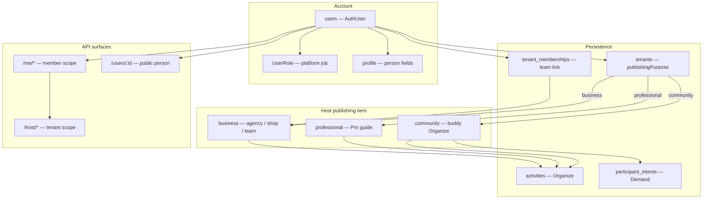

# Member model — users, roles, tiers, routes

**Canonical map** for how one **person account** connects to capabilities, storage, and HTTP. Doc index: [`DOCS_INDEX.md`](./DOCS_INDEX.md). Product voice: [`NORTHSTAR.md`](./NORTHSTAR.md). Domain entities: [`DOMAIN.md`](./DOMAIN.md). HTTP prefixes: [`API_ROUTING.md`](./API_ROUTING.md). Host audit P0–P3: [`HOST_CLEANUP_ROADMAP.md`](./HOST_CLEANUP_ROADMAP.md).

Do **not** re-implement tier logic in React hooks — consume **`GET /me/host-status`** (`HostStatusDTO` in `@uaetrail/shared-types`).

**Capabilities ≠ viewer access:** `canPublish` / `canAccessHostConsole` answer whether this member may **act** as a host. They do **not** gate whether someone may **read** full activity detail or a member profile. That is **`resolveActivityViewerAccess`** / **`resolveProfileViewerAccess`** ([`DOMAIN_CANONICALS.md`](./DOMAIN_CANONICALS.md) §15). Guest sign-in sheets (`guestBrowseGateCopy`) are presentation when `gateReason === sign_in` only.

**Host = always a user:** Every publish action has a `userId` actor. A **business** is a **tenant** the user may represent; use **publish as self / {business}** when the member has multiple activity-capable tenants (`GET /me/host-status` → `ownedProfiles[].publishingProfileKind`; Organize publish step `OrganizePublishAsField`). Host console publish-as: TBD.

**Storefront kinds (`PublishingProfileKind`):** See [`DOMAIN_CANONICALS.md`](./DOMAIN_CANONICALS.md) §1.3 — `community`, `pro_guide`, `agency`, `shop`, `ecommerce`, `hospitality`, `partner`. Wire `EntityKind.organisation` is the host storefront slug URL, not product copy.

**Naming (host vs join vs buddy):** § [Naming vocabulary](#naming-vocabulary) below · Cursor: `.cursor/rules/host-member-model.mdc` · verify: `npm run verify:host-member`.

---

## Spider map

---

## Layers (do not confuse)

| Layer | What it is | Examples |
|-------|------------|----------|
| **Person / member** | Human using the app | `users`, `/profile`, `/member/:id` |
| **UserRole** | Legacy platform job on the user row | `PARTICIPANT`, `TENANT_GUIDE`, `PLATFORM_ADMIN` |
| **Host publishing tier** | How they publish on the map | `community`, `professional`, `business` |
| **Tenant** | Publishing organisation row | `tenants.publishingPurpose`, `x-organisation-id` |
| **MembershipRole** | Person ↔ tenant (team) | `TENANT_OWNER`, `TENANT_GUIDE` |
| **Public operator brand** | Business/guide storefront | `/operator/:slug`, `/shop/:id` |

**UserRole ≠ host tier.** A `PARTICIPANT` can be a **community** host (`canPublish` + community tenant). A **business** guide is often `TENANT_GUIDE` with no owned tenant.

---

## Host publishing tiers

| Tier | Who | Tenant `publishingPurpose` | Paid Organize? | Entry |
|------|-----|------------------------------|----------------|-------|
| **Community** | Individual member | `community` | No (free / shared) | Profile complete → auto tenant (`ensureBuddyHostTenant`) |
| **Professional** | Pro guide | `professional` | Future Pro rules | `/profile/pro-membership` → host application (`individual`) |
| **Business** | Agency / shop owner or **employee** | `business` | Agency yes | Pro membership application or team invite → `tenant_memberships` |

**Profile badge (`profileRoleLabel`):**

| Key | When |
|-----|------|
| `community_member` | Default |
| `host` | `isCommunityHost` — first activity **or** demand on map |
| `professional_guide` | Professional tier tenant |
| `agency` | Agency tenant or business tier operator |
| `shop_owner` | Shop tenant |

Wire: `HostStatusDTO.hostTiers`, `HostStatusDTO.profileRoleLabel`, `HostStatusDTO.isCommunityHost`.

---

## Pro membership ladder (product)

All paths require a **signed-in user**. Upgrade entry: **`/profile/pro-membership`** (`PRO_MEMBERSHIP_PATH`).

| Pro path | Who | Required choice | Storefront / capabilities (high level) |
|----------|-----|-----------------|----------------------------------------|
| **Individual** | Solo pro guide | — | `/operator/:slug` style guide profile; Organize as self + pro tenant |
| **Business** | Company / brand | **Subtype required:** Shop · Tour agency · E-commerce · Hospitality · (extensible) | Tenant + console; paid trips / campaigns per subtype (detail later) |
| **Partner** | Hotel / campaign partner | Detail later | Partner storefront + “What’s happening” campaigns (future) |

**Business subtype** is **not** interchangeable: a **shop** is map/directions retail; a **tour agency** is trip operator without requiring a visit pin; **Partner** is a separate Pro path from generic business (see product split in `DOMAIN.md`).

Billing / `PaidMembershipSku` enforcement: layer **7** in `member-entitlements.ts` (stub until billing ships).

---

## Profile visibility (person — not host tier)

| `profileVisibility` | Guests | Other signed-in members (no relationship) |
|---------------------|--------|-------------------------------------------|
| `public` | Sign-in only — **no** member card (target policy P3) | **Public member card** on `/member/:id` |
| `group_members` | Sign-in only | Denied unless group / allowed relationship |
| `private` | Sign-in only | Denied unless buddy, co-participant, host-of-activity, etc. |

Trusted fields (year goal, upcoming list, etc.) appear only on **trusted** exposure, not on the public card.

**Member discovery (Explore going panel — product copy “Who's going”):** **Buddies** — `GET /me/buddies/activity-presence` (`registerBuddyRoutes.ts`). **Discover** — `GET /me/member-discovery/roster`, `GET /me/member-discovery-quota`, `GET /users/browse` (`registerMemberDiscoveryRoutes.ts`); profile opens `GET /users/:id/public-profile?from=discover` (**5 unique profiles / 30d**; Pro unlimited). **Join me (participation):** `POST /activities/:id/invites` (`registerActivityJoinInviteRoutes.ts` · `activity_invites`). See [`API_ROUTING.md`](./API_ROUTING.md) and [`experiment/WHOS_GOING_UX.md`](./experiment/WHOS_GOING_UX.md).

**Profile view analytics (shipped):** views recorded on `GET /users/:id/public-profile`; owners with host Pro/business see `GET /me/profile-view-stats`.

---

## Capabilities (flags on `HostStatusDTO`)

| Flag | Meaning |
|------|---------|
| `signupProfileComplete` | `/welcome` member details done |
| `canPublish` | May run Organize wizard (has activity-capable tenant) |
| `canAccessHostConsole` | May use `/host/*` (publish queue, team) |
| `canHostPaidActivities` | Agency commercial pricing |
| `isCommunityHost` | Has map footprint as host (activity or demand) |

**Demand (Find)** requires signed-in member only — **not** `canPublish`.

---

## Member audience ladder

Product-facing **who is viewing** for **capabilities** (Organize, console, future paid SKUs). Orthogonal to **social** activity/profile detail ([`DOMAIN_CANONICALS.md`](./DOMAIN_CANONICALS.md) §15).

| Audience (`MemberAudience`) | Who | Typical gates |
|-----------------------------|-----|----------------|
| `guest` | Not signed in | `gateReason: sign_in` — copy from `guestBrowseGateCopy` |
| `member_incomplete` | Signed in; `signupProfileComplete === false` | `profile_required` → `/welcome` |
| `member_basic` | Profile complete; community / buddy path | Organize when `canPublish`; map **Host** badge is separate (`isCommunityHost`) |
| `member_professional` | Pro guide tenant (`hostTiers.professional`) | Console + Pro flows |
| `member_business` | Agency / shop / team (`hostTiers.business`) | Console + `x-organisation-id` |

**Vocabulary (do not conflate):**

| User says | Code |
|-----------|------|
| Guest | `guest` |
| Signed-in, incomplete profile | `member_incomplete` — not “basic” |
| “Host” = can buddy Organize | `member_basic` + `canPublish` (profile complete + tenant) |
| “Host” badge on profile | `isCommunityHost` — first activity or demand on map |
| Paid membership (future) | `PaidMembershipSku` + layer **7** entitlements — **not** inferred from `hostTiers` alone |

**Resolver:** `resolveMemberAudience({ viewerUserId, hostStatus })` in `packages/shared-types/src/member-access.ts`. **Organize FAB denial:** `organizeEntitlementDenial` (sign-in → welcome → publish capability). Client redirects: `organizePublishGateHref` + `organizePublishGateInputFromHostGate` in `src/utils/organizePublishGate.ts` (maps denial → routes).

**Paid tiers:** stub `resolvePaidMembershipSku` → `'none'` until billing ships; enforce in `apps/api/src/services/member-entitlements.ts` **after** `resolveActivityViewerAccess` / social exposure.

---

## HTTP routing (member vs host)

| Intent | Auth | Route family |
|--------|------|----------------|
| Browse map | Guest optional | `GET /explore/map`, `GET /activities/:id` |
| Profile, demand, inbox | Member | `GET/PATCH /me/*` |
| Publish / manage outing | Member + tenant | `POST /host/activities`, `x-organisation-id` |
| Public person | Optional | `GET /users/:id` (or member public profile) |
| Pro application | Member | `POST /me/host-application` |

---

## Code map

| Concern | Location |
|---------|----------|
| Tier enum (wire) | `packages/shared-types/src/host-publishing-tier.ts` |
| Tenant purpose (DB) | `apps/api/src/domain/tenant-publishing.ts`, `tenants.publishingPurpose` |
| **Single resolver** | `apps/api/src/services/member-host-status.ts` → `GET /me/host-status` |
| Member audience ladder | `packages/shared-types/src/member-access.ts` |
| Paid / Pro detail (layer 7) | `apps/api/src/services/member-entitlements.ts` |
| Community footprint | `apps/api/src/lib/community-host.ts` |
| Buddy tenant | `apps/api/src/lib/buddy-host-tenant.ts` |
| Client display strings | `src/member/memberProfileRoleLabel.ts` |
| Client hook (thin) | `src/hooks/useOrganisationGate.ts` (`canPublish`, `canAccessHostConsole`) |

---

## Naming vocabulary

Host/member/join terms (do not duplicate in other docs — **update this section** when semantics change).

| Term | Means | Storage / route |
|------|--------|-----------------|
| **Community host (buddy)** | Profile complete → can Organize; optional **Host** label after first map post | `GET /me/host-status`, `publishingPurpose: community` |
| **Pro / business host** | Agency, shop, professional guide | `/profile/pro-membership`, `host_applications` |
| **Host console** | Tenant-scoped publish/manage | `/host/*`, `x-organisation-id` |
| **Activity join request** | Join a **published activity** (approval) | `activity_requests`, `/host/requests` |
| **Demand join request** | Join a **Find** post | `participant_intent_requests`, `/me/participant-intents/.../requests` |
| **Host application** | Pro/agency/shop onboarding | `host_applications` |
| **Buddy connection (friends)** | Mutual link between **member accounts** | `BuddySummaryDTO.userId` = other person’s user id (no “buddy id”) |
| **`actorUserId` (notifications)** | Who triggered the action | Always a **user** id — see `DOMAIN_CANONICALS.md` §11 |

| Do not | Use instead |
|--------|-------------|
| `registerHostJoinRequestRoutes` | `registerHostActivityRequestRoutes` |
| “Join request” without **activity** or **demand** | Qualified phrase |
| `isHostRole` for Organize / publish gates | `canPublish`, `canAccessHostConsole` from host-status |
| `/become-host` in new UI | `PRO_MEMBERSHIP_PATH` or `/welcome` |
| `buddyUserId` in meta/API | `actorUserId` or `otherMemberUserId` |

Host route files: `registerHostActivityRequestRoutes`, `registerHostTeamRoutes`, `registerHostDemandFulfillLegacy`, `registerMemberHostStatusRoutes` (under `routes/user/`).

---

## Related docs

- [`DOMAIN.md`](./DOMAIN.md) — Place, Activity, Demand glossary  
- [`CREATE_FLOW.md`](./CREATE_FLOW.md) — Organize vs Find gates  
- [`DOMAIN_CANONICALS.md`](./DOMAIN_CANONICALS.md) — URLs, API client, notification meta  
- [`ARCHITECTURE.md`](./ARCHITECTURE.md) — monorepo layout  
