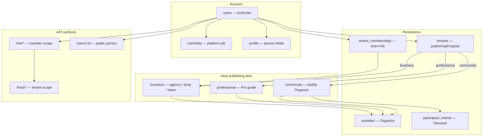

# Member model — users, roles, tiers, routes

**Canonical map** for how one **person account** connects to capabilities, storage, and HTTP. Doc index: [`DOCS_INDEX.md`](./DOCS_INDEX.md). Product voice: [`NORTHSTAR.md`](./NORTHSTAR.md). Domain entities: [`DOMAIN.md`](./DOMAIN.md). HTTP prefixes: [`API_ROUTING.md`](./API_ROUTING.md). Host audit P0–P3: [`HOST_CLEANUP_ROADMAP.md`](./HOST_CLEANUP_ROADMAP.md).

Do **not** re-implement tier logic in React hooks — consume **`GET /me/host-status`** (`HostStatusDTO` in `@uaetrail/shared-types`).

**Naming (host vs join vs buddy):** § [Naming vocabulary](#naming-vocabulary) below · Cursor: `.cursor/rules/host-member-model.mdc` · verify: `npm run verify:host-member`.

---

## Spider map

---

## Layers (do not confuse)

| Layer | What it is | Examples |
|-------|------------|----------|
| **Person / member** | Human using the app | `users`, `/profile`, `/member/:id` |
| **UserRole** | Legacy platform job on the user row | `PARTICIPANT`, `TENANT_GUIDE`, `PLATFORM_ADMIN` |
| **Host publishing tier** | How they publish on the map | `community`, `professional`, `business` |
| **Tenant** | Publishing organisation row | `tenants.publishingPurpose`, `x-organisation-id` |
| **MembershipRole** | Person ↔ tenant (team) | `TENANT_OWNER`, `TENANT_GUIDE` |
| **Public operator brand** | Business/guide storefront | `/operator/:slug`, `/shop/:id` |

**UserRole ≠ host tier.** A `PARTICIPANT` can be a **community** host (`canPublish` + community tenant). A **business** guide is often `TENANT_GUIDE` with no owned tenant.

---

## Host publishing tiers

| Tier | Who | Tenant `publishingPurpose` | Paid Organize? | Entry |
|------|-----|------------------------------|----------------|-------|
| **Community** | Individual member | `community` | No (free / shared) | Profile complete → auto tenant (`ensureBuddyHostTenant`) |
| **Professional** | Pro guide | `professional` | Future Pro rules | `/profile/pro-membership` → host application (`individual`) |
| **Business** | Agency / shop owner or **employee** | `business` | Agency yes | Pro membership application or team invite → `tenant_memberships` |

**Profile badge (`profileRoleLabel`):**

| Key | When |
|-----|------|
| `community_member` | Default |
| `host` | `isCommunityHost` — first activity **or** demand on map |
| `professional_guide` | Professional tier tenant |
| `agency` | Agency tenant or business tier operator |
| `shop_owner` | Shop tenant |

Wire: `HostStatusDTO.hostTiers`, `HostStatusDTO.profileRoleLabel`, `HostStatusDTO.isCommunityHost`.

---

## Capabilities (flags on `HostStatusDTO`)

| Flag | Meaning |
|------|---------|
| `signupProfileComplete` | `/welcome` member details done |
| `canPublish` | May run Organize wizard (has activity-capable tenant) |
| `canAccessHostConsole` | May use `/host/*` (publish queue, team) |
| `canHostPaidActivities` | Agency commercial pricing |
| `isCommunityHost` | Has map footprint as host (activity or demand) |

**Demand (Find)** requires signed-in member only — **not** `canPublish`.

---

## HTTP routing (member vs host)

| Intent | Auth | Route family |
|--------|------|----------------|
| Browse map | Guest optional | `GET /explore/map`, `GET /activities/:id` |
| Profile, demand, inbox | Member | `GET/PATCH /me/*` |
| Publish / manage outing | Member + tenant | `POST /host/activities`, `x-organisation-id` |
| Public person | Optional | `GET /users/:id` (or member public profile) |
| Pro application | Member | `POST /me/host-application` |

---

## Code map

| Concern | Location |
|---------|----------|
| Tier enum (wire) | `packages/shared-types/src/host-publishing-tier.ts` |
| Tenant purpose (DB) | `apps/api/src/domain/tenant-publishing.ts`, `tenants.publishingPurpose` |
| **Single resolver** | `apps/api/src/services/member-host-status.ts` → `GET /me/host-status` |
| Community footprint | `apps/api/src/lib/community-host.ts` |
| Buddy tenant | `apps/api/src/lib/buddy-host-tenant.ts` |
| Client display strings | `src/member/memberProfileRoleLabel.ts` |
| Client hook (thin) | `src/hooks/useOrganisationGate.ts` (`canPublish`, `canAccessHostConsole`) |

---

## Naming vocabulary

Host/member/join terms (do not duplicate in other docs — **update this section** when semantics change).

| Term | Means | Storage / route |
|------|--------|-----------------|
| **Community host (buddy)** | Profile complete → can Organize; optional **Host** label after first map post | `GET /me/host-status`, `publishingPurpose: community` |
| **Pro / business host** | Agency, shop, professional guide | `/profile/pro-membership`, `host_applications` |
| **Host console** | Tenant-scoped publish/manage | `/host/*`, `x-organisation-id` |
| **Activity join request** | Join a **published activity** (approval) | `activity_requests`, `/host/requests` |
| **Demand join request** | Join a **Find** post | `participant_intent_requests`, `/me/participant-intents/.../requests` |
| **Host application** | Pro/agency/shop onboarding | `host_applications` |
| **Buddy connection (friends)** | Mutual link between **member accounts** | `BuddySummaryDTO.userId` = other person’s user id (no “buddy id”) |
| **`actorUserId` (notifications)** | Who triggered the action | Always a **user** id — see `DOMAIN_CANONICALS.md` §11 |

| Do not | Use instead |
|--------|-------------|
| `registerHostJoinRequestRoutes` | `registerHostActivityRequestRoutes` |
| “Join request” without **activity** or **demand** | Qualified phrase |
| `isHostRole` for Organize / publish gates | `canPublish`, `canAccessHostConsole` from host-status |
| `/become-host` in new UI | `PRO_MEMBERSHIP_PATH` or `/welcome` |
| `buddyUserId` in meta/API | `actorUserId` or `otherMemberUserId` |

Host route files: `registerHostActivityRequestRoutes`, `registerHostTeamRoutes`, `registerHostDemandFulfillLegacy`, `registerMemberHostStatusRoutes` (under `routes/user/`).

---

## Related docs

- [`DOMAIN.md`](./DOMAIN.md) — Place, Activity, Demand glossary  
- [`CREATE_FLOW.md`](./CREATE_FLOW.md) — Organize vs Find gates  
- [`DOMAIN_CANONICALS.md`](./DOMAIN_CANONICALS.md) — URLs, API client, notification meta  
- [`ARCHITECTURE.md`](./ARCHITECTURE.md) — monorepo layout  
