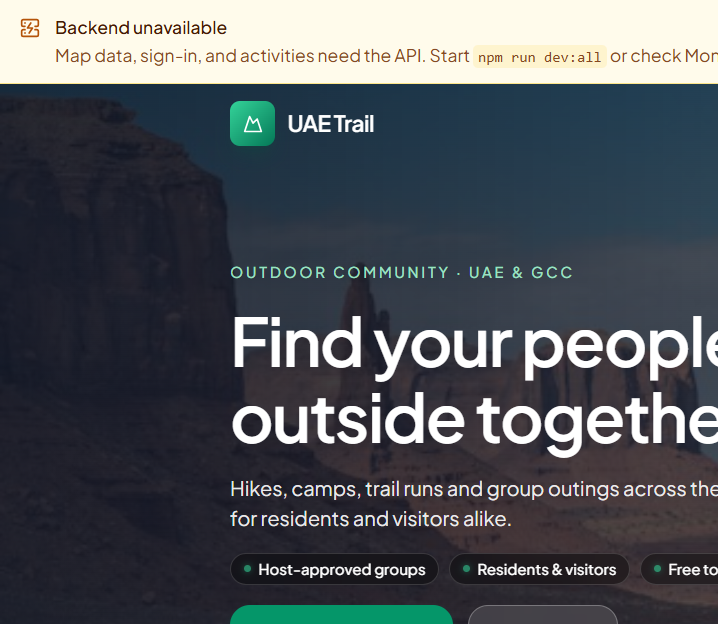
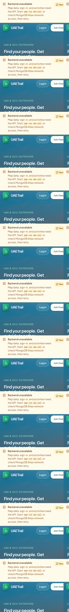
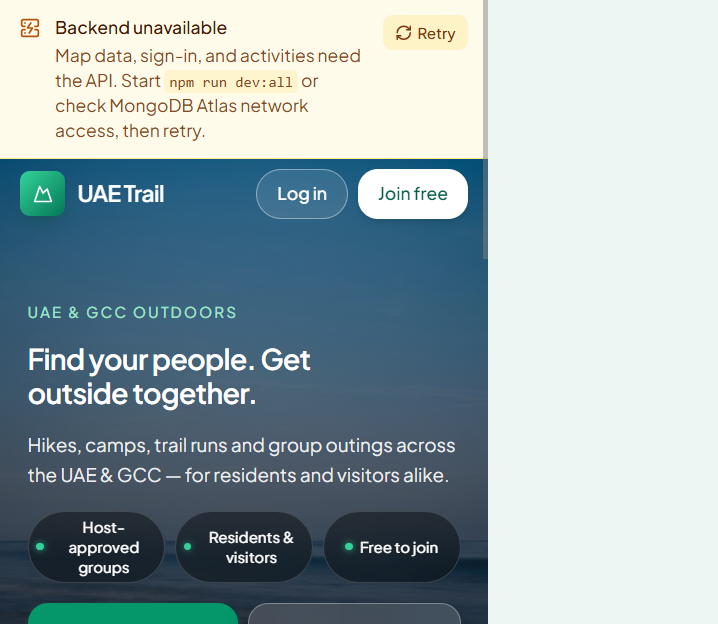
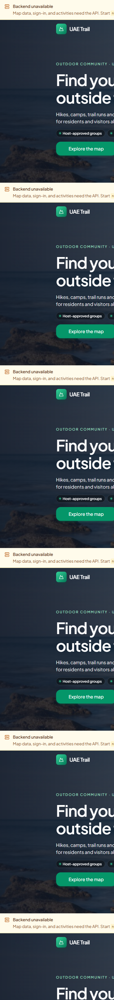

# PR review: `homePage_Layout_Update`

Use this in the GitHub pull request description after opening  
https://github.com/uaetrail/main/compare/main...homePage_Layout_Update

## Summary

- Guest homepage v2: hero carousel, proof chips → CTAs, upcoming outings (emirate flags), how it works, reviews + FAQ.
- Copy in `src/content/homeMarketing.ts`; plan in `docs/UAE_Trail_Homepage.md`.
- No Final CTA band on `/` (footer + hero CTAs only).

## Screenshots (Oct 2026, local dev)

### Desktop (1440px)

**Hero**

**Full page**

### Mobile (390px)

**Hero**

**Full page**

> Local captures may show the yellow **Backend unavailable** banner when the API is not running; staging/production with a healthy API will not.

## Test plan

- [ ] Guest `/` — signed-out only; signed-in redirects to `/explore`
- [ ] Hero carousel: pause, dots, activity chip link
- [ ] Emirate filter + activity cards (live API or fallback)
- [ ] FAQ accordion answers (no TBD)
- [ ] 360 / 768 / 1440 responsive pass
