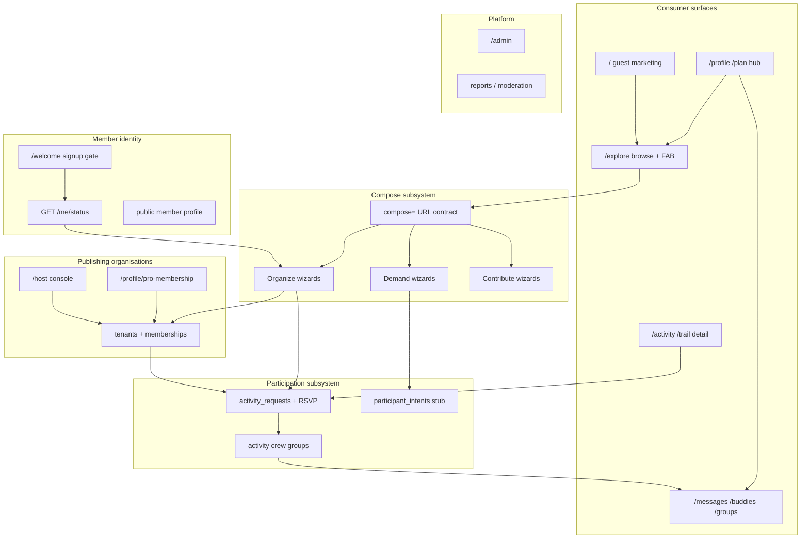

# System coherence — whole product architecture

**Purpose:** One map from **north-star outcomes** → **capabilities** → **surfaces** → **modules** → **API** → **storage**. Use this before large features or refactors so work strengthens a single system instead of adding a third parallel path.

**Not a duplicate of:** [`ARCHITECTURE.md`](./ARCHITECTURE.md) (deployment & layer diagram), [`DOMAIN.md`](./DOMAIN.md) (entity glossary), [`DOMAIN_CANONICALS.md`](./DOMAIN_CANONICALS.md) (naming & route builders), [`MEMBER_MODEL.md`](./MEMBER_MODEL.md) (person vs host tier). **This file ties them together.**

**Index:** [`DOCS_INDEX.md`](./DOCS_INDEX.md) · **Checks:** `npm run verify:system` · **Manifest:** `scripts/bounded-context-manifest.json`

---

## 1. North star → capabilities

From [`NORTHSTAR.md`](./NORTHSTAR.md), the product delivers five **capabilities** (not features):

| Capability | Member outcome | Primary surfaces |
|------------|----------------|------------------|
| **Discover** | See real outdoor plans near me | `/explore`, entity detail (`/activity`, `/trail`, …) |
| **Express demand** | Say what I want when nothing fits | Explore FAB → Find → **`activities`** (`activityMode: seeking`); intent stub for manage |
| **Connect** | Align with people before the day | **Browse — member people** (who’s going / looking / your crew on map & list) → **Chat** (`/messages`, group & outing threads) |
| **Participate** | Join or host a specific outing | Activity detail join/RSVP; host join queue |
| **Return** | Same crew, next time | `/profile`, **`/plan`**, notifications, goals |

Everything else (shops, rewards, place registry, admin, Pro agencies) **supports** these capabilities or serves a **secondary** audience (hosts, merchants, platform ops).

---

## 2. System map (logical)

---

## 3. Bounded contexts (where code must live)

Each context has **one write path** and **one public read model** where possible. Crossing boundaries happens through **services** and **shared-types**, not duplicate business rules in React.

| Context | Responsibility | Frontend home | API home | Storage (see `collections.ts`) |
|---------|----------------|---------------|----------|--------------------------------|
| **Discovery** | Map/list payload, pins, filters, card projection | `src/explore/*`, `src/list/*` (`/list` + embedded list on `/explore`) | `lib/explore-map.ts`, `GET /explore/map` | `activities`, `locations`, `participant_intents`, `tenants` (shops) |
| **Compose** | FAB intents, wizards, draft → publish payload | `src/explore/ui/*`, `compose.ts`, `organizeFlow.ts` | `POST /operator/activities`, `POST /me/participant-intents` | `activities`, `participant_intents` |
| **Participation** | Join, waitlist, RSVP, seeking joins, **Join me** invites | `useActivityJoin*`, detail + explore selection | `join-request.ts`, `activity-invite.ts`, intent join **aliases** (`participant-intent-requests-store`) | **`activity_requests`** (canonical); `participant_intent_requests` legacy-only; `activity_participants`, `activity_invites` |
| **Browse — member people** | Who can I go with? Network roster + map outing status + discover directory (quota) | `PeopleBrowsePanel`, `PeopleBrowseTabContent`, `ListDiscoverPeopleView` | `member-people-engagement.ts`, `member-discovery-roster.ts`, `registerMemberDiscoveryRoutes`, `registerSocialPeopleRoutes` (`GET /social/people`) | Composes `buddy_*`, `user_follows`, explore map, `member_profile_views` |
| **Member identity** | Profile, welcome gate, visibility, public card | `src/pages/Profile*`, `src/member/*` | `registerProfileRoutes`, `public-member-profile`, `profile-viewer-access` | `auth_users` profile fields |
| **Member publish capabilities** | Who may organize/publish & open publishing workspace (tier + `profileComplete`) | `useMemberStatus`, `organizePublishGate` | **`services/member-status.ts` only** | `tenants`, `tenant_memberships` |
| **Publishing console** | Tenant-scoped CRUD, check-in, activity join queue | `src/pages/operator/*`, `src/console/*`, `components/activity/` | `routes/host/*` + `/operator` alias | same + `activities` |
| **Communication** | DMs, inbox, group & outing chat (product label **Chat**) | `Messages.tsx`, `src/messaging`, `@/chat` | `routes/chat.ts`, `activity-group-chat`, `member-inbox` | `chat_messages`, `social_groups`, wall collections |
| **Social graph** | Relationship **writes** & group metadata (not browse roster UI) | `Buddies.tsx`, `Groups.tsx`, `/buddies` | `registerBuddyRoutes`, `buddy-activity-presence.ts`, `registerGroupRoutes`, `registerFollowRoutes` | `buddy_*`, `user_follows`, `social_groups*` |
| **Places** | Registry, contribute, venue detail | `PlaceDetail*`, `TrailDetail`, contribute flows | `place-registry`, `location-submit`, `/places` | `locations` (+ **`areaId`** on catalog rows) |
| **Areas** | Curated **hub** (`areaId`); many trails/camps/facilities/shops per area via **`place.areaId`**; Locations lens = hub pins + rollups; Activities lens = outings | `/area/:slug`, Find **Area & map pin**, admin place **area** link | `areas-store`, `explore-map-area-lens.ts`, `organizePublishArea.ts`, `place-kind.ts` | `areas`; **`locations.areaId`** (all catalog kinds); **`participant_intents.areaId`** (seeking); hosted geography = **`activity.locationId` → place.areaId** (no activity-area write) |
| **Commerce** | Shop public + merchant manage (affiliate) | `ShopPublic`, `ShopManage` | `routes/shop.ts` | `merchant_profiles`, `tenants` (SHOP) |
| **Engagement** | Goals, map pins, wishlist, follow | explore wishlist save, entity/member follow | `registerMeGoalsRoutes`, `registerMeWishlistRoutes`, `registerEntityFollowRoutes`, … | `user_goals`, `user_favorites`, `entity_follows`, `user_follows` |
| **Platform ops** | Admin console, audit, applications, master-granted staff | `src/pages/Admin*` (`/admin/users` **Users** nav) | `routes/admin.ts` + `routes/admin/registerAdmin*` | `host_applications`, `audit_logs`, `auth_users` (staff role) |

**Rule:** If a change touches “who can do X,” find the row above first. Do not add a second resolver in a route file or a random hook.

**Viewer access (read vs act):** **Capabilities** = may organize/publish / open publishing workspace (`member_publish_capabilities`). **Detail exposure** = may see full entity payload (`activity-viewer-access`, `profile-viewer-access`). **Guest sheets** = sign-in copy only — not authorization. Canonical model: [`DOMAIN_CANONICALS.md`](./DOMAIN_CANONICALS.md) §15.

### 3.1 Context alignment matrix (API · FE · storage)

Pick a **context id** when changing code; touch registrar + `src/api/domains/*` + UI roots together. Machine-readable paths: `scripts/bounded-context-manifest.json`.

| Context | Collections (wire) | Key HTTP | FE domain module | UI roots |
|---------|-------------------|----------|------------------|----------|
| discovery | `activities`, `locations`, `participant_intents`, shop tenants | `GET /explore/map` · browse also `/list` | `exploreApi` | `src/explore/*`, `src/list/*` |
| compose | `activities`, `participant_intents` | `POST /operator/activities`, `POST /me/participant-intents` | `exploreApi`, `organisationApi` | `src/explore/ui/*` |
| participation | `activity_requests`, `activity_participants`, `activity_invites` (+ intent join alias) | **`POST /activities/:id/requests`** (canonical seeking + hosted); `/me/participant-intents/.../requests` alias; tenant **`GET /host/requests`** (console API, also Plan manage) | `activitiesApi`, `exploreApi` | Activity detail, Plan manage sheet, `JoinRequestDetail` |
| *(cross-cut)* | — | `GET /activities/:id` (`viewerAccess`, `myJoinInvite`) | — | **`activity-viewer-access.ts`**, **`activity-invite.ts`** |
| member_discovery | `member_profile_views` (+ read-only compose from map/users) | `/me/member-discovery/*`, `/social/people` (browse network roster), `/users/browse`, `public-profile?from=discover` | `accountApi` (`getMemberPeopleNetwork*`, discovery roster) | Explore map **People** panel (`view=people`; legacy `view=social`), list **Buddies** (`listCat=people`), `MemberProfile` discover |
| member_identity | `auth_users` profile | `/me/profile`, `/users/:id` | `accountApi`, `memberApi` | `Profile*`, `src/member/*` |
| member_publish_capabilities | `tenants`, `tenant_memberships` | **`GET /me/status`** (legacy `/me/host-status`, `/me/operator-status`) | `memberApi` | **`useMemberStatus`** |
| publishing_workspace | + `activities` | `/operator/*` + tenant header | `organisationApi`, `activitiesApi` | `src/pages/operator/*`, `src/console/*`, `components/activity/*`, `activity/*` |
| communication | `chat_messages`, group wall | `/chat/*`, group wall | `messagingApi` (`chatApi` + wall via `socialApi`) | `Messages.tsx`, `src/messaging` |
| social_graph | `buddy_*`, `user_follows`, `social_groups*` | `/me/buddies`, `/me/buddy-requests`, `/me/groups`, `/me/following`, … | `socialApi` | `Buddies`, `Groups` — relationship admin; **not** the explore people browse panel |
| places | `locations` | `/places`, `/me/places` | `placeApi`, `placeRegistry` | `TrailDetail`, `CampDetail`, contribute |
| commerce | `merchant_profiles`, `products` | `/shop/*` | `shopApi` | `ShopPublic`, shop UI |
| engagement | `user_badges`, `user_goals`, `user_favorites`, `entity_follows`, … | `/me/badges`, `/me/goals`, `/me/wishlist`, `/me/entity-follows` | `badgesApi`, `goalsApi`, `socialApi` (wishlist + entity follow) | `ProfileBadges`, goals, `useEntityFollows`, wishlist guards |
| platform_ops | `host_applications`, `audit_logs` | `/admin/*`, `POST/DELETE /admin/platform-admins` (master) | `adminApi` | `AdminOverview`, `AdminMembers` (Users) |

**API mounts:** `/auth`, `/admin`, `/operator` (legacy `/host/*` rewritten), `/chat`, `/shop`, `/media`, `/reports`, `/` (`user.ts` + `social.ts`) — see `apps/api/src/routes/index.ts`.

### 3.2 Browse — member people vs communication (do not conflate)

| User question | Bounded context | Surfaces | Not this |
|---------------|-----------------|----------|----------|
| Who can I go with? Who’s on an outing? Who’s looking for a crew? | **member_discovery** + **discovery** map | `/explore` People panel (`view=people`), `/list?listCat=people` (**Buddies**), shared `PeopleBrowseTabContent` | `/messages`, group walls |
| Who do I talk to? What did the crew say? | **communication** | `/messages` (**Chat** tab), `/groups` → Message → thread | Explore people panel, roster APIs |

**One member model, two jobs:** browse reads show **relationship + outing status** (friend/following, trip hint, looking-for row, directory card). Chat surfaces use the **social graph** for eligibility but are a separate transport ([`COMMUNICATION.md`](./COMMUNICATION.md)).

**Naming for new code:** prefer `memberDiscovery`, `memberPeople`, `browsePeople` — reserve **social** for `social_graph` mutations, `/social/groups`, reviews, and legacy HTTP paths (`/social/people`) until a routed rename ships. Guest gate intent `explore-social` means **browse people panel**, not inbox.

**Target consolidation (implementation):** one map-enriched **member people read** with views (`networkRoster`, `discoveryRoster`) behind stable routes; UI labels “Buddies” / map panel can diverge from code names.

---

## 4. Surfaces vs routes (contract)

Canonical navigation: [`NAVIGATION.md`](./NAVIGATION.md). Structural rules:

| Surface | Route anchor | Never confuse with |
|---------|--------------|-------------------|
| Marketing | `/` | Product home (`/explore`) |
| Browse + create | `/explore?compose=…` | `/host/activities/new` as consumer default |
| Personal hub | `/profile`, **`/plan`** | Legacy `/trips` redirects; not `/activities` browse |
| Entity | `/activity/:id`, place URLs | “Trip” entity (does not exist) |
| Host console | `/host/*` (tenant workspace) | Buddy **Organize** (map FAB) + **Plan hosted** manage (same APIs, consumer surface) |
| Pro / business | `/profile/pro-membership` | `/become-host` as product entry (redirect only) |
| Messaging | `/messages` (+ `?group=` / `?to=`) | Chat embedded only on entity/Plan flows → `/chat` |
| List layout (browse) | `/list?…` (handoff) · mobile **List** pill on `/explore` | A second product home, `/map`, or **List bottom-nav tab** |

**Auth shells:** `ProtectedRoute` uses **`UserRole`** for coarse access (admin, host console shell). **Product gates** (Organize, paid host, profile chips) use **`MemberStatusDTO`** from **`GET /me/status`** (`useMemberStatus`). See [`MEMBER_MODEL.md`](./MEMBER_MODEL.md) — mixing these layers is a top source of incoherence.

### 4.1 Browse routing strategy (scalable default)

Aligned with [`DOMAIN_CANONICALS.md`](./DOMAIN_CANONICALS.md) §4.1 and [`NORTHSTAR.md`](./NORTHSTAR.md):

- **Few browse surfaces, many filterable views** — `/explore` map-first; **map list** (`list=1` / List pill) vs **discover browse** (`browse=1`, hamburger Browse, optional `/list`) share filter vocabulary (`src/list/routing.ts` ↔ `explorePath()`). **Mobile bottom nav stays three tabs** — Explore · Plan · Chat (middle tab route `/trips`) ([`NAVIGATION.md`](./NAVIGATION.md)).
- **One discovery read path on the server** — `GET /explore/map` (+ query). Map stage, explore list sheet, and list discovery UI are **projections**; avoid separate “catalog” endpoints per category unless a new bounded context is approved in Tier-1.
- **Many entity URLs where identity matters** — `/activity`, place paths, `/shop`, brand paths: sharing, notifications, per-id cache and `viewerAccess`. These are **not** browse department homepages.
- **Private engagement off the public map** — wishlist, entity follow, member follow, goals: `/me/*` and trips/profile UI ([`MEMBER_MODEL.md`](./MEMBER_MODEL.md) § Follow · Wishlist · Goal).

**Scale levers (prefer before new route trees):** bbox/region or cursor on explore map; normalized query cache keys; lighter list DTO if poster feed outgrows map payload; SSR on entity + marketing only unless SEO category landings are explicitly added.

---

## 5. API shape (how the backend stays one system)

**Mount order:** `apps/api/src/routes/index.ts` — `auth`, `admin`, `host`, `shop`, `chat`, `media`, `reports`, `social`, **`user`** (broad public + `/me`).

**Thin routes:** `apps/api/src/routes/user/register*.ts`, `routes/host/register*.ts`, and `routes/admin/registerAdmin*.ts` — validate, call **service**, map DTO. Mount shells: `user.ts`, `host.ts`, `admin.ts`.

**Domain rules:** Prefer `apps/api/src/domain/*` (pure) + `apps/api/src/services/*` (orchestration). Avoid new business rules in `lib/*-store.ts` without a service façade.

**Contracts:** `packages/shared-types` — wire DTOs, explore projection, participation enums. API `domain/` may mirror rules but **shared-types** is what the SPA imports.

**Explore read model:** Single aggregator `GET /explore/map` — clients should not reconstruct the map from three legacy catalog calls.

**Async side effects:** Fire-and-forget rewards, email, notifications, and group-chat roster updates use `scheduleNotification` / `scheduleSideEffect` (`apps/api/src/lib/schedule-side-effect.ts`) — failures **warn-log** with `logContext` (see `DEV_RUN.md`). **Chat inbox:** non-buddy partners use batched policy (`batchCanMessagePartnersFromViewer`); policy failure surfaces `directConversationsDegraded` (not silent empty inbox); regression `apps/api/tests/chat-policy.test.ts`. **Media:** private-bucket kinds deny anonymous presign (`media-access.test.ts`). **Search:** user substring search escapes via `regex-search` (`regex-search.test.ts`, `naming-coherence.test.ts`). **Read paths:** activity assembly, `/me/reviews`, `/me/entity-follows`, member browse + people rows (`countCheckedInParticipationsForUserIds`, `filterInboxMessageablePartnerIds`, read-only `batchResolveMemberProfileRoleLabelsForDirectory`), active tenant memberships (`tenant-access` + `findTenantsByIds`), host join-queue locations, wishlist profile hydration, group wall unread aggregation, publish fan-out actor labels (`resolveNotificationActorDisplayNamesForRecipients`); legacy demand map pins batch hide (`batchShouldHideFromMapMemberDiscovery`) — `naming-coherence.test.ts`. **Mount fetches / explore hygiene:** `useSafeAsyncEffect` (**S10a–b**), browse URL + pin-deep-link deps (**S10d**) — `systemCoherenceGuard.test.ts`. **Release (S10e/f):** vNext promote + manual QA — [`PRE_DEPLOY_CHECKLIST.md`](./PRE_DEPLOY_CHECKLIST.md), `npm run consumer-detail:qa-routes`; tracker **§8.1**.

Detail: [`API_ROUTING.md`](./API_ROUTING.md).

---

## 6. Frontend shape (how the SPA stays one system)

| Layer | Role |
|-------|------|
| `src/pages/*` | Route shells — lazy in `App.tsx` |
| `src/explore/*` | **Product core** — map, compose, browse panel, join overlays |
| `src/pages/operator/*`, `src/console/*` | **`/operator/*` console** — shell, hub stats (`ConsoleHubSections`), join queue |
| `src/components/organisation-console/*` | Pro onboarding, public tenant profile editors (wire: organisation) |
| `src/api/domains/*` | HTTP clients per context — composed in `services.ts` as `api` |
| `src/config/*`, `src/content/*` | Routes helpers and canonical copy |
| `src/member/*` | Host-status display helpers and guards |

**API client:** Prefer `api.getMemberHostStatus()`, `exploreApi.*`, `organisationApi.*`. Domain modules only — `legacyApi.ts` removed; see `apiLegacyGuard.test.ts`.

**Publish payload:** Single builder `activityPublishPayload.ts` for explore Organize and host console forms (shared across surfaces).

---

## 7. Incoherence register (honest debt)

Track consolidation here; sub-roadmaps link out but **this table is the system-wide backlog**.

| ID | Symptom | Why it hurts | Target state | Tracker |
|----|---------|--------------|--------------|---------|
| **C1** | Three permission notions (`UserRole`, `HostStatusDTO`, tenant middleware) | Wrong gates in UI; host console confused with Organize | Roles = shell; `HostStatusDTO` = product; tenant header = `/host` only | [`MEMBER_MODEL.md`](./MEMBER_MODEL.md), `host-member-model.mdc`, `hostMemberGuard.test.ts` (no `isHostRole` in product gates) |
| **C2** | Organisation/Host naming mix in UI | New code uses wrong copy or imports | `Host*` + `Activity*` for publish/roster; `Organisation*` only for tenant storefront wire; host user copy | [`HOST_CLEANUP_ROADMAP.md`](./HOST_CLEANUP_ROADMAP.md) P2 · [`MEMBER_MODEL.md`](./MEMBER_MODEL.md) § Organisation in filenames |
| **C3** | ~~Large `host.ts` / `admin.ts` monoliths~~ | — | **Mitigated (Oct 2026):** host + admin mount shells with `register*` registrars | [`HOST_CLEANUP_ROADMAP.md`](./HOST_CLEANUP_ROADMAP.md) P2 |
| **C4** | Parallel place detail pages (`Trail` / `Camp` / `Event`) | Duplicate SEO/loading patterns | `PlaceDetailCore` + thin kind wrappers (`placeDetailCore.test.ts`) | **R3 done** — routes unchanged for SEO |
| **C5** | `components/activities/*` modals vs explore wizards | Two create UX paths | Explore compose only for consumer create | Mostly done — audit `components/activities` |
| **C6** | Shop = `tenant` + `merchant_profile` | Two writes for one brand | Documented split; sync on ShopManage save | [`DOMAIN.md`](./DOMAIN.md) |
| **C7** | Premium location unlock + old membership page | Legacy freemium copy vs north star | Product TBD | [`NORTHSTAR.md`](./NORTHSTAR.md) |
| **C8** | `/community`, `/membership` routes | Secondary surfaces vs explore-first IA | Both redirect to `/explore`; `COMMUNITY_PATH` kept for inbound links only | [`NAVIGATION.md`](./NAVIGATION.md) legacy table |
| **C9** | Notification + privacy matrix incomplete | Rare group/private actor QA | API `notification-actor-label`; FE `notificationConsumerGuard` + `notificationRouting.test`; API route side effects → `scheduleSideEffect` / `scheduleNotification` | **Eng done (Oct 2026)** — manual QA for edge notification kinds |
| **C10** | 100+ markdown files, multiple “plans” | Agents read wrong doc | **Tier 1** only for truth; experiment defers | [`DOCS_GOVERNANCE.md`](./DOCS_GOVERNANCE.md) |
| **C11** | Long flat `api.*` surface | Wrong facade | Domain modules in `src/api/domains/*` | [`DOMAIN_CANONICALS.md`](./DOMAIN_CANONICALS.md) §10–12 |
| **C12** | Notification meta dialects | Routing sprawl | `NotificationMeta` + `actorUserId` | §11 |
| **C13** | Many `*Routing.ts` helpers | Import confusion | `routingCatalog` + `inferNotificationPath` | §10 |
| **C14** | Doc corpus duplication | Contradictory terms | **Update Tier-1 only** — [`DOCS_GOVERNANCE.md`](./DOCS_GOVERNANCE.md) | |
| **C15** | Buddy/friend vocabulary | Fake entity ids | User ids only | [`MEMBER_MODEL.md`](./MEMBER_MODEL.md) § Naming vocabulary |
| **C16** | ~~Parallel detail policy~~ | — | **Mitigated (Oct 2026):** API `viewerAccess`, map enrich, `mapViewerAccessToUi`; FE shim is wire-only | [`DOMAIN_CANONICALS.md`](./DOMAIN_CANONICALS.md) §15 |
| **C17** | Discovery card projection sprawl | Optional API `DiscoveryCardProjection` on map wire | `src/discovery` VM + `buildDiscoveryEnrichedCard`; detail wire footers (`activityDetailAcceptance` AD-PRES-02, R6) | **R1 + R6 done (FE)** — slim map DTO promotion is R5 ops |
| **C18** | `ExploreExperience` orchestration hub | Was ~900 LOC monolith | Shell hooks + `exploreBrowseUrlSync` / `exploreBrowseUrlHydrate` / apply-handlers + selection sub-hooks | **R2 done** — wiring & browse URL hook under guard budgets; public browse/selection contracts unchanged |
| **C19** | Global explore map blob | Full fetch default; bbox behind flags | `explore-map-base` + vNext bbox — [`explore-map-vnext-spec.md`](./experiment/explore-map-vnext-spec.md) | **R5 shipped (flagged)** — staging runbook |
| **C20** | Seeking **read** paths (M2d write fixed) | Legacy `demand:` deep links only in routing + notification rewrite | Activity-primary map pins; `seekingPinHygieneGuard` | **R4 done (read)** — compat parsers remain |
| **C21** | **Surface/role prefixes in shared components** (`Host*`, `Explore*`, `Plan*` outside owning folders; Host→Organizer synonym renames) | Same mistake as C2; blocks reuse and coherent refactors | Module names = bounded context; props = neutral ids; copy in labels/`workspaceVocabulary` | [`DOMAIN_CANONICALS.md`](./DOMAIN_CANONICALS.md) §13 · [`HOST_CLEANUP_ROADMAP.md`](./HOST_CLEANUP_ROADMAP.md) P5 · `moduleNamingGuard.test.ts` |

**Not debt (intentional):** stable URLs (`/trail`, `/host`, `/guide`, `/venue`; legacy `/operator` redirect); Mongo collection names; `x-organisation-id` header; `getOrganisationProfile` / `organisation-console/` for **storefront** — not for activity roster or `createHostActivity`.

---

## 8. Consolidation phases (system-wide)

Ordered for **coherence**, not feature count:

| Phase | Outcome | Primary docs / commands |
|-------|---------|-------------------------|
| **S0** | Single doc entry + automated phrase guards | `DOCS_INDEX`, `verify:docs` |
| **S1** | One member capability resolver (`GET /me/status`; legacy paths rewritten) enforced server-side | `MEMBER_MODEL`, `verify:host-member` |
| **S2** | Host route modularization + fulfill removal | **Done** — `HOST_CLEANUP_ROADMAP` P1–P2 |
| **S3** | API mount shells: **`user.ts`**, **`admin.ts`** → `register*` modules only | **Done** — admin registrars + platform master staff; user already modular |
| **S4** | Frontend `api.*` stays domain-only | **Done (guards)** — `apiLegacyGuard`, `domainImportGuard`, `consumerApiIndexGuard`, `hooksApiFacadeGuard`, ESLint R8; `api/index` only in `src/hooks` facades |
| **S5** | Privacy notification matrix + viewer access everywhere | [`HOST_CLEANUP_ROADMAP.md`](./HOST_CLEANUP_ROADMAP.md) P2 |
| **S6** | Place detail internal merge + SEO pass | **Done** — R3 `PlaceDetailCore`, thin trail/camp/event wrappers (`placeDetailCore.test.ts`) |
| **S7** | **Viewer access VA-1–VA-7** (activity detail + explore peek on API contract) | **Done** — §15.8; layer-7 hook `composeActivityViewerAccess` / `applyActivityViewEntitlements` |
| **S7b** | **Activity detail tabs** (Plan · Place · Buddies · Transport) + unified engagement policy | **Done** — program `complete`; wire footers + `activityDetailAcceptance` / AD-CTA matrix |
| **S7c** | **Viewer access naming** (wire-first, collapse resolver soup) | **Done (NA-1–NA-6)** — plan §22; API `buildActivityViewerAccess`; [`DOMAIN_CANONICALS.md`](./DOMAIN_CANONICALS.md) §15.11 |
| **S8** | **Discovery architecture** — card VM, explore shell, seeking read cleanup, map vNext spec | **Wave closed (R0–R6, R4 read, R8)** — R5 vNext **promote** via [`EXPLORE_MAP_RUNBOOK.md`](./operations/EXPLORE_MAP_RUNBOOK.md); §3 metrics (seeking branches, slim map default) = optional follow-up |
| **S9** | **Consumer detail shell alignment** — place/area/shop/agency IA + shared chrome vs activity reference | **Eng complete** — shells Phases 1–7; lineage **§3.2** + API `detail-surface-lineage-contract`; §8.1 `consumerDetailQaMatrixGuard`; §15.3 `consumerDetailAntiDriftGuard`. **Pending:** product §0 + §8 manual (`npm run consumer-detail:qa-routes`) — [`consumer-detail-surfaces-plan.md`](./experiment/consumer-detail-surfaces-plan.md) |
| **S10** | **Production hygiene audit (Oct 2026)** — security, trust, perf, stability (not new audit markdown) | **Eng complete** — **§8.1** waves **core + S10a–d** shipped; **S10e/f** = ops/human gates ([`PRE_DEPLOY_CHECKLIST.md`](./PRE_DEPLOY_CHECKLIST.md)); **S10g** deferred. **Out of scope:** **C18** rewrite; **C19** prod default = staging promote only |
| **S11** | **Structural module naming (P5 SN-1–SN-8)** — context folders, not synonym renames | **SN-1–SN-8 done** — `useMemberStatus`, `tenantActivityClientApi`, `/operator` mount, `moduleNamingGuard` SN-6 | [`HOST_CLEANUP_ROADMAP.md`](./HOST_CLEANUP_ROADMAP.md) P5 |

### 8.1 S10 remediation waves (phase plan)

Work **in order**; extend `systemCoherenceGuard.test.ts` / `naming-coherence.test.ts` per wave; update §5 bullets when a wave closes.

| Wave | Goal | Scope (representative) | Guard / proof | Status |
|------|------|------------------------|---------------|--------|
| **S10-core** | P0–P1 audit items shipped | Demo login, regex search, demo passwords, metrics auth, side effects, inbox batch + degrade, media ACL, shop rails, batched reads (assembler, reviews, entity-follows) | `verify:domain` + §5 | **Done** |
| **S10a** | Consumer **mount-fetch races** (`useSafeAsyncEffect`) | Inbox, Profile hub/edit/badges, place detail, explore peek hooks, `MemberProfile`, `ProductDetail`, `ActivityDetail`, `TripsMap`, `ShopPublic`; **AreaDetail** uses React Query (OK); plan sections = deep-link sync only | `systemCoherenceGuard` S10a lists | **Done** (Oct 2026) |
| **S10b** | Publishing workspace (`/host/*`) mount-fetch races | `Activities`, `JoinRequests`, `Places`, `History`, `Team`, `PublicProfileEdit`, `ConsoleShell` reviews chip; hub via `useConsoleHubData` (React Query) | `systemCoherenceGuard` S10b | **Done** (Oct 2026) |
| **S10c** | API **read batching** (N+1) | Read/list paths batched (incl. member browse, wishlist, group unread, publish notify actor labels); private-profile notify fan-out may still resolve per recipient | `naming-coherence.test.ts` | **Done** (Oct 2026) |
| **S10d** | Explore **runtime hygiene** (not C18 rewrite) | Browse URL migrations, organize/pin-deep-link callback deps, rideshare gate deps | `systemCoherenceGuard` S10d | **Done** (Oct 2026) |
| **S10e** | **C19** map vNext **promote** | Staging flags `EXPLORE_MAP_VNEXT` + `VITE_EXPLORE_MAP_VNEXT`; p95 bbox vs full map per runbook | `npm run s10e:staging-checklist` (`--verify` optional); [`PRE_DEPLOY_CHECKLIST.md`](./PRE_DEPLOY_CHECKLIST.md) | **Pending (ops)** — code shipped flagged |
| **S10f** | **Manual QA** | S9 §8 routes + C9 notification edge cases | `npm run consumer-detail:qa-routes` (prints both checklists) | **Pending (human)** |
| **S10g** | **C1** platform admin hardening | MFA, impersonation, cross-tenant — not a quick slice | `MEMBER_MODEL` / security review | Deferred |

Phases **S0–S4** (guards), **S6–S8** (core), and **S7/S7b/S7c** are in place; **S5** manual QA + knip optional. **S8** coded tracks are complete — remaining discovery scale work is **R5 promotion** (ops) and debt in [`system-refactor-plan.md`](./experiment/system-refactor-plan.md) §7 (not blockers). **S7** supersedes ad-hoc peek/detail gating in the SPA (**C16** mitigated). **S9** eng is complete; §8 manual QA overlaps **S10f**. **S10** engineering remediation closed Oct 2026 — run **`npm run verify:system`** before release; staging vNext (**S10e**) and printed QA routes (**S10f**) are the remaining human/ops gates.

---

## 9. Change checklist (any substantial PR)

1. Which **capability** (§1) and **context** (§3) does this touch?
2. Does it introduce a **second write path** for the same entity? If yes, stop and extend the existing service.
3. Update **Tier 1** doc(s): `CREATE_FLOW`, `NAVIGATION`, `API_ROUTING`, or `MEMBER_MODEL` — not only experiment plans.
4. Run **`npm run verify:system`** (or `verify:system:quick` before push); explore work also needs `test:explore-alignment`.

---

## 10. Related documents

| Question | Read |
|----------|------|
| Why we build this | `NORTHSTAR.md` |
| What entities exist | `DOMAIN.md` |
| Who can publish / host console | `MEMBER_MODEL.md` |
| FAB and join behavior | `CREATE_FLOW.md` |
| Who sees full detail vs peek | `DOMAIN_CANONICALS.md` §15 |
| HTTP paths | `API_ROUTING.md` |
| Deploy & monorepo layers | `ARCHITECTURE.md` |
| System-wide debt register | §7–8 (this file) |
| Host/tenant cleanup tasks | `HOST_CLEANUP_ROADMAP.md` |
