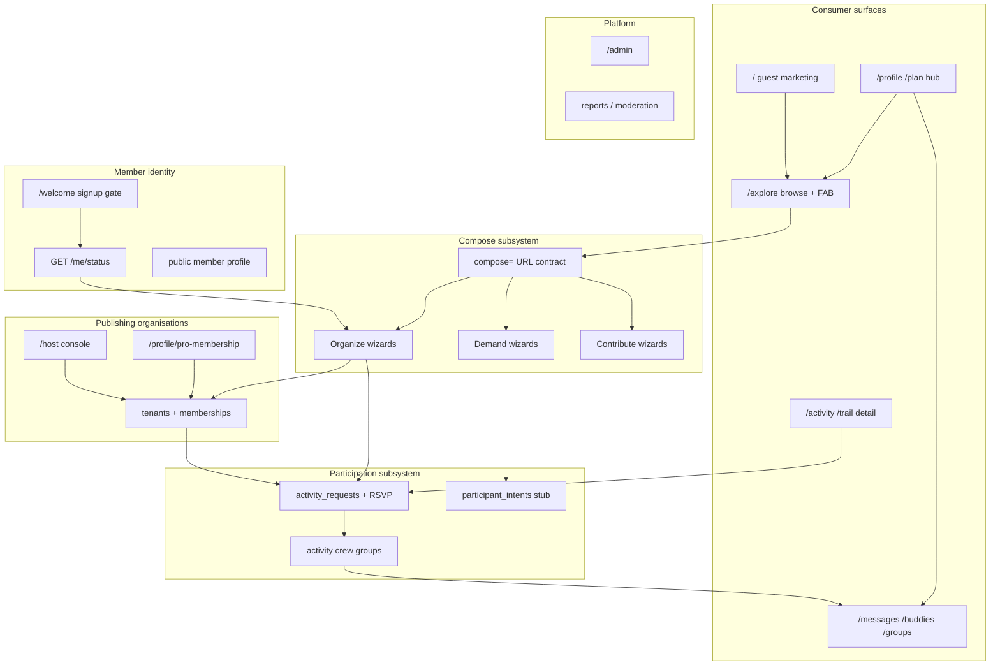
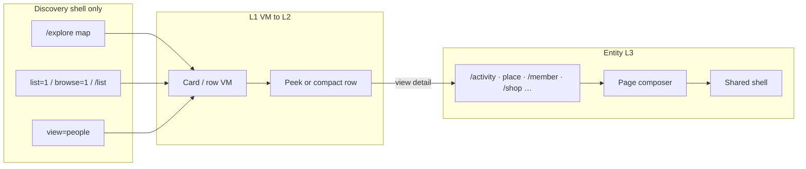

# System coherence — whole product architecture

**Purpose:** One map from **north-star outcomes** → **capabilities** → **surfaces** → **modules** → **API** → **storage**. Use this before large features or refactors so work strengthens a single system instead of adding a third parallel path.

**Not a duplicate of:** [`ARCHITECTURE.md`](./ARCHITECTURE.md) (deployment & layer diagram), [`DOMAIN.md`](./DOMAIN.md) (entity glossary), [`DOMAIN_CANONICALS.md`](./DOMAIN_CANONICALS.md) (naming & route builders), [`MEMBER_MODEL.md`](./MEMBER_MODEL.md) (person vs host tier). **This file ties them together.**

**Index:** [`DOCS_INDEX.md`](./DOCS_INDEX.md) · **Checks:** `npm run verify:system` · **Manifest:** `scripts/bounded-context-manifest.json`

---

## 1. North star → capabilities

From [`NORTHSTAR.md`](./NORTHSTAR.md), the product delivers five **capabilities** (not features):

| Capability | Member outcome | Primary surfaces |
|------------|----------------|------------------|
| **Discover** | See real outdoor plans near me | `/explore`, entity detail (`/activity`, `/trail`, …) |
| **Express demand** | Say what I want when nothing fits | Explore FAB → Find → **`activities`** (`activityMode: seeking`); intent stub for manage |
| **Connect** | Align with people before the day | **Browse — member people** (who’s going / looking / your crew on map & list) → **Chat** (`/messages`, group & outing threads) |
| **Participate** | Join or host a specific outing | Activity detail join/RSVP; host join queue |
| **Return** | Same crew, next time | `/profile`, **`/plan`**, notifications, goals |

Everything else (shops, rewards, place registry, admin, Pro agencies) **supports** these capabilities or serves a **secondary** audience (hosts, merchants, platform ops).

---

## 2. System map (logical)



---

## 3. Bounded contexts (where code must live)

Each context has **one write path** and **one public read model** where possible. Crossing boundaries happens through **services** and **shared-types**, not duplicate business rules in React.

| Context | Responsibility | Frontend home | API home | Storage (see `collections.ts`) |
|---------|----------------|---------------|----------|--------------------------------|
| **Discovery (Explore umbrella)** | **Explore** = discovery shell (URL, layout, chrome). **Projections:** map, list (`list=1`), browse catalogue (`browse=1`, `/list`), search — not separate data stores. **Activity discovery** = hosted + seeking outings from `GET /explore/map`. **Places discovery** = place / facility / shop pins from the same read (filters in explore/list). **Area** is an admin-curated **name** (`?area=` / `/area/:slug`) — **not a pin**. **People discovery** = roster, availability, directory (`member_discovery` APIs); *Looking for* tab composes **activity-discovery** seeking rows. | Shell: `src/explore/shell/*`. Activity: `src/activity-discovery/*`, activities list in `src/explore/ui`, `src/list/*`. Places: entity detail + list filters. People: `src/people-discovery/*` | `lib/explore-map.ts`, `GET /explore/map` | `activities`, `locations`, `facilities`, `areas`, `tenants` (shops) |
| **Compose** | FAB intents, wizards, draft → publish payload | `src/explore/create/`, `compose.ts`, `hostingFlowEngine.ts`, `hostingFlows/`, `seekingFlowEngine.ts` | `POST /operator/activities`, `POST /me/seeking-posts` | `activities` (seeking rows; legacy `participant_intents` read-only) |
| **Participation** | Join, waitlist, RSVP, seeking joins, **Join me** invites | `useActivityJoin*`, detail + explore selection | `join-request.ts`, `activity-invite.ts`, intent join **aliases** (`participant-intent-requests-store`) | **`activity_requests`** (canonical); `participant_intent_requests` legacy-only; `activity_participants`, `activity_invites` |
| **Browse — member people** | Who can I go with? Network roster + availability + discover directory (quota). **Looking for** tab: `GET /explore/seeking-activities` + `selectSeekingActivitiesFromExploreCatalog` (`src/activity-discovery`). | `src/people-discovery/*` (`PeopleBrowsePanel`, tabs), `ListDiscoverPeopleView` | `explore-seeking-activities-read.ts`, `member-people-engagement.ts`, `member-discovery-roster.ts`, `registerMemberDiscoveryRoutes`, `registerSocialPeopleRoutes` | Composes `buddy_*`, `user_follows`, explore catalog (read), `member_profile_views` |
| **Member identity** | Profile, welcome gate, visibility, public card | `src/pages/Profile*`, `src/member/*` | `registerProfileRoutes`, `public-member-profile`, `profile-viewer-access` | `auth_users` profile fields |
| **Member publish capabilities** | Who may organize/publish & open publishing workspace (tier + `profileComplete`) | `useMemberStatus`, `organizePublishGate` | **`services/member-status.ts` only** | `tenants`, `tenant_memberships` |
| **Publishing console** | Tenant-scoped CRUD, check-in, activity join queue | `src/pages/operator/*`, `src/console/*`, `components/activity/` | `routes/host/*` + `/operator` alias | same + `activities` |
| **Communication** | DMs, inbox, group & outing chat (product label **Chat**) | `Messages.tsx`, `src/messaging`, `@/chat` | `routes/chat.ts`, `activity-group-chat`, `member-inbox` | `chat_messages`, `social_groups`, wall collections |
| **Social graph** | Relationship **writes** & group metadata (not browse roster UI) | `Buddies.tsx`, `Groups.tsx`, `/buddies` | `registerBuddyRoutes`, `buddy-activity-presence.ts`, `registerGroupRoutes`, `registerFollowRoutes` | `buddy_*`, `user_follows`, `social_groups*` |
| **Places** | Place catalog read, place detail, **member place submit** | `src/places-discovery/*`, `PlaceDetail*`, FAB Contribute→place wizard (`compose` UI) | `place-catalog`, `place-submit`, `GET /places/catalog`, `POST /me/places` | `locations` (place rows) |
| **Facilities** | Facility catalog read, facility detail, **member facility submit** | FAB Contribute→facility wizard; `adminFacilityPlaceAdapter` | `place-catalog` (facility half), `GET /facilities/catalog`, `POST /me/facilities`, `GET/PATCH /admin/facilities` | **`facilities`** |
| **Areas** | Admin-curated **name** (`areas`, stable `areaId`) grouping Places/Facilities. **Not a map pin** — country / state / region come from map geography. Hub page `/area/:slug` + filter `?area=`. Children via **`place.areaId`** / **`facility.areaId`**. | `/area/:slug`, Find **Area then pin** (the pin is the seeking/place/facility, not the Area), admin **area** link | `areas-store`, `explore-map-area-lens.ts` (hub rollups, not map emit), `organizePublishArea.ts` | `areas`; **`locations.areaId`**; **`facilities.areaId`**; seeking `areaId` on the activity/post; hosted geography = **`activity.locationId` → `place.areaId`** |
| **Commerce** | Shop public + merchant manage (affiliate) | `ShopPublic`, `ShopManage` | `routes/shop.ts` | `merchant_profiles`, `tenants` (SHOP) |
| **Engagement** | Goals, map pins, wishlist, follow | explore wishlist save, entity/member follow | `registerMeGoalsRoutes`, `registerMeWishlistRoutes`, `registerEntityFollowRoutes`, … | `user_goals`, `user_favorites`, `entity_follows`, `user_follows` |
| **Platform ops** | Admin console, audit, applications, master-granted staff | `src/pages/Admin*` (`/admin/users` **Users** nav) | `routes/admin.ts` + `routes/admin/registerAdmin*` | `host_applications`, `audit_logs`, `auth_users` (staff role) |

**Rule:** If a change touches “who can do X,” find the row above first. Do not add a second resolver in a route file or a random hook.

**Viewer access (read vs act):** **Capabilities** = may organize/publish / open publishing workspace (`member_publish_capabilities`). **Detail exposure** = may see full entity payload (`activity-viewer-access`, `profile-viewer-access`). **Guest sheets** = sign-in copy only — not authorization. Canonical model: [`DOMAIN_CANONICALS.md`](./DOMAIN_CANONICALS.md) §15.

### 3.1 Context alignment matrix (API · FE · storage)

Pick a **context id** when changing code; touch registrar + `src/api/domains/*` + UI roots together. Machine-readable paths: `scripts/bounded-context-manifest.json`.

| Context | Collections (wire) | Key HTTP | FE domain module | UI roots |
|---------|-------------------|----------|------------------|----------|
| discovery | `activities`, `locations`, `participant_intents`, shop tenants | `GET /explore/map` · browse also `/list` | `exploreApi` | `src/discovery` (card VM), `src/explore/shell`, `src/activity-discovery`, `src/places-discovery`, `src/explore/*`, `src/list/*` — pin UI §6.1 |
| compose | `activities` (seeking) | `POST /operator/activities`, `POST /me/seeking-posts` | `exploreApi`, `seekingApi`, `organisationApi` | `src/explore/ui/*` |
| participation | `activity_requests`, `activity_participants`, `activity_invites` | **`POST /activities/:id/requests`** (canonical seeking + hosted); `/me/seeking-posts/.../requests` for Find manage; tenant **`GET /host/requests`** (console API, also Plan manage) | `activitiesApi`, `seekingApi` | Activity detail, Plan manage sheet, `JoinRequestDetail` |
| *(cross-cut)* | — | `GET /activities/:id` (`viewerAccess`, `myJoinInvite`) | — | **`activity-viewer-access.ts`**, **`activity-invite.ts`** |
| member_discovery | `member_profile_views` (+ read-only compose from map) | `/me/member-discovery/*` (roster, network, browse, quota, search); profile `?from=discover` | `accountApi` (`getMemberPeopleNetwork*`, discovery roster) | `src/people-discovery` — Explore **Find crew** panel, list **Buddies** (`listCat=people`), `MemberProfile` discover |
| member_identity | `auth_users` profile | `/me/profile`, `/users/:id` | `accountApi`, `memberApi` | `Profile*`, `src/member/*` |
| member_publish_capabilities | `tenants`, `tenant_memberships` | **`GET /me/status`** (legacy `/me/host-status`, `/me/operator-status`) | `memberApi` | **`useMemberStatus`** |
| publishing_workspace | + `activities` | `/operator/*` + tenant header | `organisationApi`, `activitiesApi` | `src/pages/operator/*`, `src/console/*`, `components/activity/*`, `activity/*` |
| communication | `chat_messages`, group wall | `/chat/*`, group wall | `messagingApi` (`chatApi` + wall via `socialApi`) | `Messages.tsx`, `src/messaging` |
| social_graph | `buddy_*`, `user_follows`, `social_groups*` | `/me/buddies`, `/me/buddy-requests`, `/me/groups`, `/me/following`, … | `socialApi` | `Buddies`, `Groups` — relationship admin; **not** the explore people browse panel |
| places | `locations` (places) | `GET /places/catalog`, `/places/:id`, `POST /me/places` | `placeApi`, `placeCatalogClient`, `memberCatalogSubmitClientApi` | `PlaceDetail*`, `memberCatalogSubmitClientApi`, `placeCatalogReadsClientApi` |
| facilities | `facilities` | `GET /facilities/catalog`, `/facilities/:id`, `POST /me/facilities`, `/admin/facilities` | `facilityApi`, `memberCatalogSubmitClientApi` | Facility submit wizard, `AdminPlaces` (`catalogSegment=facility`) |
| commerce | `merchant_profiles`, `products` | `/shop/*` | `shopApi` | `ShopPublic`, shop UI |
| engagement | `user_badges`, `user_goals`, `user_favorites`, `entity_follows`, … | `/me/badges`, `/me/goals`, `/me/wishlist`, `/me/entity-follows` | `badgesApi`, `goalsApi`, `socialApi` (wishlist + entity follow) | `ProfileBadges`, goals, `useEntityFollows`, wishlist guards |
| platform_ops | `host_applications`, `audit_logs` | `/admin/*`, `POST/DELETE /admin/platform-admins` (master) | `adminApi` | `src/pages/Admin*`, `DashboardLayout`, `ADMIN_LINKS` — **ops tables**, not discovery L1/L2 |

**API mounts:** `/auth`, `/admin`, `/operator` (legacy `/host/*` rewritten), `/chat`, `/shop`, `/media`, `/reports`, `/` (`user.ts` + `social.ts`) — see `apps/api/src/routes/index.ts`.

### 3.2 Browse — member people vs communication (do not conflate)

| User question | Bounded context | Surfaces | Not this |
|---------------|-----------------|----------|----------|
| Who can I go with? Who’s on an outing? Who’s looking for a crew? | **member_discovery** + **discovery** map | `/explore` People panel (`view=people`), `/list?listCat=people` (**Buddies**), shared `PeopleBrowseTabContent` | `/messages`, group walls |
| Who do I talk to? What did the crew say? | **communication** | `/messages` (**Chat** tab), `/groups` → Message → thread | Explore people panel, roster APIs |

**One member model, two jobs:** browse reads show **relationship + outing status** (friend/following, trip hint, looking-for row, directory card). Chat surfaces use the **social graph** for eligibility but are a separate transport ([`COMMUNICATION.md`](./COMMUNICATION.md)).

**Naming for new code:** prefer `memberDiscovery`, `memberPeople`, `browsePeople` — reserve **social** for `social_graph` mutations and **reviews** (`/reviews` on root router). Guest gate intent `explore-social` means **browse people panel**, not inbox.

**Target consolidation (implementation):** one map-enriched **member people read** with views (`networkRoster`, `discoveryRoster`) behind stable routes; UI labels “Buddies” / map panel can diverge from code names.

---

## 4. Surfaces vs routes (contract)

Canonical navigation: [`NAVIGATION.md`](./NAVIGATION.md). Structural rules:

| Surface | Route anchor | Never confuse with |
|---------|--------------|-------------------|
| Marketing | `/` | Product home (`/explore`) |
| Browse + create | `/explore?compose=…` | `/host/activities/new` as consumer default |
| Personal hub | `/profile`, **`/plan`** | Legacy `/trips` redirects; not `/activities` browse |
| Entity | `/activity/:id`, place URLs | “Trip” entity (does not exist) |
| Host console | `/host/*` (tenant workspace) | Buddy **Organize** (map FAB) + **Plan hosted** manage (same APIs, consumer surface) |
| Pro / business | `/profile/pro-membership` | `/become-host` as product entry (redirect only) |
| Messaging | `/messages` (+ `?group=` / `?to=`) | Chat embedded only on entity/Plan flows → `/chat` |
| List layout (browse) | `/list?…` (handoff) · mobile **List** pill on `/explore` | A second product home, `/map`, or **List bottom-nav tab** |
| **Publishing workspace** | `/operator/*` (legacy `/host/*` → rewrite) | Consumer **Organize** on `/explore` (same APIs, different shell) |
| **Platform admin** | `/admin/*` | Consumer peek/detail, Explore chrome, or `ConsumerShell` |
| **Public person** | `/member/:userId` | `/profile` (self hub) or tenant storefront (`/guide`, `/agency`, `/shop`) |
| **Tenant storefront** | `/guide/:slug`, `/agency/:slug`, `/shop/:id`, … | Activity **host row** (person vs brand) — link resolver picks surface |

**Auth shells:** `ProtectedRoute` uses **`UserRole`** for coarse access (admin, host console shell). **Product gates** (Organize, paid host, profile chips) use **`MemberStatusDTO`** from **`GET /me/status`** (`useMemberStatus`). See [`MEMBER_MODEL.md`](./MEMBER_MODEL.md) — mixing these layers is a top source of incoherence.

### 4.1 Browse routing strategy (scalable default)

Aligned with [`DOMAIN_CANONICALS.md`](./DOMAIN_CANONICALS.md) §4.1 and [`NORTHSTAR.md`](./NORTHSTAR.md):

- **Few browse surfaces, many filterable views** — `/explore` map-first; **map list** (`list=1` / List pill) vs **discover browse** (`browse=1`, hamburger Browse, optional `/list`) share filter vocabulary (`src/list/routing.ts` ↔ `explorePath()`). **Mobile bottom nav stays three tabs** — Explore · Plan · Chat (middle tab route **`/plan`**) ([`NAVIGATION.md`](./NAVIGATION.md)).
- **One discovery read path on the server** — `GET /explore/map` (+ query). Map stage, explore list sheet, and list discovery UI are **projections**; avoid separate “catalog” endpoints per category unless a new bounded context is approved in Tier-1.
- **Many entity URLs where identity matters** — `/activity`, place paths, `/shop`, brand paths: sharing, notifications, per-id cache and `viewerAccess`. These are **not** browse department homepages.
- **Private engagement off the public map** — wishlist, entity follow, member follow, goals: `/me/*` and trips/profile UI ([`MEMBER_MODEL.md`](./MEMBER_MODEL.md) § Follow · Wishlist · Goal).

**Scale levers (prefer before new route trees):** bbox/region or cursor on explore map; normalized query cache keys; lighter list DTO if poster feed outgrows map payload; SSR on entity + marketing only unless SEO category landings are explicitly added.

---

## 5. API shape (how the backend stays one system)

**Mount order:** `apps/api/src/routes/index.ts` — `auth`, `admin`, `host`, `shop`, `chat`, `media`, `reports`, `social`, **`user`** (broad public + `/me`).

**Thin routes:** `apps/api/src/routes/user/register*.ts`, `routes/host/register*.ts`, and `routes/admin/registerAdmin*.ts` — validate, call **service**, map DTO. Mount shells: `user.ts`, `host.ts`, `admin.ts`.

**Domain rules:** Prefer `apps/api/src/domain/*` (pure) + `apps/api/src/services/*` (orchestration). Avoid new business rules in `lib/*-store.ts` without a service façade.

**Contracts:** `packages/shared-types` — wire DTOs, explore projection, participation enums. API `domain/` may mirror rules but **shared-types** is what the SPA imports.

**Explore read model:** Single aggregator `GET /explore/map` — clients should not reconstruct the map from three legacy catalog calls.

**Async side effects:** Fire-and-forget rewards, email, notifications, and group-chat roster updates use `scheduleNotification` / `scheduleSideEffect` (`apps/api/src/lib/schedule-side-effect.ts`) — failures **warn-log** with `logContext` (see `DEV_RUN.md`). Optional durable notification queue: `SIDE_EFFECT_OUTBOX=1` (MIG-OUTBOX; default off). **Chat inbox:** non-buddy partners use batched policy (`batchCanMessagePartnersFromViewer`); policy failure surfaces `directConversationsDegraded` (not silent empty inbox); regression `apps/api/tests/chat-policy.test.ts`. **Media:** private-bucket kinds deny anonymous presign (`media-access.test.ts`). **Search:** user substring search escapes via `regex-search` (`regex-search.test.ts`, `naming-coherence.test.ts`). **Read paths:** activity assembly, `/me/reviews`, `/me/entity-follows`, member browse + people rows (`countCheckedInParticipationsForUserIds`, `filterInboxMessageablePartnerIds`, read-only `batchResolveMemberProfileRoleLabelsForDirectory`), active tenant memberships (`tenant-access` + `findTenantsByIds`), host join-queue locations, wishlist profile hydration, group wall unread aggregation, publish fan-out actor labels (`resolveNotificationActorDisplayNamesForRecipients`); legacy demand map pins batch hide (`batchShouldHideFromMapMemberDiscovery`) — `naming-coherence.test.ts`. **Mount fetches / explore hygiene:** `useSafeAsyncEffect` (**S10a–b**), browse URL + pin-deep-link deps (**S10d**) — `systemCoherenceGuard.test.ts`. **Release (S10e/f):** bbox promote + manual QA — [`PRE_DEPLOY_CHECKLIST.md`](./PRE_DEPLOY_CHECKLIST.md), `npm run consumer-detail:qa-routes`; tracker **§8.1**.

Detail: [`API_ROUTING.md`](./API_ROUTING.md).

### 5.1 HTTP entrypoints — surface-first, not profile-first

**One domain entity does not imply one route registrar.** Catalog (and most cross-audience resources) use **parallel HTTP surfaces** that share **services + stores** underneath. **Do not** collapse member submit and platform admin CRUD into a single path (e.g. `POST /facilities`) and branch on `GET /me/status` or profile “user type.”

| Surface | Mount | Auth gate | Catalog examples | Capability source |
|---------|--------|-----------|------------------|-------------------|
| **Public read** | `userRouter` (before `requireAuth`) | Optional auth for `viewerAccess` | `GET /places/:id`, `GET /facilities/:id`, `GET */catalog` | `*-viewer-access` assemblers |
| **Member write** | `userRouter` (after `requireAuth`) | Signed-in member | `POST /me/places`, `POST /me/facilities` | Auth only — **not** `publish.canPublish` |
| **Platform ops** | `adminRouter` | `UserRole.PLATFORM_ADMIN` | `GET/PATCH/DELETE /admin/places`, `/admin/facilities` | Role on mount — **not** `/me/status` |
| **Publishing workspace** | `operatorRouter` | Tenant membership + publish gates | `POST /operator/activities`, operator place submit | `GET /me/status` → `publish` |

**Registrar naming (API):** `registerPublic*`, `registerMe*`, `registerAdmin*` — Express **route mount** modules ([§8.4.9](#849-implementation-alignment-map-anti-drift)), not “who may sign up.” **`registerPublic*`** = **read-only** `GET` catalog/detail (guests + members); **no** public `POST` for place/facility submit — that is **`registerMe*`** only (`POST /me/places`, `POST /me/facilities`). **Guards:** `catalog-http-surface-guard.test.ts`, `cpc-terminology-guard.test.ts`.

**Anti-patterns:** `registerFacilityRoutes` / `registerPlaceRoutes` monoliths; `resolveMemberStatus` inside catalog submit handlers for admin CRUD; using `publish.canPublish` to gate **Contribute** place/facility submit or **join** flows.

---

## 6. Frontend shape (how the SPA stays one system)

| Layer | Role |
|-------|------|
| `src/pages/*` | Route shells — lazy in `App.tsx` |
| `src/explore/*` | **Discovery shell** — map stage, compose, browse chrome, join overlays |
| `src/discovery/*` | **Discovery read models** — card VM from `GET /explore/map` (pins, list, posters) |
| `src/pages/operator/*`, `src/console/*` | **`/operator/*` console** — shell, hub stats (`ConsoleHubSections`), join queue |
| `src/components/organisation-console/*` | Pro onboarding, public tenant profile editors (wire: organisation) |
| `src/api/domains/*` | HTTP clients per context — composed in `services.ts` as `api` |
| `src/config/*`, `src/content/*` | Routes helpers and canonical copy |
| `src/member/*` | Host-status display helpers and guards |

**API client:** Prefer `api.getMemberHostStatus()`, `exploreApi.*`, `organisationApi.*`. Domain modules only — `legacyApi.ts` removed; see `apiLegacyGuard.test.ts`.

**Publish payload:** Single builder `activityPublishPayload.ts` for explore Organize and host console forms (shared across surfaces).

### 6.1 Discovery UI stack (methodology)

**Explore** names the **route and shell** (`/explore`, `ExploreMapStage`, filter pills). It is **not** a prefix for entity UI. Consumer discovery follows one vertical stack:

| Layer | Responsibility | Canonical modules |
|-------|----------------|-------------------|
| **L0 Wire** | Map/list DTO from API | `ExploreMapItemDTO` (`shared-types`), `GET /explore/map` |
| **L1 Card VM** | Projection for peek + list + poster | `src/discovery/discoveryCardModel.ts`, `buildDiscoveryCardViewModel`; optional server `discoveryCard` on map when `EXPLORE_MAP_DISCOVERY_PROJECTION=1` |
| **L2 Map peek** | Minimized card on map/list | `MapPeekShell` + `peek/{entity}/*` + `*PeekCard` |
| **L3 Entity detail** | Marketing depth, join, tabs | `src/activity/detail/*`, `*PlaceDetailPage`, `/area/:slug` |

**Naming (L2):** One shared shell — **`MapPeekShell`**. Per entity — **`{Entity}PeekCard`**, **`{Entity}PeekBody`**, **`{Entity}PeekActions`** (activity wire actions via **`ActivityPeekEngagementActions`**). Do **not** stack extra prefixes (`PinSummary`, `Explore`) on entity parts.

**Routing rule:** `mapPeekSlots` is the **only** module that branches on `card.source` for the activity map peek **mount** (`ActivityMapPeekHost` — React surface, not activity organizer). New logic goes under `peek/{activity|place|area|shop}/`, not new `Explore*Peek*` files.

**Looking-for / seeking (unified with activity):** Product = **activity** (`activityMode: seeking`); publisher = **organizer** on wire. Map/list peek = same stack as hosted outings: `ActivityMapPeekHost` → `ActivityPeekCard` → `peek/activity/*` + `resolveActivityPeekEngagement` (`viewerAccess.mapPeekActions`). **No** intent-only peek UI in app code — map wire is activity-backed (M0/M1). L1 cards force `source: 'activity'` for seeking. Ops: backfill old DB rows (`seeking:storage-status`); keep `pin=demand:` URL rewrite only (`seekingPinHygieneGuard`).

**Parity rule:** Engagement affordances on L2 must match L3 for the same viewer state (`resolvePeekDetailAccess`, activity engagement policy) — see `consumer-detail-surfaces-plan.md`.

**Folder rule:** `src/explore/ui/Explore*.tsx` legacy map chrome may keep the surface prefix until a dedicated pass; **entity** logic does not.

**Geography vocabulary (do not mix):** **Place** = catalog entity (`locations`, HTTP `/places`, map `source: place`). **Facility** = amenity with coords (`facilities`, HTTP `/facilities`, map `source: facility`). **Area** = admin-curated **name** (`areas`, `areaId` on Place/Facility) — **not a map pin**. Country / state / region come from map geography. Legacy map aliases: `venue` / `catalog_place` → `place`; `source: area` retired. FE anchor: `src/place/geographyVocabulary.ts` · BWL: `BWL_EXPLORE_MAP_SOURCE` · guards: `geographyTerminologyGuard.test.ts`.

Canon table: [`DOMAIN_CANONICALS.md`](./DOMAIN_CANONICALS.md) (Discovery UI file names). Guards: `mapPeekNaming.test.ts`, `discoveryUiMethodologyGuard.test.ts`, `geographyTerminologyGuard.test.ts`.

### 6.2 Frontend surface architecture (system methodology)

**Purpose:** One **object-centric** stack (wire → projection → shell → page composer) across **all** user-facing families — not only map peek and entity detail. Experiment plans (`consumer-detail-surfaces-plan`, `member-surfaces-implementation-plan`) are **workstreams under this section**; they do not replace it.

#### 6.2.1 Surface families (layout chrome)

| Family | Routes (anchor) | Shell / layout | Uses L1–L3 discovery stack? |
|--------|-----------------|----------------|----------------------------|
| **Marketing & auth** | `/`, sign-in, `/welcome` | Marketing layout · guest rules on `/` | No — CTAs hand off to `/explore` |
| **Discovery shell** | `/explore`, `list=1`, `browse=1`, `/list` | `ExploreExperience` + map stage / browse asides | **L1–L2** on pins/rows/posters; not L3 |
| **Personal hub** | `/profile`, `/profile/settings/*` | `ConsumerShell` + profile stack | Launcher only — not a second browse home |
| **Plan & commitments** | `/plan` | `ConsumerShell` | Embeds manage sheets; may deep-link L3 |
| **Communication** | `/chat`, `/messages`, `/groups` | Tab chrome / inbox | No peek; people **names** link to `/member` or storefront |
| **Entity detail (L3)** | `/activity`, place URLs, `/area`, `/shop`, org slugs | `MobileDetailShell` / `EntityPublicDetailShell` | L3 — parity with L2 via `resolvePeekDetailAccess` |
| **Member & people browse** | `/member/:id`, Explore `view=people`, `/list?listCat=people`, `/buddies` | `ConsumerShell` (profile) · `PeopleBrowsePanel` (discover) | **People rows** = own card VM (`memberPeople*`); seeking tab = **activity L1** |
| **Publishing workspace** | `/operator/*` | `ConsoleShell` / `DashboardLayout` (tenant) | Preview may embed consumer L3 — **manage** is separate |
| **Platform admin** | `/admin/*` | `DashboardLayout` + `ADMIN_LINKS` | **Never** reuse `MapPeekShell` or consumer detail footers |

#### 6.2.2 Profile & publisher identity matrix

One **person account**; **one consumer profile page** (`/member/:userId` — `MemberProfile` / `MemberProfileView`). `/buddies`, people browse, host rows, and chat link here; browse **lens** is query only (`memberProfilePath(…, { lens })`). Full lens × audience table: [`DOMAIN_CANONICALS.md`](./DOMAIN_CANONICALS.md) §3.2.2. Capabilities (`GET /me/status` → `publish`) gate **organize/workspace** — not profile read ([`MEMBER_MODEL.md`](./MEMBER_MODEL.md)).

| Viewer intent | Canonical route | Primary module | `viewerAccess` / policy |
|---------------|-----------------|----------------|-------------------------|
| **Self** | `/profile`, `/profile/edit` | `Profile*` | N/A (authenticated `/me/*`) |
| **Another member** | `/member/:userId` | `MemberProfile` | `resolveProfileViewerAccess` on `GET /member/:userId/profile` |
| **Discover directory** | Same + `discover=1` / `lens: discover` | `MemberProfile` | Public visibility + discovery quota (Pro unlimited) |
| **Friends / Going** | Same + `lens: friends` (optional) | `MemberProfile` | `accepted_buddy` → full exposure |
| **Available tab** | Same + `lens: available` (optional) | `MemberProfile` | Signed-in → public card at minimum |
| **Host / Looking for** | Same + `lens: host` (optional) | `MemberProfile` | Participant + host-of-activity levels |
| **Host on activity** | Activity Plan tab **host row** | `ActivityDetail*` publisher strip | Link **person** (`/member`) vs **tenant** (`/guide`, `/agency`, `/shop`) from wire `publisher` |
| **Pro guide storefront** | `/guide/:slug` | `OrganisationPublicProfile` | Public tenant profile — not `/member` |
| **Agency / partner** | `/agency/:slug`, `/partner/:slug` | Same | Workspace team ≠ consumer buddy graph |
| **Shop brand** | `/shop/:id` | `ShopPublicPage` | Commerce context |
| **Available / roster** | Explore people tabs `available`, `going`, `connect` | `PeopleBrowseTabContent` | Roster APIs (`member_discovery`); **not** full L3 until tap through |
| **Owner preview** | Eye from profile / console | Consumer L3 with `preview` / manage affordances | Same wire as public; extra actions only in workspace |

**Target:** One **member browse row** projection (directory / availability / network roster) shared by `PeopleBrowsePanel` and list `listCat=people` — distinct from **`DiscoveryCardModel`** (map catalog entities). Keep **member** for person ids and profile routes; **people** for the browse surface name only.

#### 6.2.3 Discovery projections (one catalog, many lenses)

**Server:** `GET /explore/map` (+ query filters) is the default catalog; people directory and rosters compose from **`member_discovery`** + map read ([§3.2](./SYSTEM_COHERENCE.md#32-browse--member-people-vs-communication-do-not-conflate)).

**Client — same filter vocabulary everywhere:**

| Projection | Entry | Row/card builder | Deep link |
|------------|-------|------------------|-----------|
| Map pins | `/explore` | L1 `buildDiscoveryCardViewModel` → L2 peek | `pin=` / selection |
| Map list panel | `list=1` | Same L1 → compact row + `mapPeekActions` | Peek or L3 |
| Discover browse | `browse=1` or `/list` | `buildListFeedCards` / posters | Entity routes |
| Header search | Explore search modal | `exploreItemSearch` taxonomy | Entity or filtered explore |
| People — looking | `peopleTab=looking` | Activity L1 (seeking) | `/activity` |
| People — network | `going` / `connect` | Network roster VM | `/member`, message |
| People — available | `available` | Availability + directory VM | `memberProfilePath(id, { lens: 'available' })` — **not** discover quota |

**URL sync:** `explorePath()` ↔ `listDiscoveryPath()` ↔ `exploreBrowseUrlSync` / hydrate — do not add parallel query dialects per surface ([`NAVIGATION.md`](./NAVIGATION.md) § Explore URLs).

#### 6.2.4 L0–L3 by bounded context (extension of §6.1)

| Context | L1 (card VM) | L2 (peek / row) | L3 (detail composer) |
|---------|--------------|-----------------|----------------------|
| Activity (hosted + seeking) | `discoveryCardModel` | `peek/activity/*` | Kind **page composers** (`*ActivityDetailPage` → shell) — **not** one `ActivityDetailBody` with kind `if` chains |
| Place | L1 place slice | `peek/place/*` (`PlacePeekHero`, `PlacePeekBody`, …) | `buildPlaceDetailPageModel` → `PlaceDetailPage` → `PlaceDetailPageShell` → `PlaceConsumerDetailPage` |
| Area | **Not a pin** — `areaId` / `areaSlug` on Place/Facility (and activity via place) | Hub chrome / `peek/area/*` (hub page only — do not emit `source: area` on the map) | `AreaDetailPage` sections/tabs |
| Shop | L1 shop pin | `peek/shop/*` | `ShopPublicPage` |
| Member (browse) | `memberPeople*` row VM | Optional mini-card in people panel | `MemberProfile` |
| Tenant storefront | Org list cards (browse) | — | `OrganisationPublicProfile` |

#### 6.2.4.1 Shared L3 kind pattern (activity + place)

One methodology for catalog **detail templates** — not one URL for every entity:

| Step | Activity (`/activity/:id`) | Place (`/trail` · `/camp` · `/venue`) |
|------|----------------------------|----------------------------------------|
| Route loader | `ActivityDetail.tsx` (wire, modals, SEO) | `PlaceDetailPage.tsx` |
| Kind key | `ActivityDetailKind` from `activityType` | `PlaceDetailKind` from route wrapper |
| Kind route file | `*ActivityDetailPage` → `ActivityDetailPageShell` | `*PlaceDetailPage` → `PlaceDetailPageShell` |
| L1 | `buildActivityDetailPageModel` | `buildPlaceDetailPageModel` |
| Public body | `ActivityConsumerDetailBody` (scroll; peek L1 card) | `PlaceConsumerDetailPage` (scroll; peek-native hero parity) |
| **Presentation wire** | `GET /activities/:id` → `presentation.consumerLayout` (+ `engagement`, `mapPeekActions` via `viewerAccess`) | Place: catalog fields on `GET /places/:id` (no `consumerLayout` yet — scroll sections local) |
| Kind-specific facts / plan | `*ActivityDetailPlanSections` → `ActivityDetailBody` (hiking / camping / rideshare / other) | `PlaceConsumerKindFacts` + shared scroll (`PlaceConsumerDetailPage`); contribute preview still uses `PlaceDetailTabs` |
| Shared core | `ActivityDetailView` + `MobileDetailShell` | `MobileDetailShell` via `PlaceConsumerDetailPage` |

Host preview / `ActivityManageSheet` embed `ActivityDetailView` with `isEmbedded: true` → `presentation.tabs` + `footerByTab` (no `consumerLayout`). They skip `ActivityDetailByKind`.

#### 6.2.5 Cross-cutting kits (one implementation per concern)

| Concern | Canonical location | Surfaces |
|---------|-------------------|----------|
| Guest sign-in / browse gate | `guestBrowseGate*`, `ActivityDetailGuestGate`, `ExploreGuestJoinSheet` | Peek details, L3, people tabs (non-public) |
| Join / RSVP / request | `useActivityJoinFlow`, wire footers | L2 actions, L3 footers, Plan manage |
| `viewerAccess` → UI | `mapViewerAccessToUi`, `resolvePeekDetailAccess` | L2–L3 parity guards |
| Participation modals | Activity manage / invite sheets | Explore host on map, L3, `/operator` queue |

#### 6.2.6 Admin & operator (out of consumer methodology)

- **Admin (`/admin/*`):** CRUD tables, moderation queues, metrics — `adminApi` + `DashboardLayout`. Does **not** adopt discovery card VM or entity tab footers; may link **out** to consumer URLs for inspection only.
- **Operator (`/operator/*`):** Tenant-scoped publishing — `ConsoleShell`, join request queue, activity forms. **Organize** on the map remains consumer shell; shared **publish payload** (`activityPublishPayload.ts`) is the cross-surface write contract.

**Program:** **S13** (§8) — implementation waves; activity kind page split is **S13d**, not a standalone architecture.

---

## 7. Incoherence register (honest debt)

Track consolidation here; sub-roadmaps link out but **this table is the system-wide backlog**.

| ID | Symptom | Why it hurts | Target state | Tracker |
|----|---------|--------------|--------------|---------|
| **C1** | Three permission notions (`UserRole`, `HostStatusDTO`, tenant middleware) | Wrong gates in UI; workspace confused with Organize | Roles = shell; **`GET /me/status`** / `MemberStatusDTO` = product; tenant header = **`/operator/*`** (legacy `/host/*` rewritten) | [`MEMBER_MODEL.md`](./MEMBER_MODEL.md), `host-member-model.mdc`, `hostMemberGuard.test.ts` (no `isHostRole` in product gates) |
| **C2** | Organisation/Host naming mix in UI | New code uses wrong copy or imports | `Host*` + `Activity*` for publish/roster; `Organisation*` only for tenant storefront wire; host user copy | [`HOST_CLEANUP_ROADMAP.md`](./HOST_CLEANUP_ROADMAP.md) P2 · [`MEMBER_MODEL.md`](./MEMBER_MODEL.md) § Organisation in filenames |
| **C3** | ~~Large `host.ts` / `admin.ts` monoliths~~ | — | **Mitigated (Oct 2026):** host + admin mount shells with `register*` registrars | [`HOST_CLEANUP_ROADMAP.md`](./HOST_CLEANUP_ROADMAP.md) P2 |
| **C4** | Parallel place detail pages (`Trail` / `Camp` / `Event`) | Duplicate SEO/loading patterns | `PlaceDetailCore` + thin kind wrappers (`placeDetailCore.test.ts`) | **R3 done** — routes unchanged for SEO |
| **C5** | `components/activities/*` modals vs explore wizards | Two create UX paths | Explore compose only for consumer create | Mostly done — audit `components/activities` |
| **C6** | Shop = `tenant` + `merchant_profile` | Two writes for one brand | Documented split; sync on ShopManage save | [`DOMAIN.md`](./DOMAIN.md) |
| **C7** | Premium location unlock + old membership page | Legacy freemium copy vs north star | Product TBD | [`NORTHSTAR.md`](./NORTHSTAR.md) |
| **C8** | `/community`, `/membership` routes | Secondary surfaces vs explore-first IA | Both redirect to `/explore`; `COMMUNITY_PATH` kept for inbound links only | [`NAVIGATION.md`](./NAVIGATION.md) legacy table |
| **C9** | Notification + privacy matrix incomplete | Rare group/private actor QA | API `notification-actor-label`; FE `notificationConsumerGuard` + `notificationRouting.test`; API route side effects → `scheduleSideEffect` / `scheduleNotification` | **Eng done (Oct 2026)** — manual QA for edge notification kinds |
| **C10** | 100+ markdown files, multiple “plans” | Agents read wrong doc | **Tier 1** only for truth; experiment cap + stubs (**C27**, §8.6.4) | [`DOCS_GOVERNANCE.md`](./DOCS_GOVERNANCE.md) |
| **C11** | Long flat `api.*` surface | Wrong facade | Domain modules in `src/api/domains/*` | [`DOMAIN_CANONICALS.md`](./DOMAIN_CANONICALS.md) §10–12 |
| **C12** | Notification meta dialects | Routing sprawl | `NotificationMeta` + `actorUserId` | §11 |
| **C13** | Many `*Routing.ts` helpers | Import confusion | `routingCatalog` + `inferNotificationPath` | §10 |
| **C14** | Doc corpus duplication | Contradictory terms | **Update Tier-1 only** — [`DOCS_GOVERNANCE.md`](./DOCS_GOVERNANCE.md) | |
| **C15** | Buddy/friend vocabulary | Fake entity ids | User ids only | [`MEMBER_MODEL.md`](./MEMBER_MODEL.md) § Naming vocabulary |
| **C16** | ~~Parallel detail policy~~ | — | **Mitigated (Oct 2026):** API `viewerAccess`, map enrich, `mapViewerAccessToUi`; FE shim is wire-only | [`DOMAIN_CANONICALS.md`](./DOMAIN_CANONICALS.md) §15 |
| **C17** | Discovery card projection sprawl | Optional API `DiscoveryCardProjection` on map wire | `src/discovery` VM + `buildDiscoveryEnrichedCard`; detail wire footers (`activityDetailAcceptance` AD-PRES-02, R6) | **R1 + R6 done (FE)** — slim map DTO promotion is R5 ops |
| **C18** | `ExploreExperience` orchestration hub | Was ~900 LOC monolith | Shell hooks + `exploreBrowseUrlSync` / `exploreBrowseUrlHydrate` / apply-handlers + selection sub-hooks | **R2 done** — wiring & browse URL hook under guard budgets; public browse/selection contracts unchanged |
| **C19** | Global explore map blob | Full fetch default; bbox behind flags | `explore-map-base` + bbox fetch — [`explore-map-bbox-spec.md`](./experiment/explore-map-bbox-spec.md) | **R5 shipped (flagged)** — staging runbook |
| **C20** | Seeking **read** paths (M2d write fixed) | Legacy `demand:` deep links only in routing + notification rewrite | Activity-primary map pins; `seekingPinHygieneGuard` | **R4 done (read)** — compat parsers remain |
| **C21** | **Surface/role prefixes in shared components** (`Host*`, `Explore*`, `Plan*` outside owning folders; Host→Organizer synonym renames) | Same mistake as C2; blocks reuse and coherent refactors | Module names = bounded context; props = neutral ids; copy in labels/`workspaceVocabulary` | [`DOMAIN_CANONICALS.md`](./DOMAIN_CANONICALS.md) §13 · [`HOST_CLEANUP_ROADMAP.md`](./HOST_CLEANUP_ROADMAP.md) P5 · `moduleNamingGuard.test.ts` |
| **C22** | **Find vs Organize split in UI** (legacy host-manage peek, `participantIntentId` publish paths, transport vs `link-activity`) | Same map activity, different chrome and wrong transport link | **S12** in [`CREATE_FLOW.md`](./CREATE_FLOW.md) — one host peek; parent `linkToParentActivityId` for transport | **S12 done** |
| **C23** | ~~**Activity L3 monolith**~~ | — | **Done (S13-W7)** — thin `ActivityDetailBody` + `ActivityDetailPlanColumn` / `ActivityDetailSidebarColumn`; kind `planSections` on plan column | **S13-W7** |
| **C24** | **People surfaces split** (`PeopleBrowsePanel`, `ListDiscoverPeopleView`, `Buddies`, activity host row) without shared people card VM | Inconsistent roster masks, duplicate buddy CTAs | `memberBrowseRowModel` + one `PeopleBrowseTabContent` — §6.2.2 | **S13-W3 done** |
| **C25** | ~~Admin / platform_ops FE roots under-documented~~ | — | **Done (S13-W9)** — `NAVIGATION.md` admin table, `adminSurfacesAcceptance`, manifest `feRoots` | **S13-W9** |
| **C26** | Catalog POI model flat (`locations` + `place-kind` amenities); area-wide “nearby facilities”; FAB **Host·Find crew·Add on map** (legacy **Plan·Contribute** wire only); contribute/submit/registry jargon split | Wrong trail amenities; organize picker pollution; duplicate shop semantics (member pin vs operator storefront) | **Program CPC** (§8.4): **Place** + **Facility** entities; catalog queries; `viewerAccess` on places; compose wire + legacy aliases | **Mitigated (CPC-0–6)** — CPC-7 dual-read tail + `verify:system` before close |
| **C27** | ~~**Doc corpus sprawl**~~ | — | **Mitigated (Oct 2026)** — `experiment/*` stubs only; bodies `archive/experiment/`; schedules §8.3/§8.6/§8.7 | [`DOCS_GOVERNANCE.md`](./DOCS_GOVERNANCE.md) · `verify:docs` |
| **C28** | **Multi-quarter refactor without program spine** | Half-migrations, lost context mid-flight | **`scripts/refactor-program.json`** + §8.6 phase gates; manifest + migration IDs; strangler rules | §8.6 below |

**Not debt (intentional):** legacy `/host/*` → `/operator/*` rewrite; Mongo `locations` collection name (wire **Place**); `x-organisation-id` header; `getOrganisationProfile` for **storefront** — not activity roster. **During CPC:** `/trail`·`/camp`·`/venue` and `/contributions` remain until **CPC-6** redirects ship (target `/place/:id`, `/profile/submissions`).

---

## 8. Consolidation phases (system-wide)

Ordered for **coherence**, not feature count:

| Phase | Outcome | Primary docs / commands |
|-------|---------|-------------------------|
| **S0** | Single doc entry + automated phrase guards | `DOCS_INDEX`, `verify:docs` |
| **S1** | One member capability resolver (`GET /me/status`; legacy paths rewritten) enforced server-side | `MEMBER_MODEL`, `verify:host-member` |
| **S2** | Host route modularization + fulfill removal | **Done** — `HOST_CLEANUP_ROADMAP` P1–P2 |
| **S3** | API mount shells: **`user.ts`**, **`admin.ts`** → `register*` modules only | **Done** — admin registrars + platform master staff; user already modular |
| **S4** | Frontend `api.*` stays domain-only | **Done (guards)** — `apiLegacyGuard`, `domainImportGuard`, `consumerApiIndexGuard`, `hooksApiFacadeGuard`, ESLint R8; `api/index` only in `src/hooks` facades |
| **S5** | Privacy notification matrix + viewer access everywhere | [`HOST_CLEANUP_ROADMAP.md`](./HOST_CLEANUP_ROADMAP.md) P2 |
| **S6** | Place detail internal merge + SEO pass | **Done** — R3 `PlaceDetailCore`, thin trail/camp/event wrappers (`placeDetailCore.test.ts`) |
| **S7** | **Viewer access VA-1–VA-7** (activity detail + explore peek on API contract) | **Done** — §15.8; layer-7 hook `composeActivityViewerAccess` / `applyActivityViewEntitlements` |
| **S7b** | **Activity detail tabs** (Plan · Place · Buddies · Transport) + unified engagement policy | **Done** — program `complete`; wire footers + `activityDetailAcceptance` / AD-CTA matrix |
| **S7c** | **Viewer access naming** (wire-first, collapse resolver soup) | **Done (NA-1–NA-6)** — plan §22; API `buildActivityViewerAccess`; [`DOMAIN_CANONICALS.md`](./DOMAIN_CANONICALS.md) §15.11 |
| **S8** | **Discovery architecture** — card VM, explore shell, seeking read cleanup, map bbox spec | **Wave closed (R0–R6, R4 read, R8)** — R5 bbox **promote** via [`EXPLORE_MAP_RUNBOOK.md`](./operations/EXPLORE_MAP_RUNBOOK.md); §3 metrics (seeking branches, slim map default) = optional follow-up |
| **S9** | **Consumer detail shell alignment** — place/area/shop/agency IA + shared chrome vs activity reference | **Eng complete** — shells Phases 1–7; lineage **§3.2** + API `detail-surface-lineage-contract`; §8.1 `consumerDetailQaMatrixGuard`; §15.3 `consumerDetailAntiDriftGuard`. **Pending:** product §0 + §8 manual (`npm run consumer-detail:qa-routes`) — [`consumer-detail-surfaces-plan.md`](./experiment/consumer-detail-surfaces-plan.md) |
| **S10** | **Production hygiene audit (Oct 2026)** — security, trust, perf, stability (not new audit markdown) | **Eng complete** — **§8.1** waves **core + S10a–d** shipped; **S10e/f** = ops/human gates ([`PRE_DEPLOY_CHECKLIST.md`](./PRE_DEPLOY_CHECKLIST.md)); **S10g** deferred. **Out of scope:** **C18** rewrite; **C19** prod default = staging promote only |
| **S11** | **Structural module naming (P5 SN-1–SN-8)** — context folders, not synonym renames | **SN-1–SN-8 done** — `useMemberStatus`, `tenantActivityClientApi`, `/operator` mount, `moduleNamingGuard` SN-6 | [`HOST_CLEANUP_ROADMAP.md`](./HOST_CLEANUP_ROADMAP.md) P5 |
| **S12** | **Hosted + seeking activity coherence** (one host, one map pin, linked transport) | **S12a–d done** | [`CREATE_FLOW.md`](./CREATE_FLOW.md) § Coherence program |
| **S13** | **Frontend surface methodology** — profiles, discovery projections, admin/operator boundaries, L3 composers (§6.2) | **Guards + W1–W9 shipped** — **product closure = P4b** (`MIG-SURFACE-*`); **W10** = S10f gate | §8.3 · **§8.6 P4b** |

### 8.3 S13 — unified frontend & UI program (final phase plan)

**Canonical architecture:** §6.1 (discovery L0–L3) + §6.2 (surface families). **This section** is the **only** implementation schedule for remaining UI structure work. Experiment trackers defer here:

| Experiment plan | Role under S13 |
|-----------------|----------------|
| [`consumer-detail-surfaces-plan.md`](./experiment/consumer-detail-surfaces-plan.md) | S9 **done** (shells/chrome); remaining = **S13-W4–W5** (activity kind composers, optional area/place polish) |
| [`member-surfaces-implementation-plan.md`](./experiment/member-surfaces-implementation-plan.md) | People panel **shipped**; remaining = **S13-W1–W2** (lens URLs, row VM, dedupe modules) |
| [`activity-detail-tabs-implementation-plan.md`](./experiment/activity-detail-tabs-implementation-plan.md) | Tabs/CTA matrix **done**; kind-specific **body** = **S13-W4** only |

#### 8.3.1 Synthesis — one vertical stack per object

**Surfaces** (§6.2.1) provide **route chrome only** — map stage, `ConsumerShell`, `DashboardLayout`, marketing layout. They do **not** own entity UI.

**Per object** (activity, place, area, shop, person), the same five layers apply everywhere the object appears:

| Layer | Responsibility | Policy |
|-------|----------------|--------|
| **L0 Wire** | API DTO + `viewerAccess` / entitlements | Server only — [`DOMAIN_CANONICALS.md`](./DOMAIN_CANONICALS.md) §15 |
| **L1 Projection** | Card/row view model | `discoveryCardModel` (catalog pins) · `memberPeople*` (people browse) · future `activityDetailPageModel` (L3) |
| **L2 Peek / row / poster** | Minimized engagement | `MapPeekShell` + `peek/{entity}/*` · list rows · list posters |
| **L3 Page composer** | Sections + tabs for one id | `*ActivityDetailPage`, `PlaceConsumerDetailPage`, `MemberProfile`, `ShopPublicPage`, … |
| **L3 Shell** | Shared chrome (hero, tabs, sticky footer) | `MobileDetailShell`, `EntityPublicDetailShell`, `ActivityDetailPageShell` |



**Cross-cutting kits** (§6.2.5): guest gate, join flow, `mapViewerAccessToUi` — imported by L2/L3; never forked per surface.

#### 8.3.2 Baseline — already shipped (do not rebuild)

| Area | Status | Proof |
|------|--------|--------|
| Discovery L1 + unified activity peek (hosted + seeking) | Done | S8, §6.1, `discoveryUiMethodologyGuard` |
| `viewerAccess` on activity detail + peek parity | Done | S7, `mapDetailEngagementParity` |
| Place L3 (`PlaceConsumerDetailPage` + kind routes) | Done | S6, `placeDetailCore.test.ts`, `placeDetailUiHygieneGuard` |
| Consumer detail shells (shop/agency/area/activity chrome) | Eng done | S9, `consumerDetailAntiDriftGuard` |
| Single member route `/member/:userId` + API profile access | Done | `MemberProfile`, `profile-viewer-access` |
| `/buddies` list → `/member` links | Done | `Buddies.tsx` |
| Discover directory quota + `discover=1` on API | Done | `member-discovery-quota`, `MemberProfile` |
| Publishing workspace vs consumer Organize split | Done | S12, `CREATE_FLOW` |
| Module naming / domain API clients | Done | S11, S4 |

**Known gaps (S13 fixes):** human consumer-detail QA sign-off (**W10** — `npm run consumer-detail:qa-routes`). **Closed (W1–W9 eng):** profile lenses · people browse VM/shim · guest kit · profile section gates · activity L3 columns + kind composers (**C23**) · place L1 + **camp/event hero facts** · area tabbed hub (S9 Ph 4) · shop/agency `EntityPublicDetailShell` (`publicEntityShellAcceptance`) · admin catalog (C25).

#### 8.3.3 Implementation waves (order + PR boundaries)

Work **top to bottom**. Each wave ends with **`npm run verify:system:quick`** (wave touch explore → also `test:explore-alignment`). Update §6.2 / `DOMAIN_CANONICALS` §3.2 when behavior changes.

| Wave | ID | Outcome | Primary deliverables | Exit criteria |
|------|-----|---------|----------------------|---------------|
| **0** | **S13a** | Charter frozen in Tier-1 | §6.2 (this file), §3.2.2 member lenses, `DOCS_INDEX` | `verify:docs` |
| **1** | **S13-W1** | **Profile link lenses** | **`memberProfileLink(userId, lens)`** (`src/member/memberProfileLink.ts`) used by people browse, `/buddies`, roster chips, `memberDiscoverProfilePath`; wire = `memberProfilePath` in shared-types | `memberProfileLink.test.ts`, `memberSurfacesAcceptance` S13; no duplicate `explore/ui/peopleBrowse` implementations |
| **2** | **S13-W2** | **People browse module unity** | One `PeopleBrowseTabContent` import path; delete or re-export duplicate under `explore/ui/peopleBrowse`; `ListDiscoverPeopleView` uses same module | `memberSurfacesAcceptance`, `listModuleHygiene` |
| **3** | **S13-W3** | **Member browse row VM** | `src/people-discovery/memberBrowseRowModel.ts` — L1 rows for directory, availability, going, seeking; **not** authorization | `memberBrowseRowModel.test.ts` + panel/list consume VM; C24 closed |
| **4** | **S13-W4** | **Profile L3 polish** | `MemberProfileView` sections keyed off `viewerAccess` only; activity publisher strip uses `resolveActivityPublisherProfilePath`; owner `?view=public` unchanged | `detailSurfaceWiringAcceptance`, §15 profile tests |
| **5** | **S13-W5** | **Discovery projection parity** | L1/L2 engagement parity per `listCat` / people tab; member browse L1 in methodology guards | `discoveryUiMethodologyGuard` DISC-METH-07–09 · `listModuleHygiene` peopleBrowse shim |
| **6** | **S13-W6** | **Guest + participation kit** | `guestBrowseGateCopy` + `ExploreGuestSignInCard` for people browse, member profile, activity L3, peek-details | `guestParticipationKitGuard.test.ts` + `detailSurfaceWiringAcceptance` DS-WIRE-02 |
| **7** | **S13-W7** | **Activity L3 kind composers** | `buildActivityDetailPageModel(wire)`; per-kind `*ActivityDetailPage` composes sections (place pattern); remove unwired `planFacts` / shrink `ActivityDetailBody` | `activityDetailAcceptance` per kind; C23 closed |
| **8** | **S13-W8** | **Entity L3 leftovers (S9)** | Optional: area tabbed hub; place Facts/Transport tab labels; shop/agency `EntityPublicDetailShell` parity audit | `consumerDetailQaMatrixGuard` rows green |
| **9** | **S13-W9** | **Ops surfaces catalog** | `NAVIGATION.md` § Platform admin table; `systemCoherenceGuard` lists all `Admin*` routes; manifest `feRoots` (C25) | No consumer peek imports in `src/pages/Admin*` |
| **10** | **S13-W10** | **Release gates** | Human QA `npm run consumer-detail:qa-routes`; ops S10e bbox promote if scheduled | `PRE_DEPLOY_CHECKLIST` |

**Parallelism:** W1–W2 can ship as one PR if small. **W7** (activity kinds) should not start until **W6** guest kit is stable (same join surfaces). **W8** can run parallel to **W7** by another owner. **W9** is doc/guard-only anytime after W0.

**Explicitly out of S13:** marketing/`/` rewrite · new Mongo entities · operator console feature expansion · C19 production map default (ops) · C1 admin MFA (S10g).

#### 8.3.4 Mapping legacy phase labels

| Old label | S13 wave |
|-----------|----------|
| consumer-detail Phase 2 (activity kind) | **W7** |
| consumer-detail Phase 3–4 (place/area tabs) | **W8** |
| consumer-detail Phase 6 (people clarity) | **W1–W4** |
| member-surfaces people panel | **baseline**; W2–W3 |
| S13b–g (prior table) | W2–W3 (b), W4 (c), W7 (d), W9 (e), W6 (f), W5 (g) |

#### 8.3.5 Per-PR checklist (all S13 waves)

1. Bounded context from §3.1 — touch `feRoots` in `bounded-context-manifest.json` when adding roots.
2. No new `Explore*Peek*` entity files; no new `/become-host` links; no product `isHostRole` gates.
3. Authorization stays on API `viewerAccess` — FE maps with `mapViewerAccessToUi` / `mapProfileViewerAccessToMemberLink`.
4. Tier-1 doc delta in same PR (at least `NAVIGATION` or `DOMAIN_CANONICALS` §3.2 if routes/links change).

### 8.2 S12 — hosted + seeking coherence (phase plan)

| Phase | Outcome | Primary code | Status |
|-------|---------|--------------|--------|
| **S12a** | Transport child links via `linkedActivityId` / `linkParentToRideshareActivity`; **no** `link-activity` on rideshare publish | `useExploreRideshareOrganizeLinks.ts`, `organizeActivityPublish.ts`, `linkActivityRideshareOffer.ts` | **Done** |
| **S12b** | Owner peek = `ExploreActivityMapPeekActions` for seeking + hosted (legacy demand-owner fork only without activity host wire) | `exploreSelectionSelectedCard.ts`, `enrichListFeedCard.ts` | **Done** |
| **S12c** | Find success + intent manage → same transport surfaces as Organize (`LinkRidesharePanel`, paste link) | `DemandSubmitSuccessSheet.tsx`, `ParticipantIntentManageSheet.tsx`, `navigateParticipantIntentManage.ts` | **Done** |
| **S12d** | Docs/guards: no new `demand`-only product gates; intent APIs read-through only | `seekingPinHygieneGuard` (S12d tests), `exploreCardModel` legacy flags | **Done** |

### 8.1 S10 remediation waves (phase plan)

Work **in order**; extend `systemCoherenceGuard.test.ts` / `naming-coherence.test.ts` per wave; update §5 bullets when a wave closes.

| Wave | Goal | Scope (representative) | Guard / proof | Status |
|------|------|------------------------|---------------|--------|
| **S10-core** | P0–P1 audit items shipped | Demo login, regex search, demo passwords, metrics auth, side effects, inbox batch + degrade, media ACL, shop rails, batched reads (assembler, reviews, entity-follows) | `verify:domain` + §5 | **Done** |
| **S10a** | Consumer **mount-fetch races** (`useSafeAsyncEffect`) | Inbox, Profile hub/edit/badges, place detail, explore peek hooks, `MemberProfile`, `ProductDetail`, `ActivityDetail`, `JourneyMapPage`, `ShopPublic`; **AreaDetail** uses React Query (OK); plan sections = deep-link sync only | `systemCoherenceGuard` S10a lists | **Done** (Oct 2026) |
| **S10b** | Publishing workspace (`/host/*`) mount-fetch races | `Activities`, `JoinRequests`, `Places`, `History`, `Team`, `PublicProfileEdit`, `ConsoleShell` reviews chip; hub via `useConsoleHubData` (React Query) | `systemCoherenceGuard` S10b | **Done** (Oct 2026) |
| **S10c** | API **read batching** (N+1) | Read/list paths batched (incl. member browse, wishlist, group unread, publish notify actor labels); private-profile notify fan-out may still resolve per recipient | `naming-coherence.test.ts` | **Done** (Oct 2026) |
| **S10d** | Explore **runtime hygiene** (not C18 rewrite) | Browse URL migrations, organize/pin-deep-link callback deps, rideshare gate deps | `systemCoherenceGuard` S10d | **Done** (Oct 2026) |
| **S10e** | **C19** map bbox **promote** | Staging flags `EXPLORE_MAP_BBOX` + `VITE_EXPLORE_MAP_BBOX`; p95 bbox vs full map per runbook | `npm run s10e:staging-checklist` (`--verify` optional); [`PRE_DEPLOY_CHECKLIST.md`](./PRE_DEPLOY_CHECKLIST.md) | **Deferred (eng)** — prod/staging promote pending ops; P2 eng may proceed behind flags |
| **S10f** | **Manual QA** | S9 §8 routes + C9 notification edge cases | `npm run consumer-detail:qa-routes` (prints both checklists) | **Pending (human)** |
| **S10g** | **C1** platform admin hardening | MFA, impersonation, cross-tenant — not a quick slice | `MEMBER_MODEL` / security review | Deferred |

Phases **S0–S4** (guards), **S6–S8** (core), and **S7/S7b/S7c** are in place; **S5** manual QA + knip optional. **S8** coded tracks are complete — remaining discovery scale work is **R5 promotion** (ops) and optional metrics (**C19**); discovery execution archive = [`archive/system-refactor-plan-2026-10.md`](./archive/system-refactor-plan-2026-10.md). **Platform program (P0–P6):** §8.6 + [`refactor-program.json`](../scripts/refactor-program.json). **S7** supersedes ad-hoc peek/detail gating in the SPA (**C16** mitigated). **S9** eng is complete; §8 manual QA overlaps **S10f**. **S10** engineering remediation closed Oct 2026 — run **`npm run verify:system`** before release; staging bbox (**S10e**) and printed QA routes (**S10f**) are the remaining human/ops gates.

### 8.4 Program CPC — Catalog & Publishing Coherence (**C26**)

**Status:** Approved architecture · **CPC-0–7** shipped (catalog wire; Oct 2026) · **CPC-8–9** done · **§8.4.9** = implementation map (no drift). Member-status flat dual-read = HOST_CLEANUP P5 tail.  
**Single release train:** one integration branch / flag window; internal phases **CPC-0 … CPC-9** — not ad-hoc rename patches.  
**Read between phases:** this §8.4 + [`CREATE_FLOW.md`](./CREATE_FLOW.md) + [`DOMAIN.md`](./DOMAIN.md) § **What · Where · Who · How** + Place · Facility · Shop layers + [`DOMAIN_CANONICALS.md`](./DOMAIN_CANONICALS.md) §1.7.

#### 8.4.1 Architecture snapshot (agreed)

**Lens:** **What** = Activity · **Where** = Area / Place / Facility · **Who** = Person / Host / Operator · **How** = participate (**context only** — gates, join/RSVP; not a fourth entity) — [`DOMAIN.md`](./DOMAIN.md). Never “destination place”; trails and camps **are** Places.

| Layer | Decision |
|-------|----------|
| **North star** | People + plans + outdoors together — catalog supports *where* and *comfort*; activities support *who + when* ([`NORTHSTAR.md`](./NORTHSTAR.md)). |
| **Auth actor** | One **person** (`users`); capabilities `GET /me/status`; **operator** = tenant-scoped **`/operator/*`** workspace (guide, agency, shop owner) — not a separate login entity ([`MEMBER_MODEL.md`](./MEMBER_MODEL.md)). |
| **Place** | Trail, camp, venue, outdoor spot (**place kind**). Storage: `locations` (place rows after CPC). Organize registry picks **places only**. |
| **Facility** | **Amenity** POI (toilet, rest_area, parking, …; member **outdoor_shop** pin ≠ operator shop). Storage: **`facilities` collection** (target). Optional **`parentPlaceId`** (rest stop on a trail); required **`areaId`**. |
| **Activity** | Scheduled outing; `activityMode: hosted` \| `seeking`. **Find crew** (fixed) + **Host** on explore FAB (no separate legacy **Find** menu). |
| **Area** | Curated hub; places and facilities link via `areaId`; activity geography via `activity.locationId → place.areaId`. |
| **Shop (commerce)** | **Operator tenant** + `/shop/:id` + `/operator/*` — **not** FAB Contribute. Member gear pin → **facility `outdoor_shop`** (peek exposure). |
| **Contribute / register** | **Not** an API or table — **provenance** `registeredByUserId` (alias `submittedById` during migration) on place/facility rows. |
| **Registry** | **Named catalog queries** — `GET /places/catalog` (places), `GET /facilities/catalog` — not separate Mongo “registry” collections. |
| **Lifecycle (catalog)** | **Moderation** (`pending` \| `approved` \| `rejected` \| `suspended`) + **publication** (`listed` \| `unlisted` \| `anchor_only`) — migrate from `LocationStatus` + `registryListed`. **No member-facing draft editor** — profile **submissions** + pending copy. |
| **Policy** | Parity with activities: `viewerAccess` + `allowedActions[]` + `presentation` on **place** and **facility** GET (and peek). |
| **FAB (UI)** | **Host** · **Find crew** · **Add on map**. Bottom nav **My Plans** = **`/plan`** (commitments hub — not FAB). |
| **Compose (wire)** | v3 `host:*` \| `seek:*` \| `add:*`; aliases `plan:*`, `contribute:*`, `organize:*`, `find:*` on parse ([`CREATE_FLOW.md`](./CREATE_FLOW.md)). |
| **URLs (target)** | `/place/:id`, `/facility/:id`, `/profile/submissions`; 301 from `/trail`, `/camp`, `/venue`, `/event`, `/contributions`. |

#### 8.4.2 Geography (why Facility is separate)

```text
Region → Area (areaId)
  ├── Place: Trail X                    ← where; organize anchor
  │     ├── Facility (parentPlaceId=X)  ← rest @ km 3, toilet @ trailhead
  │     └── …
  ├── Place: Camp Y
  └── Facility (parentPlaceId=null)     ← area-scoped gas, etc.
```

**Retire:** `listNearbyFacilitiesForPlace` **area-sibling-only** semantics as the primary rule — **CPC-3** queries `parentPlaceId` first.

#### 8.4.3 Shop — three layers (do not merge)

| Layer | Who | Surface |
|-------|-----|---------|
| **A** Community map pin | Member Contribute → facility `outdoor_shop` | Map peek (`CatalogProfileExposure: peek`) |
| **B** Catalog place | Admin / import | Claim path toward Pro |
| **C** Operator shop | Pro tenant | `/shop/:id`, `/operator/*`, `EntityKind.shop` |

#### 8.4.4 Terminology — retire vs use

| Retire (new code & copy) | Use instead |
|--------------------------|-------------|
| FAB **Find** / **Organize** (legacy) | **Find crew** (fixed) / **Host** |
| FAB **Add** (legacy) | **Add on map** |
| Bottom nav **Plan** (word) | **My Plans** tab **`/plan`** only — not FAB |
| **contribute** modules / API noun | **place submit**, **facility submit**, `registeredByUserId` |
| Facility as `PlaceKind` on place rows | `FacilityKind` on `facilities` collection |
| `submitUserLocation` / `/me/locations` (new call sites) | `submitUserPlace` / `/me/places`, `POST /me/facilities` |
| **Map contributions** (target) | **Your submissions** / `/profile/submissions` |
| Separate “contribute API” | Same catalog write paths + moderation |

#### 8.4.5 Locked decisions (architecture review)

| ID | Decision |
|----|----------|
| D1 | Facilities in **`facilities` collection** |
| D2 | Member gear pin = **facility `outdoor_shop`**, not `EntityKind.shop` |
| D3 | `parentPlaceId` when amenity belongs to a trail; optional for area-only |
| D4 | Trail detail amenities: query **`parentPlaceId`**, not area siblings only |
| D5 | Operator = **workspace**; all tenant kinds → `/operator/*` |
| D6 | Pending catalog UX: **submissions list**, no public draft URL for unlisted rows |
| D7 | Cutover: optional `CATALOG_V2` read flag → single deploy → redirects **CPC-6** |
| F1–F6 | FAB **Host · Find crew · Add on map**; compose wire + legacy `plan` / `contribute` parse ([`CREATE_FLOW.md`](./CREATE_FLOW.md)) |

#### 8.4.6 Phase plan & checklists

Mark `[x]` in the PR that completes the item. **Gate:** `npm run verify:system:quick` each PR; **`npm run verify:system`** before closing **CPC-7**.

---

**CPC-0 — Tier-1 canon (docs only)**  
*Context for implementers: §8.4.1–8.4.5; no code required.*

- [x] `SYSTEM_COHERENCE.md` §8.4 + **C26** (this section)
- [x] `CREATE_FLOW.md` — FAB **Host · Find crew · Add on map**, compose wire, legacy map
- [x] `DOMAIN.md` — Place vs Facility vs Shop layers; geography §8.4.2
- [x] `DOMAIN_CANONICALS.md` §1.7 — ontology + compose wire
- [x] `NAVIGATION.md` — FAB, `/profile/submissions` target, contributions redirect note
- [x] `API_ROUTING.md` — target `/facilities`, `/places/catalog` (stubs marked **CPC**)
- [x] `DOCS_INDEX.md` — CREATE_FLOW blurb
- [x] `scripts/bounded-context-manifest.json` — **`facilities`** context stub (populate in CPC-2+)
- [x] `npm run verify:docs`

---

**CPC-1 — Shared types & contracts**  
*Depends: CPC-0. Context: `packages/shared-types` mirrors §8.4.1.*

- [x] `FacilityDTO`, `FacilityKind`, `PlaceCatalogQuery`, `FacilityCatalogQuery`
- [x] `PlaceViewerAccessDTO`, `FacilityViewerAccessDTO`, shared `CatalogActionId` (or extend activity pattern)
- [x] `moderationStatus` + `publicationStatus` enums (catalog)
- [x] `registeredByUserId` on DTOs; `@deprecated submittedById` dual-read
- [x] `PLACE_CATALOG_KINDS` + `isPlaceCatalogKind` (facility split in CPC-2; deprecated `DESTINATION_*` aliases)
- [x] Compose wire: `plan` / `contribute`, `PlanMode`, `parseComposeWire` / `formatComposeWire` + legacy map
- [x] Tests: `compose-route.test.ts`, `compose.test.ts`, `placeKind.test.ts`
- [x] `npm run verify:system:quick` (2026-10-16)

---

**CPC-2 — Data: `facilities` collection + backfill**  
*Depends: CPC-1. Context: migrate from `locations` where `isFacilityPlaceKind`.*

- [x] `facilities` schema in API domain types + `collections.ts`
- [x] Mongo migration M1: create collection + indexes (`areaId`, `parentPlaceId`, `facilityKind`, moderation/publication)
- [x] M2: backfill from facility rows in `locations`
- [x] M3: backfill `community-shop` → `outdoor_shop` facilities
- [x] M4: backfill `moderationStatus` / `publicationStatus` on places (and facilities)
- [x] Staging row-count reconciliation script / test (`reconcileCatalogCpcMigration` + `catalog-cpc-migration.test.ts`)
- [x] API tests: migration idempotency or fixture seed

---

**CPC-3 — API: facility routes + place policy + catalog reads**  
*Depends: CPC-2. Context: `buildPlaceViewerAccess`; replace `place-nearby-facilities`.*

- [x] `GET /facilities`, `GET /facilities/:id`, `POST /me/facilities` (list + detail + member submit; admin `POST /facilities` deferred)
- [x] `GET /places/catalog` (evolve from `/places/registry`; places only, `segment=place`)
- [x] `GET /facilities/catalog`
- [x] `buildPlaceViewerAccess` + wire on `GET /places/:id`
- [x] `buildFacilityViewerAccess` + wire on `GET /facilities/:id`
- [x] Place detail: `nearbyFacilities[]` by `parentPlaceId` (`facilities` collection)
- [x] `apps/api/tests/place-viewer-access-contract.test.ts` (new)
- [x] `apps/api/tests/facility-catalog-contract.test.ts` (new)
- [x] Extend `detail-surface-lineage-contract.test.ts` for facility activate → public GET
- [x] Dual-write places/facilities moderation fields during transition (`withCatalogLifecycleFields` + `upsertFacilityFromLocationRow` on admin update)

---

**CPC-4 — API: member submit unification**  
*Depends: CPC-3 (or parallel after CPC-1 for places-only).*

- [x] All member place submits → `POST /me/places` only (remove new `/me/locations` clients)
- [x] Facility submit → `POST /me/facilities` with `areaId`, optional `parentPlaceId`, `facilityKind`
- [x] Admin: `/admin/facilities` uses facility store (not `locations` segment only)
- [x] Audit actions: `place.submit`, `facility.submit` (keep `location.submit` alias one release)
- [x] `notifyAdminsLocationSubmitted` → generic catalog submit copy (`notifyAdminsCatalogSubmitted`)
- [x] §8.4.9 implementation alignment map + §3 matrix vocabulary (no **contribute** in architecture rows)
- [x] FE facades: `memberCatalogSubmitClientApi`, `placeCatalogReadsClientApi`, `placeCatalogClient` (+ legacy shims)
- [x] API facade: `place-submit.ts`; routes use `buildPlaceSubmitPayload`
- [x] Terminology guards: `cpc-terminology-guard.test.ts` (API), `cpcTerminologyGuard.test.ts` (FE subset)

---

**CPC-5 — Discovery: explore map & list**
*Depends: CPC-3.*

- [x] Explore map reads facilities from `facilities` collection
- [x] Shop **tenant** pins unchanged (`commerce` context)
- [x] Community outdoor_shop: peek-only projection (`catalog-profile-exposure`)
- [x] Update `explore-map-layers.test.ts`
- [x] Area lens rollups use facility map pins (`placeKind` on explore items)

---

**CPC-6 — FE: routes, detail shells, redirects**  
*Depends: CPC-3, CPC-5.*

- [x] Canonical `/place/:id` — single `PlaceConsumerDetailPage`
- [x] `/facility/:id` — `FacilityConsumerDetailPage`
- [x] Client redirects: `/trail`, `/camp`, `/venue`, `/event` → `/place/:id`
- [x] `/profile/submissions` + redirect `/contributions`
- [x] `routingCatalog.ts`, `entity-path.ts` (`placeDetailPath` → `/place/:id`)
- [x] `TrailDetail` / `CampDetail` / `EventDetail` → redirect wrappers
- [x] `placeDetailClientApi`, `facilityDetailClientApi` hooks
- [x] `consumerDetailQaMatrixGuard` / domain tests updated

---

**CPC-7 — FE: legacy removal & guards**  
*Depends: CPC-6.*

- [x] Member `POST /me/facilities` — **no** `locations` dual-write (`facility-submit.ts` + guard)
- [x] Admin facility CRUD — **no** `locations` dual-write (`createAdminFacility` + guard)
- [x] Terminology guard: `submitUserLocation` scan + catalog submit orchestrators in FE guard
- [x] API guard: member facility route + contribute route naming (`cpc-terminology-guard`)
- [x] **§5.1** HTTP surface-first model (public / `/me` / `/admin`); catalog registrar matrix §8.4.9
- [x] `catalog-http-surface-guard.test.ts` — places + facilities registrars; no profile-first monolith routes
- [x] `updateAdminLocation` — facility sync **only** when `locationRowRepresentsFacility` (legacy amenity rows in `locations`)
- [x] Public place wire: `registeredByUserId` only; `submittedById` on **admin** DTO (`toLocationDto` + guards)
- [ ] Remove `GET /me/status` flat publish dual-read when telemetry clean (HOST_CLEANUP P5 — not catalog)
- [x] **C26** → mitigated in §7 (CPC-0–6 shipped; dual-read removal telemetry-gated)
- [x] `npm run verify:system` (full gate — Oct 2026)

---

**CPC-8 — Ops & links**  
*Depends: CPC-6.*

- [x] `operations/EXPLORE_MAP_RUNBOOK.md` — facility seed (`seed:catalog-facilities`)
- [x] Agent manifest — `/place/`, `/facility/`, `/api/places`, `/api/facilities`; discover URLs use `placeDetailPath` (canonical `/place/:id`)
- [x] Push review prompt — `canonicalPlaceDetailPath` in `review-prompt.ts`
- [x] `PRE_DEPLOY_CHECKLIST.md` CPC cutover bullets

---

**CPC-9 — FAB Host · Find crew · Add on map + compose wire**  
*Can start after CPC-1; must finish before CPC-7. Context: `CreateIntentSheet`, `composeFlowCatalog`.*

- [x] `COMPOSE_MENU_OPTIONS` → **Host** · **Find crew** · **Add on map** (bottom nav **Plan** = schedule, not FAB)
- [x] compose wire: `host:*` \| `seek:fixed:*` \| `seek:flexible` \| `add:*` + legacy `plan` / `contribute` / `organize` / `find` aliases
- [x] Find crew: fixed → `seekingFlowEngine`; flexible → `SeekFlexibleComposeSheet` / `member_availability`
- [x] Add on map: **Place** (trail/camp/other) \| **Facility** (kinds); drop standalone **Shops** chip
- [x] `formatComposeQuery` / `parseExploreCompose` v3 canonical + legacy aliases (`packages/shared-types/compose-route.ts`)
- [x] `composeFlowCatalog.ts` storage ids: `plan.*` / `contribute.*`; v3 wire aliases `host.*` / `seek.fixed.*` / `add.*` via `normalizeComposeFlowId` (`composeFlowIds.ts`)
- [x] Update area CTAs (`AreaDetailView` find links → `plan:*:seeking`)
- [x] `composeFlowCatalog.test.ts` / `exploreComposeRouteGuard` (v2 routes)
- [ ] Rename modules: `contributeFlow` → `contributePlaceFlow` / align with `addPlace*` (optional in same phase)
- [ ] `src/content/productNorthStar.ts` if FAB strings centralized

**Supersession (shipped):** Product FAB **Host · Find crew · Add on map** with v3 `?compose=` (`host` \| `seek` \| `add`); v2 `plan` / `contribute` remain parse aliases — [`CREATE_FLOW.md`](./CREATE_FLOW.md).

---

#### 8.4.9 Implementation alignment map (anti-drift)

**Rule:** Product says **Contribute**; code and HTTP say **catalog** + **submit**. Compose wire may use `contribute:place:*` — that is not an API surface.

| Concern | Read (catalog) | Write (submit) | Provenance | Do **not** add |
|---------|----------------|----------------|------------|----------------|
| **Place** | `GET /places/catalog` (alias `/places/registry`) · `GET /places/:id` | `POST /me/places` · operator place submit | `registeredByUserId` | `/contribute`, `contributeApi`, `submitUserLocation` (new) |
| **Facility** | `GET /facilities/catalog` · `GET /facilities/:id` | `POST /me/facilities` · `POST/PATCH /admin/facilities` | same | Facility rows as primary `PlaceKind` on `locations` (new) |
| **FAB UI** | — | Wizards call facades below | — | Server modules named `*Contribute*` |

**Frontend facades (canonical):**

| Facade | Role |
|--------|------|
| `src/api/domains/placeCatalogClient.ts` | `fetchPlaceCatalog` → `/places/catalog` |
| `src/api/domains/facilities.ts` | facility catalog HTTP + admin |
| `src/hooks/memberCatalogSubmitClientApi.ts` | `submitMemberPlace`, `submitMemberFacility`, `fetchMyPlaceSubmissions` |
| `src/hooks/placeCatalogReadsClientApi.ts` | picker/list reads |

Legacy shims (one release, no new imports): `placeCatalogApi.ts`, `placeRegistry.ts`.

**API services (canonical):**

| Service | Role |
|---------|------|
| `services/place-catalog.ts` | `buildPlaceCatalog` |
| `services/place-registry.ts` | organize picker merge (transitional name; calls catalog builders) |
| `services/place-submit.ts` | `buildPlaceSubmitPayload` |
| `services/facility-submit.ts` | `buildFacilitySubmitInput` |
| `services/catalog-submit-notifications.ts` | admin notify on catalog submit |

**Route registrars (`registerMe*`, `registerPublic*`, `registerAdmin*`):** HTTP **mount layer only** (auth + path) — see **§5.1**. Domain logic lives in services + stores — not duplicated “user type” domain modules and **not** a single `registerPlaceRoutes` / `registerFacilityRoutes` that branches on profile. Prefer extending `place-catalog` / `facilities-store` over new `register*Contribute*` files.

| Context | Public read registrar | Member submit registrar | Admin CRUD registrar |
|---------|----------------------|-------------------------|----------------------|
| **places** | `registerPublicPlaceRoutes` | `registerMeSubmittedPlaceRoutes` | `registerAdminPlaceRoutes` |
| **facilities** | `registerPublicFacilityRoutes` | `registerMeFacilityRoutes` | `registerAdminFacilityRoutes` |

**Admin UI:** `AdminPlaces.tsx` is a **catalog console** with `catalogSegment` (`outdoor` \| `facility`); outdoor → `/admin/places`, facility → `/admin/facilities` API. Target rename to shared `AdminCatalogConsole` is **CPC-9** cosmetic, not a second product surface.

---

#### 8.4.10 Creation lifecycles — activities vs catalog (Plan vs Contribute)

**Not “lifestyle”** — use **lifecycle**: what state the row is in, who transitions it, and what appears on the map.

| FAB branch | Entity | Member “register” (create row) | Member “publish” (go public on map) | Admin / platform |
|------------|--------|----------------------------------|-------------------------------------|------------------|
| **Plan → hosting** | `activities` (hosted) | `POST /operator/activities` → **DRAFT** | `POST /operator/activities/:id/publish` → **PUBLISHED** | Moderation suspend |
| **Plan → seeking** | `activities` (`activityMode: seeking`) | `POST /me/seeking-posts` (published seeking activity — **no** member draft step) | N/A (single shot) | Cancel / moderate |
| **Contribute → place** | `locations` (place row) | `POST /me/places` → **DRAFT** + moderation **pending** | **No member publish** — inventory = `/profile/submissions` | Approve → `status: active` + `moderationStatus: approved` + `publicationStatus: listed` (`/admin/places`) |
| **Contribute → facility** | `facilities` | `POST /me/facilities` → same pending pattern | **No member publish** | `/admin/facilities` (`facilities` only — §5.1) |
| **Organize side-effect** | Place **anchor** (not catalog) | `submitMemberPlace` with `activityAnchor` (ACTIVE, **not** registry-listed) | Tied to activity publish, not catalog | — |
| **Operator / admin create** | Place / facility | Admin or operator POST | Admin can create **active** immediately; operator paths use tenant headers | Audit + map cache |

**Do not** mirror hosted **draft + publish** for member catalog submits: §8.4.1 — **no member-facing draft editor**; one wizard submit, then moderation. Vocabulary: **submit** (member) · **approve / list** (admin) · not “publish” in consumer copy for places.

**Frontend pattern (mirror activities, different steps):**

| Layer | Activities (hosting) | Catalog (place / facility) |
|-------|----------------------|----------------------------|
| Wizard UI | `CreateHostingActivityFlow` + `hostingFlowEngine.ts` + `hostingFlows/` | `CreateContributeFlow` + `placeSubmitFlow` / `facilitySubmitFlow` (**CPC-9b** rename from `contributeFlow*`) |
| Compose shell (map + list) | `src/explore/create/` — `useComposeRoute`, `ComposeHost`, `useHostingWizardPrefill` (**not** `useExplore*` on create paths) | same FAB host |
| Orchestrator | `organizeActivityPublish.ts` (`createActivity` → `publishActivity`) | **`catalogPlaceSubmit.ts` / `catalogFacilitySubmit.ts`** — draft from wizard → `memberCatalogSubmitClientApi` only; **no** second publish call |
| Console edit | `/host/activities` drafts | **None** for members — only `/profile/submissions` read + admin queue |
| Pickers | `placeCatalogReadsClientApi` | same |

**Implementation phases (flow cleanup):**

- **CPC-5** — Map/list read `facilities` collection; keep activity publish path unchanged.
- **CPC-9a** — Extract `catalogPlaceSubmit.ts` / `catalogFacilitySubmit.ts` from explore wizards; rename flows; wire compose v2 ids.
- **CPC-9b** — Admin: explicit **approve catalog submission** helper (single PATCH policy: moderation + publication + status) shared by places + facilities — not duplicate AdminPlaces save logic.
- **CPC-7** — Optional `POST /admin/places/:id/list` alias only if needed; prefer one `approveCatalogRow()` service over new member routes.

---

#### 8.4.7 Suggested PR order

`CPC-0` → `CPC-1` → `CPC-2` → `CPC-3` + `CPC-4` → `CPC-5` → `CPC-9` (parallel with CPC-5/6) → `CPC-6` → `CPC-7` → `CPC-8`.

#### 8.4.8 Bounded contexts (target manifest)

| Context id | Responsibility | Storage |
|------------|----------------|---------|
| `places` | Place catalog, place detail | `locations` (place rows) |
| `facilities` | Amenities, facility catalog, facility detail | `facilities` |
| `commerce` | Operator shop storefront | `tenants`, merchants |
| `publishing_workspace` | Operator activities, tenant place submit | `activities`, places |
| `compose` | FAB wizards | — |

§3 **Places** / **Facilities** rows and §8.4.9 implementation map are the living alignment source (updated CPC-4).

### 8.6 Platform program (P0–P6) — CEO-approved Oct 2026

**Purpose:** Whole-repo strategic refactor (scalability, performance, debt) **without losing context** between waves. **Engineering work is horizontal** (API registrar + `src/api/domains/*` + UI roots per §3.1) — JSON and gates track it; they do not replace code alignment. **CTO whole-system audit** (12 pillars, greenfield vs brownfield): `scripts/cto-audit-pillars.json` · baseline `npm run system:audit` → `scripts/system-audit-baseline.json`. **This section + machine JSON are the only living roadmap** — do not add `AUDIT_*`, `PLAN_*`, or parallel CTO markdown.

#### 8.6.0 Authorization (CTO charter — 2026-10-17)

> **CTO coherence program (PCOH): pre-launch domain dedup and strict UPL/BWL separation. P0–P4 API complete. Sole implementation schedule: §8.8 and MIG-COH-* in refactor-program.json. S10e/S10f gate release.**

| Rule | Detail |
|------|--------|
| **Capacity** | ~**30–40%** engineering on platform waves; product continues on strangler slices |
| **WIP limit** | At most **2** migrations `in_progress` at once (`refactor-program.json` → `capacity.maxInProgressMigrations`; enforced by `verify:refactor-program`) |
| **P0–P1** | **Complete** (Oct 2026) — census, W0 audit, CPC catalog wire, seeking storage gate |
| **P4** | **API routes only** — CQRS-light complete (eng); not whole-product UI/storage unification |
| **P4b** | **Complete** (Oct 2026) — pre-PCOH surface tranche; further work only via **§8.8 PCOH** |
| **PCOH** | **In progress** — §8.8 UPL/BWL separation, domain dedup, `MIG-COH-*` |
| **P5–P6** | P5 SLO with COH-08 ops; P6 gated on §7 / S10g |

Board one-liner: *P4 thinned the API; **PCOH** (§8.8) finishes coherent product system before launch; release gated on S10e/S10f.*

| Artifact | Role |
|----------|------|
| [`scripts/refactor-program.json`](../scripts/refactor-program.json) | Phases **P0–P6** + **P4b**, migrations **MIG-***, `authorization`, `capacity`, P5 `slos` |
| [`scripts/repo-census-baseline.json`](../scripts/repo-census-baseline.json) | P0 inventory (`npm run repo:census`; knip issue count optional) |
| [`scripts/bounded-context-manifest.json`](../scripts/bounded-context-manifest.json) | Context → API/FE roots (update per migration PR) |
| §7 register | **C27** (docs) · **C28** (program spine) · close rows when migrations complete |

**Gate every phase:** `npm run verify:system:quick` minimum; phase close → `npm run verify:system` + update this table + `refactor-program.json` status fields.

#### 8.6.1 Phases (outcomes)

| Phase | Owner | Window | Outcome | Status |
|-------|-------|--------|---------|--------|
| **P0** | platform | 2–6 wk | Census + doc trim + **W0** system audit (`system:audit` v2) | **Complete** |
| **P1** | product-eng | 4–8 wk | CPC catalog wire + seeking storage gate | **Complete** (repeat `seeking:deploy-gate` per env at release) |
| **P2** | platform | 6–10 wk | **MIG-OUTBOX**, **MIG-EXPLORE-READ** (flags); **S10e** promote ops | **Complete** (eng) |
| **P3** | platform | 6–10 wk | **MIG-CLIENT-QUERY** (TanStack Query on consumer reads) | **Complete** (eng) |
| **P4** | platform | 8–12 wk | **API only** — CQRS-light; all **`apps/api/src/routes/**`** → `services/*` (no `*-store` in routes) | **Complete** (eng) |
| **P4b** | product-eng | 8–16 wk | Pre-PCOH surface tranche | **Complete** |
| **PCOH** | product-eng + platform | pre-launch | §8.8 coherence program (`MIG-COH-*`) | **In progress** |
| **P5** | platform | 4–6 wk | SLO smoke + staging baselines (`p5:slo-smoke`) | **Planned** |
| **P6** | platform | ongoing | **C1**/S10g, §7 burn-down | **Gated** |

**Relationship to S0–S13:** **S8–S11** eng closed. **S13** methodology + guards shipped; **product parity** (W10, peek→detail, explore IA) is **P4b**, not “done” because P4 API passed. **P*** = platform capacity (~30–40%) on top of product slices.

#### 8.6.2 Migration register (machine + human)

| ID | Phase | Focus | Status |
|----|-------|-------|--------|
| **MIG-P0-CENSUS** | P0 | `repo:census` baseline; SPA routes, API registrars, knip count | **Complete** |
| **MIG-P0-DOCS** | P0 | Stub superseded experiment plans; archive copies | **Complete** |
| **MIG-W0-SYSTEM-AUDIT** | P0 | CTO baseline: collections, route map (`register*` + mounted routers + `registerActivityRoute`) | **Complete** |
| **MIG-MANIFEST-DOMAINS** | P0 | All `src/api/domains/*` assigned in manifest | **Complete** |
| **MIG-PLAN-HUB** | P0 | Plan manage deep links (one surface, not program center) | **Complete** |
| **MIG-CPC-P1** | P1 | CPC-7+ catalog vocabulary (**C26**) | **Complete** |
| **MIG-SEEKING-READ** | P1 | `seeking:deploy-gate`; C20 read paths | **Complete** |
| **MIG-OUTBOX** | P2 | Side-effect outbox (`SIDE_EFFECT_OUTBOX=1`; notifications + map bust + drain) | **Complete** |
| **MIG-EXPLORE-READ** | P2 | `discoveryCard` on map (incl. bbox) + list/peek via VM merge; flags default off | **Complete** |
| **MIG-CLIENT-QUERY** | P3 | `clientQueryKeys` + hooks across discovery, social, member, messaging, place detail | **Complete** |
| **MIG-CQRS-ROUTES** | P4 | Route CQRS guard; entire `apps/api/src/routes/**` tree → read/command services (no `*-store`) | **Complete** |
| **MIG-CQRS-ROUTE-DATA** | P4 | Route layer → services for `auth-users`, `chat-data`, `social-data` (guard enforced) | **Complete** |
| **MIG-CQRS-ROUTE-AUTH** | P4 | `auth.ts` → `auth-*-commands` + `auth-session-flow`; HTTP cookies in `auth-route-http` | **Complete** |
| **MIG-P5-SLO-SMOKE** | P5 | `npm run p5:slo-smoke` + PRE_DEPLOY SLO baseline checklist | **In progress** |
| **MIG-SURFACE-ACTIVITY-DETAIL** | P4b | Activity L3 + guest/join + peek parity (S13-W6–W7, S10f) | **In progress** |
| **MIG-SURFACE-EXPLORE-IA** | P4b | Map / browse / list / discover one IA | **Planned** |
| **MIG-SURFACE-MEMBER-PEOPLE** | P4b | Profile lenses + people browse unity | **Planned** |
| **MIG-SURFACE-ADMIN-OPS** | P4b | Admin surface catalog + boundaries | **Planned** |
| **MIG-SERVICE-IDENTITY-BOUNDARY** | P4b | Services off raw `auth-users` / chat-data libs | **Planned** |
| **MIG-DOCS-EXPERIMENT-STUB** | P4b | Experiment plans → stubs; bodies in `docs/archive/experiment/` | **Complete** |
| **MIG-ROUTING-CANON-P0** | P4b | `routing-canonical-map.json` + `verify:routing-canon` + §8.7 schedule | **Complete** |
| **MIG-ROUTING-CANON-P1** | P4b | Publishing plane: `/operator` only — delete `/host` SPA + API shims | **Complete** |
| **MIG-ROUTING-CANON-P2** | P4b | Member identity: `/member/:id` SPA ↔ API `/member/:userId/*` | **Complete** |
| **MIG-ROUTING-CANON-P3** | P4b | People/discovery API family under `/me/member-discovery/*`; drop `/social` mount | **Complete** |
| **MIG-ROUTING-CANON-P4** | P4b | Trust: `POST /safety/reports` + `safetyApi` domain module | **Complete** |
| **MIG-ROUTING-CANON-P5** | P4b | Engagement `/me/*` domain module boundaries (goals, wishlist, follows) | **Planned** |
| **MIG-ROUTING-CANON-P11** | P4b | SPA legacy route purge (no `Navigate` aliases) after API/client aligned | **Planned** |

#### 8.7 Routing alignment (end-to-end — no redirect shims)

**Machine map:** [`scripts/routing-canonical-map.json`](../scripts/routing-canonical-map.json) · **Gate:** `npm run verify:routing-canon` (strict enforcement after Phase 0).

| Phase | Migration | Delete (same PR as new canon) | Horizontal touch |
|-------|-----------|-------------------------------|------------------|
| **0** | MIG-ROUTING-CANON-P0 | — | Map + §8.7 + program JSON |
| **1** | MIG-ROUTING-CANON-P1 | `legacyHostApiRewrite`, `legacyPublishingPathDeprecation`, `/host/*` SPA, `LegacyPublishingConsoleRedirect` | `operator/*`, `organisationApi`, guards |
| **2** | MIG-ROUTING-CANON-P2 | `/users/:id/public-profile` (+ brief, upcoming) | `accountApi`, `useMemberProfilePage`, API registrar |
| **3** | MIG-ROUTING-CANON-P3 | `/social/people*`, `/users/browse`, `/users/search`, `/me/member-discovery-quota` | `registerMemberDiscoveryRoutes`, explore people panel |
| **4** | MIG-ROUTING-CANON-P4 | `POST /reports`, `socialApi.reportContent` | `safety.ts`, content report hook |
| **5** | MIG-ROUTING-CANON-P5 | Cross-leaks in `socialApi` (goals/wishlist) | split domain modules + `apiLegacyGuard` |
| **6–10** | MIG-SURFACE-* + MIG-SERVICE-IDENTITY-BOUNDARY | Per context | discovery, places, admin, services |
| **11** | MIG-ROUTING-CANON-P11 | `App.tsx` legacy `Navigate` routes | `routingHygiene` bans |

**Doc corpus:** **MIG-DOCS-EXPERIMENT-STUB** complete — `docs/experiment/*.md` are ≤8-line stubs; archaeology in `docs/archive/experiment/`. Schedules **only** in §8.3 / §8.6 / §8.7.

#### 8.6.3 Context continuity (do not skip)

1. **Phase charter** — one row in §8.6.1; expand only in `refactor-program.json` `exitCriteria`, not new docs.
2. **Strangler** — dual-run until exit criteria; then delete legacy paths in the **same PR** as manifest update.
3. **Freeze** — while a migration is `in_progress`, no new legacy URLs/strings in that `feRoots` tree (`verify:domain` + code review).
4. **Handoff** — `DOCS_INDEX` § Platform program blurb updated at phase close (one paragraph).
5. **Agents / humans** — read `DOCS_INDEX` → §8.6 → manifest; **ignore** stubbed `experiment/*` files.

#### 8.6.4 P0 checklist (doc trim targets)

- [x] `refactor-program.json` + `verify:refactor-program` in `verify:system` (incl. CTO line + WIP limit)
- [x] Archive [`system-refactor-plan`](./archive/system-refactor-plan-2026-10.md) + [`system-structure-deep-audit`](./archive/system-structure-deep-audit-2026-10.md); experiment stubs
- [x] `repo:census` baseline — SPA `<Route>` count, API `register*Routes` files, knip `issueCount`
- [x] Tier-1 dedupe policy — no duplicate phase schedules in `experiment/*` ([`DOCS_GOVERNANCE.md`](./DOCS_GOVERNANCE.md))
- [x] Living experiment plans ≤ **12** files (excl. `README.md`; enforced by `verify:docs`)
- [x] **MIG-PLAN-HUB** + **MIG-W0-SYSTEM-AUDIT** → P0 `complete` in `refactor-program.json`
- [ ] **S10f** human QA + **S10e** ops promote (release gates for P2+; track in §8.1)

### 8.8 Coherence program 2026 (PCOH) — sole implementation schedule

**Authority:** Pre-launch aggressive deduplication, strict **UPL / BWL separation**, one write path per entity. **Do not implement from** `docs/archive/**`, stubbed `docs/experiment/*.md`, or superseded migration narratives in §8.7 alone — **PCOH + `MIG-COH-*`** in [`refactor-program.json`](../scripts/refactor-program.json) drive work.

**Code contracts (not prose docs):**

| Layer | Module | Role |
|-------|--------|------|
| **UPL** | [`src/content/upl-glossary.ts`](../src/content/upl-glossary.ts), [`workspaceVocabulary.ts`](../src/content/workspaceVocabulary.ts), [`geographyVocabulary.ts`](../src/place/geographyVocabulary.ts), [`productNorthStar.ts`](../src/content/productNorthStar.ts) | Member-visible labels only |
| **BWL** | [`packages/shared-types/src/wire-lexicon.ts`](../packages/shared-types/src/wire-lexicon.ts), [`collections.ts`](../apps/api/src/lib/collections.ts) | HTTP, JSON, Mongo, internal modules |
| **Presentation** | `packages/shared-types` `*-display`, `*-presentation`, `viewer-access` | Maps BWL → UI labels/paths |

**Rules:** R1 UPL only in `src/content/*` + vocabulary modules. R2 BWL stable until a `MIG-COH-*` PR migrates it. R3 No UPL words in new route path segments. R4 Presentation builders are the only place that combines BWL + UPL. R5 Work by manifest **context id**.

#### 8.8.1 UI Product Language (UPL) — complete glossary

| UPL term | Meaning |
|----------|---------|
| Find your crew | North-star people discovery (`productNorthStar`, explore people panel) |
| Explore | Map-first home `/explore` |
| Activity | Scheduled outing |
| Host | Person leading **this** activity |
| Hosted by | Card/detail attribution |
| Organize | Create/publish on map (capability) |
| Looking for company | Seeking mode on map (not availability calendar) |
| Area | Admin-curated name grouping Places/Facilities (hub `/area/:slug`); **not a map pin**. Country / state / region come from map geography |
| Place | Trail, camp, or event venue in catalog |
| Facility | Amenity POI |
| Spots | Map lens for Place pins |
| People | Browse/discover members (not map pins) |
| Buddies | Page title for mutual connections |
| Friends | List label for accepted buddies (UPL only) |
| Following | One-way member follow |
| Plan | Personal hub `/plan` |
| Goals | Personal outdoor targets |
| Availability | When I'm free to go (Plan) — **not** seeking |
| Pro membership | Upgrade for **individual guides** and **shops/agencies** |
| Operator | Shop or agency **business** (UI) — not HTTP console prefix |
| Publishing workspace | Console shell (manage outings, team, requests) |
| Wishlist, Groups, Messages, Reviews, Shop | Engagement surfaces |

**Join copy:** Host / join request / comment **for the host** (`upl-glossary`, `joinWithdrawCopy` target state). **Not** a new field name — existing BWL `organizer_note` may rename to `host_note` in MIG-COH-06 only.

#### 8.8.2 Backend Wire Lexicon (BWL) — complete glossary

| BWL | Meaning |
|-----|---------|
| `activities` + `activity_mode: hosted \| seeking` | All outings; **delete** parallel `participant_intents` (MIG-COH-01) |
| `activity_requests` / `note` / `organizer_note` | Join queue; host decision message (rename to `host_note` in COH-06) |
| `host_id`, `created_by_id` | Activity person ids (keep; UPL “Host”) |
| `locations` (+ HTTP `/places` only after COH-02) | Place catalog |
| `facilities`, `areas` | CPC |
| `tenants`, `tenant_memberships` | Business orgs |
| `pro_applications` | Target collection rename; HTTP is `/me/pro-application` now (COH-03). Collection still `host_applications` |
| `auth_users` | Members |
| `buddy_*` | Mutual graph — **never** `friend` in BWL |
| `user_follows`, `entity_follows` | Follow edges |
| `member_availability`, `user_goals` | Plan commitment (distinct from seeking) |
| `user_favorites` → `user_wishlist` | COH-09 |
| `/operator` → `/publishing` | Publishing workspace HTTP (COH-04) |
| `/me/member-discovery/*` | People discovery API (optional `/me/people/*`) |
| `explore_map` sources | `activity` · `place` · `facility` · `shop` · `agency`. Area is not a pin. Retire `demand`; `venue` / `catalog_place` → `place` (COH-02) |
| `UserRole`, `HostPublishingTier`, `GET /me/status` | RBAC / capabilities — not UPL |

#### 8.8.3 Bounded contexts — topics covered (manifest §3)

All **17** contexts: `discovery`, `compose`, `participation`, `member_identity`, `member_publish_capabilities`, `publishing_workspace`, `communication`, `social_graph`, `places`, `facilities`, `commerce`, `member_discovery`, `engagement`, `areas`, `availability`, `media`, `platform_ops`.

**Cross-cutting (in PCOH scope):** auth & account lifecycle; notifications & push; check-in; viewer access; side-effect outbox; explore Redis cache; agent/OG; premium place PDF; member discovery quota; coordination attention; journey map pins; legacy SPA redirects; `verify:system` / journey tests.

**Removed products (do not restore):** trail-points wallet, `/host` API/SPA, `/social` graph mount, bare rewards domains (`manifest.removedProducts`).

#### 8.8.4 Canonical API flows (one BWL path each)

Discover map `GET /explore/map` (+ optional `GET /me/discover/overlay` COH-08) · People `GET /me/member-discovery/*` · Buddies `/me/buddies` · Follow `/me/following` · Goals `/me/goals` · Availability `/me/availability` · Wishlist `/me/wishlist` · Join/RSVP `/activities/:id/requests` · Host queue `/operator/activities/.../requests` (→ `/publishing/...`) · Pro apply `/me/pro-application` (alias `/me/host-application`) · Capability `GET /me/status` · Places `/places/*` · Facilities `/facilities/:id` · Areas `/areas` (names, not pins) · Safety `POST /safety/reports` · Chat `/chat` · Reviews `/reviews`.

**Delete flows:** participant-intent CRUD/join, `/people` orphan registrar, `demand:` map ids, dual `/locations` HTTP.

#### 8.8.5 PCOH phases (execution order)

| Phase | MIG-COH | BWL focus | UPL focus |
|-------|---------|-----------|-----------|
| **0** | MIG-COH-00 | `wire-lexicon`, leak guards | `upl-glossary`, program JSON |
| **1** | MIG-COH-01 | Seeking = activities only; drop intents | “Looking for company” copy |
| **2** | MIG-COH-02 | HTTP `/places`; map `place` + `facility`; Area is a name | Place, Facility, Area, Spots |
| **3** | MIG-COH-03 | `pro_applications`, `/me/pro-application` | Pro membership only |
| **4** | MIG-COH-04 | `/publishing` mount | Guide/Operator workspace titles |
| **5** | MIG-COH-05 | People API cleanup; `buddies` segment | People, Friends, crew |
| **6** | MIG-COH-06 | `organizer_note` → `host_note` | Comment for the host |
| **7** | MIG-COH-07 | Publisher resolver; `/member` links | Host / business attribution |
| **8** | MIG-COH-08 | Map public vs overlay; outbox invalidation | — |
| **9** | MIG-COH-09 | Split `socialApi`; `user_wishlist` | Page titles unchanged |
| **10** | MIG-COH-10 | Organize-only compose tree | Organize (delete hosting duplicate UI) |
| **11** | MIG-COH-11 | Admin/safety/shop contracts | Admin copy |
| **12** | MIG-COH-12 | Legacy purge; journey tests; CI shard | Redirects only |

**Waves:** W1 = COH-00+01+03 · W2 = COH-02+04+06 · W3 = COH-05+07+08 · W4 = COH-09+10 · W5 = COH-11+12. **WIP:** max 2 `in_progress` migrations (`refactor-program.json`).

**Supersedes:** P4b surface/routing tranches as *schedule* (work folds into COH rows). `MIG-ROUTING-CANON-P5/P11` → COH-09/12. SLO (`MIG-P5-SLO-SMOKE`) runs with COH-08 ops.

#### 8.8.6 Locked defaults (CTO)

| Decision | Default |
|----------|---------|
| People HTTP prefix | Keep `/me/member-discovery/*` unless COH-05 chooses `/me/people/*` |
| BWL roster segment | `buddies`; UPL label “Friends” |
| `organizer_note` rename | Yes in COH-06 (existing field, not new semantics) |
| `locations` collection | HTTP first in COH-02; collection rename optional same phase |
| Publishing HTTP | `/publishing` |
| Activity `host_id` | Keep in BWL |

#### 8.8.7 Definition of done

One seeking model · one join pipeline · one place HTTP prefix · one publishing HTTP prefix · one pro onboarding BWL · UPL only in content modules · BWL in wire-lexicon · publisher resolver on map/detail/notifications · `socialApi` split · `npm run verify:system` + journey suite per §8.8.3.

---

## 9. Change checklist (any substantial PR)

1. Which **capability** (§1) and **context** (§3) does this touch?
2. Does it introduce a **second write path** for the same entity? If yes, stop and extend the existing service.
3. Update **Tier 1** doc(s): `CREATE_FLOW`, `NAVIGATION`, `API_ROUTING`, or `MEMBER_MODEL` — not only experiment plans.
4. **Program CPC** work: check off items in §8.4.6; run **`npm run verify:system`** (or `verify:system:quick` before push); explore/FAB also needs `test:explore-alignment`.
5. **Platform program (P0–P6):** if touching a migration in [`refactor-program.json`](../scripts/refactor-program.json), update manifest roots + migration `status` in the same PR.

---

## 10. Related documents

| Question | Read |
|----------|------|
| Why we build this | `NORTHSTAR.md` |
| What entities exist | `DOMAIN.md` |
| Who can publish / host console | `MEMBER_MODEL.md` |
| FAB and join behavior | `CREATE_FLOW.md` |
| Who sees full detail vs peek | `DOMAIN_CANONICALS.md` §15 |
| HTTP paths | `API_ROUTING.md` |
| Deploy & monorepo layers | `ARCHITECTURE.md` |
| System-wide debt register | §7–8 (this file) |
| Coherence implementation schedule | **§8.8** + `refactor-program.json` `MIG-COH-*` |
| UPL vs BWL | `src/content/upl-glossary.ts` · `packages/shared-types/src/wire-lexicon.ts` |
