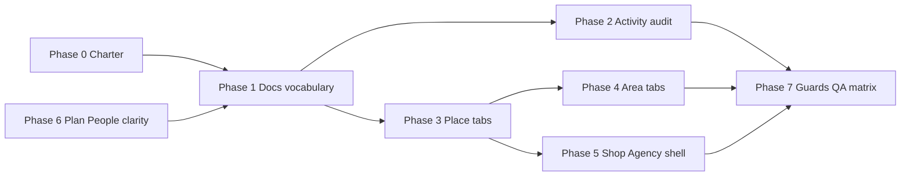

# Consumer detail surfaces — phased implementation plan

**Status:** Planning (not started) · **Last updated:** 2026-10-13  
**Audience:** Product + design + eng — one surface family per PR wave; **no big-bang UI rewrite.**  
**Handoff:** §14 (conversation record) · §15 (design anti-drift) · §16 (code anchors) — read before any phase PR.

**Defers to Tier 1:** [`NAVIGATION.md`](../NAVIGATION.md) (routes & tab labels), [`CREATE_FLOW.md`](../CREATE_FLOW.md) (organize/find field truth), [`DOMAIN_CANONICALS.md`](../DOMAIN_CANONICALS.md) (URLs & tab wire ids), [`NORTHSTAR.md`](../NORTHSTAR.md) (voice).  
**Related:** [`member-surfaces-implementation-plan.md`](./member-surfaces-implementation-plan.md) (D4 catalog projections, §3.5 area hub), [`activity-detail-tabs-implementation-plan.md`](./activity-detail-tabs-implementation-plan.md) (activity shell — **largely shipped**), [`system-refactor-plan.md`](./system-refactor-plan.md) (discovery refactor — **wave closed**; this plan is **UX shell alignment**, not R1–R8).

---

## 0. Purpose

Confirm and align **main consumer surfaces** where users **understand an object** and **engage** (join, save, chat, follow, report). These routes are the hub for modals and participation flows spawned from Explore, Plan, Chat, and notifications.

**In scope:** layout chrome (hero, tabs, footers), tab **information architecture** vs create-flow fields, cross-surface consistency, guards/tests.  
**Out of scope (unless a phase explicitly says otherwise):** new bounded contexts, Mongo reshapes, host console redesign, marketing copy overhaul, R5 map promote, Programme (R7).

---

## 1. Surface inventory (your checklist → product truth)

| # | Surface | Canonical route | Primary module | Shell today | Target shell |
|---|---------|-----------------|----------------|-------------|--------------|
| 1 | Explore | `/explore`, `/list`, `browse=1` | `ExploreExperience` + `explore/shell/*` | Map orchestrator (not entity detail) | **Keep** — reference for CTAs only |
| 2 | My Plans | `/plan` | `Activities.tsx`, `Plan*View` | `ConsumerShell` | **Keep** — tighten labels vs spec |
| 3 | Chat | `/chat` | `Messages.tsx` | Tab chrome | **Keep** |
| 4 | Area detail | `/area/:slug` | `AreaDetailPage` | Hero + **scroll sections** | **Tabbed** hub (Phase 4) |
| 5–6 | Activity detail | `/activity/:id` | `ActivityDetailView` | `MobileDetailShell` + Plan/Place/Buddies/Transport | **Keep** — audit kinds (Phase 2) |
| 7 | Place (trail/camp/venue) | `/trail`, `/camp`, `/venue` | `PlaceDetailCore` | Overview / Location / Guide tabs | **Overview / Facts / Transport** (+ guide) (Phase 3) |
| 8 | Member (public) | `/member/:userId` | `MemberProfile` | `ConsumerShell` | **Keep** — optional polish |
| 9 | Shop | `/shop/:id` | `ShopPublicPage` | Custom | **Entity public shell** (Phase 5) |
| 10 | Agency / guide | `/guide`, `/agency`, `/partner` | `OrganisationPublicProfile` | `ConsumerShell` | **Entity public shell** (Phase 5) |
| 11 | Notifications | `/notifications` | `Notifications.tsx` | List page | **Keep** |
| 12 | Badges | `/profile/badges` | `ProfileBadges` | Profile stack | **Keep** |
| 13 | My Map | `/profile/history/map` | `TripsMap` | History sub-route | **Keep** (not a root tab) |
| 14 | Goals | Plan **Wishlist** tab | `PlanWishlistView` + goals section | Embedded in Plan | **No separate page** unless product reverses D10 |
| 15 | People | Explore `view=people`, `/buddies` | People panel + `Buddies.tsx` | Split surfaces | **Document** or single redirect (Phase 6) |
| 16 | Settings | `/profile/settings/*` | Settings stack | Profile stack | **Keep** |
| 17 | Landing & auth | `/`, auth routes, `/welcome` | `Home`, `SignIn`, … | Marketing vs app | **Keep** (guest `/` rule) |

**Engagement rule:** Join, request, invite, crew chat, save, and report **originate** from entity detail or Explore peek/list; detail pages must expose the same **wire actions** as map peek where applicable (existing parity tests: `mapDetailEngagementParity`, activity detail program §6).

---

## 2. Target layout pattern (reference design)

### 2.1 Entity detail template (Activity, Place, Area, Shop, Agency)

| Region | Content | Notes |
|--------|---------|--------|
| **Chrome** | Back · optional share/menu · `MobileDetailShell` or successor | `detailBackPath(kind)` |
| **Hero** | Cover image (or map placeholder) · eyebrow (kind/area) · **title** · **region/area** · 1-line subtitle | Activity: smart date + chips (`activityDetailHeroStatus`) |
| **Tabs** | 3–4 max; **icon + label** on mobile; URL `?tab=` where deep-linking matters | Activity: `plan\|place\|buddies\|transport` (canonical) |
| **Body** | Tab panel only — no duplicate hero fields | Wire-driven CTAs, not React role matrices |
| **Footer** | Sticky primary action per tab (mobile) | Activity: `activityDetailTabFooters` |

### 2.2 Non-detail surfaces (do not force entity template)

Explore (discovery), Plan (commitments), Chat (threads), Profile hub (launcher), Notifications (inbox).

### 2.3 Kind-specific content (curated, not clone)

| Object | Hero eyebrow | Tab content drivers |
|--------|--------------|---------------------|
| Hike/camp **activity** | Activity type + schedule | CREATE_FLOW organize fields → Plan/Place/Transport |
| **Rideshare** activity | Rideshare + route hint | Transport tab primary; linked offer |
| Buddy / **others** activity | Topic + free-text “what” | Same 4 tabs; lighter place tab if no venue |
| **Trail** place | Hiking trail | Facts: distance, elevation, duration, surface |
| **Camp** place | Camping spot | Facts: access, season, facilities flags |
| **Area** | Region + area name | Activities (hosted+seeking), places by kind, optional people |
| **Shop** | Shop name + region | Products, contact, map/presence |
| **Agency** | Brand + verified host | Activities, team, contact, public profile |

---

## 3. Phase dependency graph

**Parallelism:** After Phase 1, **Phase 2** (activity) and **Phase 3** (place) can run in parallel by different owners. **Phase 4** (area) should follow **Phase 3** so tab component patterns exist. **Phase 5** can follow Phase 3. **Phase 6** is mostly docs/UX copy and can interleave. **Phase 7** closes each wave with guards.

---

## Phase 0 — Charter & sign-off (no code)

**Goal:** Lock what “done” means per surface; avoid re-debating routes mid-implementation.

| Step | Deliverable | Owner |
|------|-------------|--------|
| 0.1 | Product sign-off on **inventory table §1** (Goals on Plan, People split, My Map under history) | Product |
| 0.2 | Design reference: 1 Figma frame per **entity template** (activity already canonical) | Design |
| 0.3 | Decision: **Place** — keep “Guided information” as 4th tab vs fold into Facts | Product + design |
| 0.4 | Decision: **Area** — tab ids `overview \| places \| activities` (+ optional `people` tab vs section) | Product |
| 0.5 | Decision: **Shop/Agency** — shared 3-tab model names (e.g. About · Offerings · Location) | Product |
| 0.6 | Issue/PR template: “Surface phase X” checklist (tests + NAVIGATION delta) | Eng |
| 0.7 | Design **entity detail** Figma frame annotated to code slots (§15.2); activity = reference | Design |
| 0.8 | Confirm **anti-drift stack** (§15) accepted: shells, shared tab bar, copy modules, wire CTAs | Eng lead |

**Exit:** Checkbox row in this doc §12 decision log; no `verify:system` required.

---

## Phase 1 — Documentation & vocabulary (Tier 1 only)

**Goal:** Single source of truth for routes, tab ids, and stale term cleanup before UI moves.

| Step | Work | Files |
|------|------|--------|
| 1.1 | Add **Consumer detail surfaces** section to `NAVIGATION.md`: routes + tab labels + “not a page” notes (Goals, People, Map) | `NAVIGATION.md` |
| 1.2 | Fix **mobile tab** table: `/plan` not `/trips`; three tabs Explore · My Plans · Chat | `NAVIGATION.md` |
| 1.3 | Add **§ surface tab wire ids** table (activity + place + area target) | `DOMAIN_CANONICALS.md` § (one subsection) |
| 1.4 | Cross-link from `member-surfaces-implementation-plan.md` D4 → this doc | experiment only |
| 1.5 | `SYSTEM_COHERENCE.md` matrix row if new bounded-context touch (unlikely) | optional |

**Exit:** `npm run verify:docs` · no behavior change.

**PR size:** 1 doc PR.

---

## Phase 2 — Activity detail kind parity (audit + small gaps)

**Goal:** Hike, camp, rideshare, events, and generic buddy activities **feel** consistent on `/activity/:id`; same shell, curated tab bodies.

**Prerequisite:** Phase 1 tab ids documented; activity detail program already shipped.

| Step | Work | Detail |
|------|------|--------|
| 2.1 | **Matrix QA** — fixture activities per `ActivityType` + `activityMode` + `outingTopic` | Manual script in §2.3 below |
| 2.2 | Gap fixes only: missing hero chips, empty Transport for rideshare, Place lock copy | `ActivityDetailView`, `detail/tabs/*`, `activityDetailHeroStatus` |
| 2.3 | Extend automated matrix if gaps found | `activity-detail-cta-matrix.test.ts`, `mapDetailEngagementParity.test.ts` |
| 2.4 | Confirm peek ↔ detail footer parity for each kind | `activityPeekEngagement`, list feed footers |

**Out of scope:** New activity types, Programme entity, redesign host manage sheet.

**Exit:** `npm run verify:system:quick` · activity acceptance tests green · signed QA matrix (§8).

**PR size:** 1–2 PRs max.

---

## Phase 3 — Place detail tab IA (Facts / Transport)

**Goal:** Match product spec: **Overview** (image, title, area, description) · **Facts** (dynamic by kind) · **Transport** (accessible by, parking pin) · optional **Guide** (premium).

**Prerequisite:** Phase 0.3 decision on Guide tab.

| Step | Work | Detail |
|------|------|--------|
| 3.1 | Split/rename tabs in `PlaceDetailTabs` | `overview` → keep; extract stats from overview → **`facts`**; move parking/accessible/map reach → **`transport`**; `guide` unchanged or merged |
| 3.1b | Introduce shared **`ConsumerEntityTabBar`** (icon + label pattern from `ActivityDetailTabBar`); place tabs use it — no second tab visual language | `src/components/mobile/ConsumerEntityTabBar.tsx` (new); migrate activity bar to thin wrapper |
| 3.2 | URL deep link `?tab=facts|transport|overview|guide` on `/trail`, `/camp`, `/venue` | `PlaceDetailPage`, routing helpers |
| 3.3 | Trail vs camp vs venue: **Facts** panel config | `placeDetailConfig.ts` + shared presenter |
| 3.4 | Desktop + mobile: align with `MobileDetailShell` hero (already on core) | visual pass |
| 3.5 | SEO: tab change does not break canonical | `PageMeta` unchanged path |
| 3.6 | Tests | Extend `placeDetailCore.test.ts` + snapshot strings for tab labels |

**API:** None expected (fields already on `LocationDTO` / premium).

**Exit:** `verify:system` · `placeDetailCore.test.ts` · manual place QA (§8).

**PR size:** 1 PR (UI-heavy); avoid drive-by shop/agency.

---

## Phase 4 — Area detail tabbed shell

**Goal:** `/area/:slug` matches entity template: hero + **Overview · Places · Activities** (and optional **People**).

**Prerequisite:** Phase 3 establishes reusable **tab nav** component pattern (extract if needed).

| Step | Work | Detail |
|------|------|--------|
| 4.1 | Introduce `AreaDetailShell` (or extend `MobileDetailShell` + tabs) | `src/pages/AreaDetailPage.tsx`, `src/components/area/*` |
| 4.2 | **Overview tab:** image, title, region, description, stat chips (counts) | move from current page top |
| 4.3 | **Places tab:** `AreaHubPreviewSections` place groups + shops rail | anchor `id="places"` → tab |
| 4.4 | **Activities tab:** upcoming + seeking previews + CTAs to explore `?area=` | split hosted vs seeking labels |
| 4.5 | **People** (optional): “Available this week” — tab vs overview footer | Phase 0.4 decision |
| 4.6 | Keep `AreaHubMapStrip` in Overview or full-width above tabs | design call |
| 4.7 | Tests | New `areaDetailAcceptance.test.ts` (grep/static) or extend member surfaces G-plan |
| 4.8 | Update `NAVIGATION.md` area section + member-surfaces §3.5 | Tier 1 |

**API:** Optional — only if `GET /areas/:slug` needs richer preview slices per tab (prefer client filter first).

**Exit:** `verify:system:quick` · area smoke in §8.

**PR size:** 1–2 PRs.

---

## Phase 5 — Shop & agency public shell alignment

**Goal:** `/shop/:id` and `/guide|/agency/:slug` share **entity public shell** (hero, meta, tabs) with curated bodies.

**Prerequisite:** Phase 0.5 tab names; Phase 3 tab component reuse.

| Step | Work | Detail |
|------|------|--------|
| 5.1 | Extract `EntityPublicDetailShell` (thin wrapper over `MobileDetailShell`) | `src/components/entity-public/*` |
| 5.2 | **Shop:** wrap `ShopPublicPage` — tabs e.g. About · Products · Location/Contact | `ShopPublic.tsx` |
| 5.3 | **Agency/guide:** wrap `OrganisationPublicProfile` — About · Outings · Team/Contact | `OrganisationProfile.tsx` |
| 5.4 | Reviews/follow if present — same slot as place reviews pattern | reuse `ReviewSection` / follow controls where applicable |
| 5.5 | Tests | `planComponentsApi`-style guard or new `publicEntityShellGuard.test.ts` |
| 5.6 | `NAVIGATION.md` — shop vs agency vs member profile disambiguation | Tier 1 |

**Exit:** `verify:system:quick` · manual shop/agency QA §8.

**PR size:** 2 PRs (shop, then agency) recommended.

---

## Phase 6 — Plan, People, Goals clarity (lightweight)

**Goal:** External spec matches app: no false expectation of “Goals page” or single “People page.”

| Step | Work | Detail |
|------|------|--------|
| 6.1 | Plan copy audit: **My Plans**, Upcoming vs Wishlist, goals block prominence | `productNorthStar.ts`, `PlanPageTabs` |
| 6.2 | Profile teaser → Wishlist tab with goals visible (already) | verify `planLensPath('goals')` redirect |
| 6.3 | Optional: `/people` → redirect to `explorePath({ view: 'people' })` | only if product wants one URL |
| 6.4 | Hamburger / launcher labels: Friends vs People vs Find your crew | `NAVIGATION.md`, explore copy |
| 6.5 | Notification deep links land on correct detail surface | spot-check `notificationRouting.test.ts` |

**Exit:** Doc + copy PR; optional single redirect PR.

---

## Phase 7 — Enforcement & regression matrix

**Goal:** Prevent shell drift when new detail pages are added.

| Step | Work | Detail |
|------|------|--------|
| 7.1 | Vitest **surface shell guard**: entity routes must use `MobileDetailShell`, `EntityPublicDetailShell`, or allowlisted shell | `src/config/entityDetailShellGuard.test.ts` |
| 7.2 | Tab wire id guard for activity + place (+ area when shipped) | extend `DOMAIN_CANONICALS` tests or config guard |
| 7.2b | **Anti-drift:** grep guard — entity detail pages must not use ad-hoc `min-h-screen` without `consumer-bg` / shell wrapper (allowlist in test) | same guard file or `consumerShellGuard.test.ts` |
| 7.3 | **Manual regression matrix** (§8) run before phase close | QA sign-off |
| 7.4 | Mark phases complete in this doc §12 | |

**Exit:** `npm run verify:system`.

---

## 4. Per-PR rules (all phases)

1. **One primary surface** per PR (activity OR place OR area OR shop).
2. Update **one Tier-1 section** in the same PR as behavior change (`DOCS_GOVERNANCE.md` order).
3. Run **`npm run verify:system:quick`** minimum; **`verify:system`** at phase close.
4. No new `api.*` in components/pages (R8 guards).
5. Engagement actions stay **wire-driven** (no new `isHostRole` matrices).
6. Copy lead: north star — togetherness first; mechanisms second.

---

## 5. API & data touchpoints (by surface)

| Surface | Read API (typical) | Write / engage |
|---------|-------------------|----------------|
| Activity | `GET /activities/:id` | join request, RSVP, reviews, invite, crew chat |
| Place | `GET` place/location public | reviews, contribute (separate flow) |
| Area | `GET /areas/:slug` | none on page — links to explore compose |
| Shop | shop public + tenant profile | external product links |
| Agency | organisation public profile | follow, contact |
| Member | `GET` public profile | buddy request, message |

Phase 4 is the only likely **read-model** enhancement (tab-scoped previews); default is **reuse** `AreaDetailPayload` previews client-side.

---

## 6. Testing strategy

| Layer | What |
|-------|------|
| **Static guards** | Shell imports, tab id strings, no `api/index` in pages |
| **Acceptance** | Activity (`activityDetailAcceptance`), place (`placeDetailCore`), area (new, Phase 4) |
| **Parity** | Map peek vs detail CTAs (`mapDetailEngagementParity`) |
| **Explore** | `test:explore-alignment` when area/explore links change |
| **Manual** | §8 matrix per release candidate |

---

## 7. Risks & mitigations

| Risk | Mitigation |
|------|------------|
| Tab rename breaks bookmarks | Keep legacy `?tab=` aliases one release (`location` → `transport`) |
| Area page SEO regression | Single canonical URL; tabs as client state or documented query params |
| Shop/agency redesign breaks tenant branding | Phase 5 uses shell **chrome** only; inner content components stay |
| Scope creep into Explore redesign | Explore explicitly out of entity template |
| Parallel PR conflicts | Phase owners: Place vs Area sequential dependency per §3 graph |

---

## 8. Manual QA matrix (run at Phase 2, 4, 5 close)

**Tester:** signed-in member + guest where noted.

| Surface | Route | Checks |
|---------|-------|--------|
| Explore | `/explore` | Map, list pill, join guest sheet, peek actions |
| Plan | `/plan` | Upcoming hosted/joined, Wishlist goals+saved+suggested rail |
| Chat | `/chat` | Inbox filters, crew deep link from activity |
| Activity hike | `/activity/:id` | 4 tabs, join/footer, Place lock when pending |
| Activity rideshare | same | Transport tab emphasis |
| Place trail | `/trail/:id` | Facts + Transport tabs (post Phase 3) |
| Place camp | `/camp/:id` | Camp-specific facts |
| Area | `/area/hatta` (example) | Tabs + explore deep links (post Phase 4) |
| Member | `/member/:id` | Visibility gate, buddy CTA |
| Shop | `/shop/:id` | Products, map link |
| Agency | `/guide/:slug` | Profile, activities link |
| Notifications | `/notifications` | Tap → correct entity route |
| Badges | `/profile/badges` | List + share |
| My Map | `/profile/history/map` | Pins, filters |
| Settings | `/profile/settings` | Account stack |
| Landing | `/` (guest) | CTA → explore; signed-in redirect |
| Auth | sign-in → `/explore` or return URL | |

---

## 9. Suggested timeline (indicative)

| Phase | Effort (eng) | Depends on |
|-------|----------------|------------|
| 0 | 0.5–1 day workshop | Product/design |
| 1 | 0.5 day | 0 |
| 2 | 2–4 days | 1 |
| 3 | 4–6 days | 0.3, 1 |
| 4 | 4–6 days | 3 |
| 5 | 6–8 days | 3, 0.5 |
| 6 | 1–2 days | 1 |
| 7 | 2 days | 2–5 |

**Total:** ~4–6 weeks calendar with reviews, not one sprint.

---

## 10. Tier-1 update map (per phase)

| Phase | `NAVIGATION.md` | `DOMAIN_CANONICALS.md` | `CREATE_FLOW.md` | Other |
|-------|-----------------|------------------------|------------------|--------|
| 1 | ✓ main | ✓ tab ids | — | member-surfaces link |
| 2 | if CTA labels | — | maybe footnote | activity program changelog |
| 3 | Place § | place tab ids | — | — |
| 4 | Area § | area tab ids | — | member-surfaces §3.5 |
| 5 | Shop/agency § | — | — | — |
| 6 | Plan/People § | — | — | `productNorthStar.ts` |
| 7 | — | guards mention | — | `SYSTEM_COHERENCE` optional |

---

## 11. Out of scope (explicit)

- Full **Explore** or **Plan** redesign
- **Host console** (`/host/*`) consumer parity
- **Admin** detail pages
- **Programme** campaigns (R7)
- **i18n** / RTL layout pass
- **Desktop-first** new layouts (mobile-first shell remains source of truth)

---

## 12. Decision log

| Date | Decision | Status |
|------|----------|--------|
| 2026-10-13 | This plan created; implementation **not** started | Recorded |
| 2026-10-13 | **Separate from R8/S8** — discovery refactor wave closed; this plan is UX shell / IA only (no R1–R8 scope) | Recorded |
| 2026-10-13 | **Do not big-bang** — phases 0–7 sequential gates; Phase 2 ∥ Phase 3 after Phase 1 | Recorded |
| 2026-10-13 | **17-surface inventory** (§1) accepted as planning baseline pending product 0.1 sign-off | Recorded |
| 2026-10-13 | **Phase 0.3 engineering default:** keep **Guide** as 4th place tab until product reverses | Recorded |
| 2026-10-13 | **Phase 1 complete** — `NAVIGATION.md` consumer detail § + mobile tabs; `DOMAIN_CANONICALS` §3.1 | Recorded |
| 2026-10-13 | **Phase 3 (core) shipped** — place tabs IA + `ConsumerEntityTabBar` + `?tab=` deep links | Recorded |
| 2026-10-13 | **Phase 4 shipped** — area tabbed `MobileDetailShell`; people on overview (no people tab) | Recorded |
| 2026-10-13 | **Phase 7 (partial)** — `entityDetailShellGuard.test.ts` for entity pages | Recorded |
| 2026-10-13 | **Phase 5 shipped** — `EntityPublicDetailShell`; shop + organisation public tabs | Recorded |
| | Phase 0.3 — Guide tab on place (product confirm) | ⬜ Pending |
| | Phase 0.4 — Area people tab vs section | ⬜ Pending |
| | Phase 0.5 — Shop/agency tab names | ⬜ Pending |
| | Phase 0.1 — Inventory sign-off (product checkbox) | ⬜ Pending |
| | Phase 0.7 — Figma entity template | ⬜ Pending |
| | Phase 0.8 — Anti-drift stack (§15) | ⬜ Pending |

---

## 13. Changelog

| Date | Note |
|------|------|
| 2026-10-13 | Initial phased plan from product surface checklist alignment review |
| 2026-10-13 | §14–§17 handoff: conversation record, anti-drift, code anchors, implementer workflow |
| 2026-10-13 | **Phase 1** Tier-1 vocabulary shipped (`NAVIGATION`, `DOMAIN_CANONICALS` §3.1) |
| 2026-10-13 | **Phase 3** place tab IA + shared `ConsumerEntityTabBar` (activity + place) |
| 2026-10-13 | **Phase 4** area hub tabs + shell; **Phase 7** initial shell guard |
| 2026-10-13 | **Phase 5** shop + agency/guide `EntityPublicDetailShell` and tab deep links |

---

## 14. Implementation handoff (conversation record)

**Purpose:** Preserve context from planning chats (refactor closure, 17-surface alignment, phased delivery, design consistency) so implementers do not re-derive scope in PRs.

### 14.1 What was agreed (product + eng)

| Topic | Recorded outcome |
|-------|------------------|
| **Delivery** | Phase-by-phase (§3); **not** one combined UI rewrite. Start only after Phase 0 decisions or an explicitly chosen phase (default: **Phase 1 docs**, then **2 ∥ 3**). |
| **Checklist** | User 17-surface list mapped in §1 — Explore/Plan/Chat stay non-entity; Goals on Plan Wishlist; People = Explore `view=people` + `/buddies`; My Map = `/profile/history/map`; single activity route `/activity/:id` for all kinds. |
| **Gaps vs today** | Area = scroll page, not tabbed shell; Place tabs ≠ Facts/Transport IA; Shop uses `MobileDetailShell`, agency uses `ConsumerShell` — Phase 4–5; NAVIGATION still has legacy `/trips` wording → Phase 1. |
| **R8 / system refactor** | **S8 wave closed** in Tier 1 (`SYSTEM_COHERENCE` §8, `system-refactor-plan.md`). Remaining: R5 promote (ops), R4 `demand:` tail, R7 Programme (PM gate), optional §7 metrics. **This plan does not reopen R1–R8.** |
| **Engagement** | Join/request/save/report stay **wire-driven**; peek ↔ detail parity tests remain source of truth for activity (`mapDetailEngagementParity`, `activityDetailAcceptance`). |
| **Git (planning era)** | Work may exist **local-only** on `main` ahead of `origin`; **no push** unless product explicitly requests. |

### 14.2 Phase entry criteria (do not skip)

| Phase | Start when |
|-------|------------|
| **0** | Workshop scheduled; §12 rows 0.1, 0.3–0.5, 0.7–0.8 checked |
| **1** | Phase 0.1 inventory agreed (or product waives with written note in §12) |
| **2** | Phase 1 merged; activity tab ids in `DOMAIN_CANONICALS` |
| **3** | Phase 0.3 Guide decision; Phase 1 done |
| **4** | Phase 3 tab bar pattern shipped (`ConsumerEntityTabBar` or equivalent) |
| **5** | Phase 0.5 tab names; Phase 3 tab reuse |
| **6** | Phase 1 NAVIGATION draft (Plan/People) |
| **7** | Phases 2–5 code merged for surfaces you guard |

### 14.3 Member-surfaces cross-links (locked decisions)

These **member-surfaces** decisions bound this plan — do not contradict in UI copy or routes:

- **D4** — Catalog projections share detail pattern → this doc.
- **D10** — Goals + wishlist on **Plan**, not a standalone Goals app route.
- **D11** — No fifth tab; People discovery on Explore, friends at `/buddies`.
- **D3** — Product term **My Plans** at `/plan`, not “trips”.

Full table: [`member-surfaces-implementation-plan.md`](./member-surfaces-implementation-plan.md) §0.

### 14.4 Related completed programs (reference only)

| Program | Status | Use as |
|---------|--------|--------|
| Activity detail tabs | **Complete** | Visual + tab + footer reference (`ActivityDetailView`, `ActivityDetailTabBar`) |
| Place R3 merge | **Complete** | `PlaceDetailCore` — Phase 3 changes IA inside core |
| Discovery R8 | **Complete** | Client facades; no new `api.*` in pages |

---

## 15. Design consistency & anti-drift

**Goal:** Layout, branding, and engagement stay aligned across activity, place, area, shop, and agency **without** a separate design-system package — enforce **composition + tokens + guards**.

### 15.1 Three layers (do not mix)

| Layer | Consistent via | Drift symptom |
|-------|----------------|---------------|
| **Brand & voice** | `NORTHSTAR.md`, `productNorthStar.ts`, surface copy modules (`activityDetailCopy`, explore copy) | One-off marketing strings on a page |
| **Chrome & layout** | `MobileDetailShell`, `ConsumerShell`, `ConsumerHeroBanner`; CSS `consumer-bg`, `glass-header`, `consumer-tab-title` in `src/index.css` | Custom `<main>` page (e.g. area today) |
| **Engagement** | API wire + resolvers; parity tests | Custom join buttons / `isHostRole` matrices |

**Tenant branding (shop/agency):** Phase 5 standardizes **chrome slots only** — hero frame, tab rail, footer slot. Inner product/team content components keep operator imagery and copy.

### 15.2 Design contract (Phase 0.7)

1. One Figma **entity detail** frame: regions = §2.1 (chrome · hero · tabs · body · footer).
2. **Activity detail** = reference implementation mapped to components.
3. **Non-detail surfaces** listed in §2.2 — do not force entity template on Explore/Plan/Chat.
4. PR screenshot: mobile hero + tab row for the surface touched.

### 15.3 Code composition rules (all implementation phases)

1. **Entity detail routes** must compose through `MobileDetailShell` or `EntityPublicDetailShell` (Phase 5) — not raw page layout.
2. **Hub routes** use `ConsumerShell` with documented `layout` (`tab` \| `stack` \| `editorial`).
3. **Tab navigation** on entity pages uses **`ConsumerEntityTabBar`** (Phase 3.1b) — same icon+label sticky pattern as `ActivityDetailTabBar`.
4. **Back navigation** uses `detailBackPath(kind)` from `routingCatalog` / `explore/routing.ts` — not hard-coded `/explore` strings.
5. **Sticky footer CTAs** use shell `footer` prop + portal (activity pattern) — not fixed `bottom-0` one-offs.
6. **New user-facing labels** go through `productNorthStar` or the surface copy module — not inline unless trivial.

### 15.4 Enforcement ladder

| Level | Mechanism | When |
|-------|-----------|------|
| Docs | Tier 1 `NAVIGATION` + `DOMAIN_CANONICALS` tab ids | Phase 1+ per §10 |
| Types | `ActivityDetailTabId`, place/area tab unions | Same PR as tab rename |
| Tests | `activityDetailAcceptance`, `mapDetailEngagementParity`, `placeDetailCore.test.ts` | Activity + place |
| Guards | `entityDetailShellGuard` (Phase 7) | CI on entity pages |
| Human | §8 manual QA matrix | Phase 2, 4, 5 close |
| Optional later | Playwright screenshots on 2–3 golden routes | Not in scope until Phase 7 done |

### 15.5 Known drift vectors (fix by phase)

| Vector | Today | Fix |
|--------|-------|-----|
| Area hub | `AreaDetailPage` — no `MobileDetailShell` | Phase 4 |
| Place tabs | `PlaceDetailTabs` — different tab UX than activity | Phase 3 + `ConsumerEntityTabBar` |
| Agency vs shop shell | `ConsumerShell` vs `MobileDetailShell` | Phase 5 `EntityPublicDetailShell` |
| NAVIGATION | Stale `/trips` mobile tab wording | Phase 1 |

---

## 16. Code anchors (quick map)

| Concern | Path |
|---------|------|
| Entity detail shell | `src/components/mobile/MobileDetailShell.tsx` |
| Hub shell | `src/components/mobile/ConsumerShell.tsx` |
| Activity detail (reference) | `src/components/activity/ActivityDetailView.tsx`, `detail/ActivityDetailTabBar.tsx` |
| Activity tab ids | `src/activity/activityDetailTab.ts` |
| Place detail body | `src/components/place/PlaceDetailCore.tsx`, `src/components/ui/PlaceDetailTabs.tsx` |
| Area hub (pre-tabs) | `src/pages/AreaDetailPage.tsx`, `src/components/area/*` |
| Shop public | `src/components/shop/ShopPublicPage.tsx` |
| Agency public | `src/pages/OrganisationProfile.tsx`, `OrganisationPublicProfile.tsx` |
| Consumer mesh / glass tokens | `src/index.css` — `.consumer-bg`, `.glass-header` |
| Back paths | `src/explore/routing.ts` — `detailBackPath` |
| Engagement parity tests | `src/activity/mapDetailEngagementParity.test.ts`, `activityDetailAcceptance.test.ts` |
| Plan surface | `src/pages/Activities.tsx`, `src/components/plan/*` |

---

## 17. Implementer workflow (each PR)

1. Read **§14** (scope) and **§15** (anti-drift) for your phase.
2. Pick **one primary surface** (§4 rule 1).
3. Update **one Tier-1 section** when behavior or routes change (§10 table).
4. Run **`npm run verify:system:quick`** (minimum); **`verify:system`** at phase close.
5. Tick **§12** decision log if you resolve a Phase 0 item.
6. Add a line to **§13** changelog when a phase completes.
7. Cross-check **member-surfaces D3/D4/D10/D11** before changing Plan/People/Goals copy or routes.
