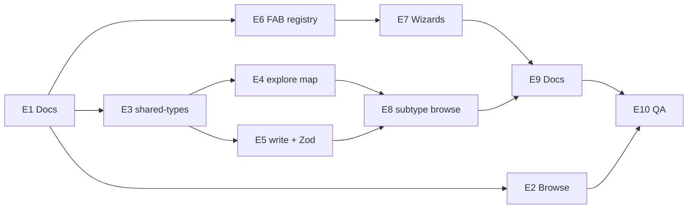

# Explore alignment — phased plan

**Branch:** `experiment-ui` · **Goal:** Browse + **Organize / Demand / Add**, separate flows, API alignment — no merged wizards.

**Docs:** [`explore-backend-alignment.md`](./explore-backend-alignment.md) · [`explore-flow-registry.md`](./explore-flow-registry.md) · [`../CREATE_FLOW.md`](../CREATE_FLOW.md) · [`../ENGINEERING_PLAN.md`](../ENGINEERING_PLAN.md).

---

## Architecture snapshot (simple)

| | **Organize** | **Demand** (outdoor) | **Add** |
|--|--------------|----------------------|---------|
| Time-bound? | Yes | Yes | No (catalog) |
| Storage | `activities` | `participant_intents` | `locations`, shops |
| Map source | `activity` | `demand` | `venue`, `shop` |
| Browse tab | Activities | Activities | Places |
| Who | Host role | Any member | Member / host |
| Categories | Hiking, camping, events, rideshare, **activities** | **Same five** | Trail / spot / shop types |
| Approval | Host sets `participationMode` | Demand lifecycle | — |

**Future:** **Demand for goods or services** — separate flows (`demand.goods.*`), not the outdoor category list.

**Naming:** Tab **Activities** = Organize + Demand pins. Category **activities** = fifth outing type (runs, climbs…). In code use **`OutingCategory`**, not “Plan” or “published/seeking”. FAB may say **Find**; architecture says **Demand**.

**Hard rules:** separate flowId + lifecycle; step kits only; no unified create API.

---

## Track A — Engineering plan (already shipped on experiment-ui)

| Phase | Focus | Status |
|-------|--------|--------|
| 0–4 | Lint, detail unify, publish payload, routing → `/explore` | Done |
| 5–6 | API split, domain aliases, consumer feedback, copy guard | Done |
| 7–8 | Mobile tabs, signup profile wizard | Done |
| 9 | Explore shell hooks, become-host guard, manual smoke doc | In progress ([`PHASE9_MANUAL_SMOKE.md`](./PHASE9_MANUAL_SMOKE.md)) |

This track cleaned **how code is organized**; it did not finish **OutingCategory projection + FAB/registry + backend DTO fields**.

---

## Track B — Explore alignment (implementation order)

Phases are **sequential gates**. Later phases may start UI spikes only if they do not depend on missing API fields (noted per phase).

---

### E1 — Architecture & registry docs ✅

**Align:** Vocabulary, storage map, non‑negotiable separate flows.

| Deliverable | Status |
|-------------|--------|
| [`explore-backend-alignment.md`](./explore-backend-alignment.md) | Done |
| [`explore-flow-registry.md`](./explore-flow-registry.md) | Done |
| This phased plan | Done |

**Exit:** **Organize / Find / Add** match `compose.ts`; storage **Demand** = intent `find`; catalog IDs `organize.*`, `find.*`, `add.*`.

---

### E2 — Discovery layer (browse) — mostly done, verify & close

**Align:** Activities vs Places; same pills/filters on map + list; no activities on Places catalog.

| Work | Code / doc | Status |
|------|------------|--------|
| Tab order Activities → Places | `exploreBrowsePanelCopy.ts` | Done |
| Layer-aware pills (Activities: All/Hiking/Camping/Rideshare/Others; Places: Trails/Spots/Shops) | `exploreMapFilters.ts`, `useExploreBrowseUrlState.ts` | Done |
| List/map same filter model | `exploreMapPinModel.ts`, `useExploreBrowseList.ts` | Done |
| Unified filter chrome (desktop inline, mobile sticky) | `ExploreBrowseFilterChrome.tsx`, `ExploreFilterPillsRow.tsx` | Done |
| Colocated pin stacks + emoji badges | `exploreMapPinModel.ts` | Done |
| Get Directions (external) | `ExploreCardPresentation.tsx` | Done |
| Coach marks say “Activities” | `ExploreCoachMarks.tsx` | Done |

**Remaining (E2 close-out):**

- [ ] Remove redundant legacy filter keys in mobile panel if still duplicated (`ActivityListFilterKey` / venue filters).
- [ ] Optional: sticky map segment Places \| Activities (`view=` URL) if product wants it on map chrome.
- [ ] Run manual pass: Places All = N venues + shops; Activities never shows venue-only rows; shop list sections only when `filter=shops`.
- [ ] Update [`explore-ux-spec.md`](./explore-ux-spec.md) checklist to match pill labels (Trails/Spots/Shops).

**Exit:** Browse URL + map + list behave identically; Places layer excludes published/seeking pins.

**Backend required:** None (uses existing `kind` + `source`).

---

### E3 — Shared contract (`ComposeIntent` + `OutingCategory`)

| Work | Owner |
|------|--------|
| Add `ComposeIntent` (`organize` \| `demand`), `OutingCategory`, optional `OutingTopic` | `packages/shared-types` |
| Explore DTO: `composeIntent`, `outingCategory`, `outingTopic`, `participationMode` (Organize only) | shared-types |
| Mappers: `activityType` / intent `kind` ↔ `OutingCategory` | shared-types or API lib |

**Exit:** Types compile; frontend may import types but filters still use `kind` until E4.

**Depends on:** E1.

---

### E4 — Backend read path (explore map projection)

**Align:** Server sends Plan projection on map items; tests lock Activities vs Places rules.

| Work | Owner |
|------|--------|
| `buildExploreMapPayload` sets `composeIntent`, `outingCategory`, `outingTopic`, `participationMode` (Organize) | `explore-map.ts` |
| Demand mapper sets same on `source: demand` | `participant-intents-store.ts` |
| Include `participationMode` on published plan items (from activity DTO) | explore-map |
| Extend `apps/api/tests/explore-map-publish.test.ts` | API tests |
| Bump explore map cache key if DTO shape changes | explore-map |

**Optional same phase:** Persist `planFamily` / `planTopic` on Mongo (see E5) — if deferred, E4 is **derive-on-read only**.

**Exit:** Cached map payload includes Plan fields; tests green.

**Depends on:** E3.

---

### E5 — Backend write path (optional persistence + per-flow validation)

**Align:** Each flow keeps its endpoint; validation schemas split by `flowId`.

| Work | Owner |
|------|--------|
| Mongo optional `outingCategory`, `outingTopic` | migrations |
| Per-flow Zod: `organizeHikingCreateSchema`, `demandCarpoolCreateSchema`, … | domain modules |
| Tighten `locationSubmitBodySchema` — drop carpool/legacy enums on place submit | location-submit |
| Registry table ↔ schema names documented | `explore-flow-registry.md` |

**Exit:** New posts can store family/topic explicitly; each flow has a named schema; no unified create body.

**Depends on:** E3 (E4 can ship before E5 if derive-on-read is enough for browse).

---

### E6 — Frontend flow registry + FAB routing

**Align:** FAB menus match registry; compose URLs encode flowId — still separate wizards.

| Work | Owner |
|------|--------|
| `composeFlowCatalog.ts` — `organize.*`, `find.*`, `add.*` | frontend |
| FAB: Organize menu, Demand menu (UI may label Find), Add menu | `compose.ts` |
| Wire `organize.rideshare` | `organizeFlow.ts` |
| Unit tests: registry covers every menu item | `compose.test.ts` |

**Exit:** Every FAB choice maps to exactly one `flowId` and one wizard entrypoint.

**Depends on:** E1 (E5 optional for menus that only use existing activityType).

---

### E7 — Wizard completeness (separate blocks & lifecycles)

**Align:** Each flowId owns steps, draft, submit, lifecycle — step kits reused only as UI blocks.

| Flow group | Files | Gaps to close |
|------------|-------|----------------|
| `organize.*` | `organizeFlow.ts` | Rideshare; activities submenu; participation toggle all flows |
| `demand.*` | `demandFlow.ts` | Outdoor categories; **later:** `demand.goods.*` separate |
| `place.add.*` | `contributeFlow.ts`, `CreateContributeFlow.tsx` | Labels Trails/Spots/Shops/Others; shop path unchanged |
| Convert seeking → published | `useExploreFulfillIntent.ts`, host prefill | Keep separate lifecycle; document in CREATE_FLOW |

| Cross-cutting | |
|---------------|--|
| Step kits | Extract/shared: when step, map pin, review shell — **no** shared draft reducer across flows |
| Publish payload | Already unified builder (`activityPublishPayload.ts`) — passes `participationMode` from **that flow’s** draft |
| Tests | Extend `organizeFlow.test.ts`, demand/contribute tests per flow family |

**Exit:** No menu item is a stub; participation is host-selected on every publish flow; seek/place lifecycles unchanged.

**Depends on:** E6.

---

### E8 — Subtype browse (Activities Others / topics)

**Align:** Pills and URL `subtype` filter on **PlanFamily** + **PlanTopic** — not title guessing.

| Work | Owner |
|------|--------|
| URL state: optional `subtype` for Activities panel only | `useExploreBrowseUrlState.ts` |
| Pin/list filter on `outingCategory` + `outingTopic` | `exploreMapPinModel.ts` |
| Sub-pill row UI (climbing, run, workshop, …) | `ExploreFilterPillsRow.tsx` |
| Emoji/map labels | `exploreCopy.ts`, `mapPinIcons.ts` |

**Exit:** Others drill-down works on live data.

**Depends on:** E4 minimum; **E5 strongly recommended** for accurate `planTopic` on create.

---

### E9 — Product & domain docs

**Align:** Main docs describe behaviour; experiment docs describe architecture.

| Doc | Updates |
|-----|---------|
| [`DOMAIN.md`](../DOMAIN.md) | Organize vs Demand vs Add; OutingCategory; Host role |
| [`CREATE_FLOW.md`](../CREATE_FLOW.md) | FAB → flow IDs; defaults vs host toggle; status table |
| [`NAVIGATION.md`](../NAVIGATION.md) | Activities/Places browse params |
| [`explore-ux-spec.md`](./explore-ux-spec.md) | Pills, emojis, CTAs vs PlanFamily |

**Exit:** New contributor reads main docs + experiment alignment without chat context.

**Depends on:** E6–E8 product-stable.

---

### E10 — QA gate & merge readiness (experiment-ui)

| Work | |
|------|--|
| [`PHASE9_MANUAL_SMOKE.md`](./PHASE9_MANUAL_SMOKE.md) + explore browse smoke | |
| API explore-map + intent + publish contract tests | |
| `copyGuard` / `exploreModuleBoundary` CI | |
| Seed data: one pin per PlanFamily × PlanSide for map QA | `apps/api/scripts/seed.ts` |

**Exit:** Checklist signed; ready for product call on merge to `main` (separate decision per experiment-ui policy).

---

## Dependency diagram

**Parallel allowed:** E2 close-out + E3; E6 + E4 after E3; E7 after E6 without waiting for E8.

---

## What not to do (regression guard)

| Anti-pattern | Why |
|--------------|-----|
| Single wizard for Organize + Demand | Different lifecycles and endpoints |
| Rename browse tab to “Plans” | Tab stays **Activities** |
| Force approval by outing category | Host chooses on Organize |
| Outdoor goods demand in same enum as hiking | Future `demand.goods.*` separate |
| Places tab showing scheduled outings | Discovery layer split |

---

## Quick status summary (today)

| Phase | Summary |
|-------|---------|
| **E1** | Done |
| **E2** | ~90% — close-out checklist |
| **E3–E5** | Not started (backend gate) |
| **E6–E8** | Not started (FAB + wizards + subtypes) |
| **E9–E10** | Not started |

**Recommended next work:** Finish **E2 close-out**, then **E3 → E4** so browse and future subtype filters share a single contract before **E6** FAB registry.
