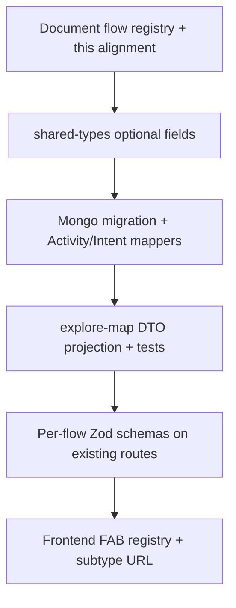

# Explore backend alignment (API · DB · DTOs)

**Branch:** `main` · **Status:** Shipped — FAB + browse on `main`; this doc is architecture reference.

**Companion:** [`explore-flow-registry.md`](./explore-flow-registry.md) (flow IDs → endpoints), [`../CREATE_FLOW.md`](../CREATE_FLOW.md), [`../DOMAIN.md`](../DOMAIN.md), frontend [`explore-ux-spec.md`](./explore-ux-spec.md).

---

## Architecture vocabulary (keep it simple)

Three compose intents on the map product. **Two are time-bound and share the same categories.** **Add** is catalog (not time-bound).

| Intent | What it is | Who | Storage | Explore `source` |
|--------|------------|-----|---------|-------------------|
| **Organize** | A dated outing on the map (you’re hosting) | **Host** role required | `activities` | `activity` |
| **Demand** | A dated “looking for…” post | Any signed-in member | `participant_intents` | `demand` |
| **Add** | Trail, spot, shop on the catalog | Member / host | `locations`, shops | `venue`, `shop` |

**Do not use** a separate “Plan / published / seeking / offer” layer in docs or types — say **Organize** and **Demand**.

**Shared outing categories** (same list for Organize and Demand — pills, FAB, filters):

| Category (UX) | Organize `activityType` | Demand `kind` |
|-----------------|-------------------------|---------------|
| Hiking | `hiking` | `hiking` |
| Camping | `camping` | `camping` |
| Events | `event` | `event` |
| Rideshare | `rideshare` | `rideshare` |
| Activities | `event` (+ optional topic: climb, run, …) | `event` / `other` |

Code name for the shared enum: **`OutingCategory`** (field e.g. `outingCategory`) — so it is not confused with the **`activities`** collection (Organize rows only).

**Browse tab “Activities”** = map/list of **Organize + Demand** time-bound pins (not the category label “Activities”). Category **Activities** = the fifth outing type (runs, climbs, etc.).

**Host** = role only (`canPublish`). Gates **Organize**, not Demand.

**Join behaviour**

- **Organize only:** **`participationMode`**: `rsvp` \| `approval` — host **chooses** in the wizard; category may set an initial default only. **`joinMode`**: `open` \| `private` — map visibility only ([`CREATE_FLOW.md`](../CREATE_FLOW.md)).
- **Demand:** Always **public** on the map when pinned. Join = **`participant_intent_requests`** only (**request to join** → poster approves). **No RSVP**, no **I'm going**, no `participationMode`, no `joinMode`, no private demand pins. Lifecycle: active → fulfilled \| cancelled; poster links published activity via **`link-activity`** (`convertedActivityId`), which enrolls approved demand joiners on that activity (host-approved participation — not RSVP on the intent).

**Future (not outdoor time-bound):** **Demand for goods or services** — separate flows, lifecycle, and likely storage from outdoor Demand. Same word “Demand” in product, different `flowId` prefix (e.g. `demand.goods.*`). Does not share `OutingCategory` with hiking/camping unless product explicitly merges later.

**Navigation (unchanged UX)**

| FAB / tab | Architecture |
|-----------|--------------|
| **Organize** | Organize flows → `activities` |
| **Find** (consumer copy) | **Demand** flows → `participant_intents` |
| **Add** | Place catalog → `locations` / shop |
| Tab **Activities** | Discovery: Organize + Demand pins |
| Tab **Places** | Discovery: catalog only |

---

## Non‑negotiable: separate flows, blocks, and lifecycles

Unifying browse chrome, enums, or DTO projection **does not** mean unifying wizards or APIs.

| Rule | What it means |
|------|----------------|
| **Separate flows** | Each FAB entry = distinct `flowId`, step list, validation, and submit handler ([`explore-flow-registry.md`](./explore-flow-registry.md)). |
| **Separate blocks** | Reuse **step kits** only (when, map pin, review chrome) — not one shared wizard state machine or one Zod mega-schema. |
| **Separate lifecycles** | **Organize:** draft → published → cancelled. **Demand:** active → fulfilled \| cancelled (+ convert). **Add place:** submit → active. **Future goods/services demand:** its own lifecycle. |
| **Separate endpoints** | Keep `POST /host/events`, `POST /me/participant-intents`, `POST /me/locations`, shop onboarding — no `POST /plans` catch‑all. |

Code today: `organizeFlow.ts`, `demandFlow.ts`, `contributeFlow.ts` — extend via registry, **do not** replace with a taxonomy seed wizard.

---

## Principle: three layers, three storage patterns

Align by **contracts**; Organize and Demand stay in separate collections.

| Layer | Product job | Persists as |
|-------|-------------|-------------|
| **A — Discovery** | Activities vs Places tabs, pills, map/list filters | **No collection** — URL + `ExploreMapItemDTO` |
| **B — Flow catalog** | FAB → wizard (`organize.hiking`, `find.rideshare`, `add.trail`, …) | Optional catalog id on audit logs |
| **C — Step kits** | Shared UI blocks (when, pin, review) | N/A |

**Storage stays split:**

| Entity | Collection / store | Explore `source` | Activities tab | Places tab |
|--------|-------------------|------------------|----------------|------------|
| Organize row | `activities` | `activity` | Yes | No |
| Venue catalog | `locations` | `venue` | No | Yes (hiking/camping/event venue; not carpool) |
| Shop | `tenants` + `merchant_profiles` | `shop` | No | Yes |
| Demand row | `participant_intents` | `demand` | Yes | No |

---

## Current state (baseline)

### Top-level type enums (stable — extend, don’t explode)

**Activity row** (`activities.activityType`, Prisma/Mongo):

- `HIKING` | `CAMPING` | `EVENT` | `RIDESHARE` (+ deprecated `COMMUNITY_ACTIVITY`)

**Location row** (`locations.activityType`):

- Same family; **event** venues = “spots / others” catalog; **carpool** should not appear on Places map (already skipped in `explore-map.ts`).

**Participant intent** (`participant_intents.kind`):

- `hiking` | `camping` | `event` | `guide` | `rideshare` | `other`

**Explore map item** (`ExploreMapItemDTO` in `@uaetrail/shared-types`):

- `kind`: `ActivityType | 'shop' | 'agency'`
- `source`: `activity` | `venue` | `shop` | `agency` | `demand`
- **No** `activityVariant` / `outdoorSubtype` on DTO today — “Others” (climbing, run, workshop) all appear as `kind: event`.

### Create / submit endpoints (keep separate)

| Flow family | Method + path | Body schema (today) |
|-------------|---------------|---------------------|
| Organize | Host `POST /host/events` (alias activities) | `eventCreateSchema` |
| Add trail/camp/spot | `POST /me/locations`, host `POST /host/locations` | `locationSubmitBodySchema` |
| Add shop | Shop / host onboarding | Shop-specific |
| Demand | `POST /me/participant-intents` | `createParticipantIntentSchema` |
| Read map | `GET /api/v1/explore/map` | `buildExploreMapPayload()` — Redis/memory cache |

Frontend mirrors this split: `organizeFlow.ts`, `demandFlow.ts`, `contributeFlow.ts` — **do not** replace with one wizard schema.

---

## Gaps vs product UI (historical)

| Product surface | UI filter / FAB | Backend today |
|-----------------|-----------------|---------------|
| Activities pill **Others** + subtypes (climbing, run, swim, workshop) | Client-only or title heuristics | All stored as `event` / intent `event` or `other` |
| Organize **Rideshare** | `activityType: carpool` | Supported on API; FAB/registry wiring incomplete |
| Organize **Activities** submenu | Climbing, run, … | Same as generic **event** row |
| Places **Trails / Spots / Shops** | `venue` hiking/camping/event + `shop` | OK at `kind` level; “spot” = `event` venue type |
| Find outdoor vs rideshare | Two demand families | One schema; `rideshare` has extra coord rules |

**Conclusion:** Unifying browse chrome is safe **now** (client filters on existing DTOs). **Subtype pills and FAB submenu labels** need optional fields + explore-map projection — implement backend **before** relying on them in production data.

---

## Recommended schema additions

### 1. `OutingCategory` (+ optional `outingTopic`) on Organize & Demand rows

Shared enum for the five outing types (maps to existing `activityType` / intent `kind`):

```ts
export type ComposeIntent = 'organize' | 'demand'; // Add = place flows, not this enum
export type OutingCategory = 'hiking' | 'camping' | 'events' | 'rideshare' | 'activities';

/** Optional: climb, run, workshop — under events | activities */
export type OutingTopic = 'climbing' | 'trail_run' | 'road_run' | 'swim' | 'workshop' | 'community';
```

- **Organize:** store or derive `outingCategory` (+ optional `outingTopic`) on `activities`.
- **Demand:** same on `participant_intents`.
- **Wire compat:** keep `activityType` and intent `kind`; mappers translate ↔ `OutingCategory`.

### 2. Explore DTO projection

```ts
composeIntent?: ComposeIntent | null;   // organize → source activity; demand → source demand
outingCategory?: OutingCategory | null;
outingTopic?: OutingTopic | null;
participationMode?: 'rsvp' | 'approval' | null; // Organize only
```

**Explore map builder rules** (document in code comments + tests):

| source | Include in Activities payload slice | Include in Places slice |
|--------|-------------------------------------|-------------------------|
| `activity` | Always (except `joinMode: private`) | Never |
| `demand` | Always active | Never |
| `venue` | Never | hiking, camping, event |
| `shop` | Never | Yes |

Filter pills (client or future `?filter=` server-side):

- Activities browse pills: filter on `outingCategory` (+ optional `outingTopic` for sub-pills).
- Activities **Rideshare:** `kind === 'rideshare'`.
- Places **Trails / Spots:** `source === 'venue'` + `kind === 'hiking'` | `kind === 'event'` (product: spots = event venues).

### 4. Location submit — clarify venue kind (no new collection)

Keep `activityType` on locations:

- **Trail** → `hiking`
- **Camp spot** → `camping`
- **Other outdoor place** → `event` (maps to Places “Spots”)

Tighten `locationSubmitBodySchema` over time:

- Prefer discriminated unions per **flow ID** (`add.trail` vs `add.camp` vs `add.venue.other`) reusing the same POST handler.
- Remove legacy accepts: `EVENT`, `COMMUNITY_ACTIVITY`, `rideshare` on location submit (migration + 400 with clear message).

---

## API validation strategy (per flow family)

Registry entry documents **one primary schema** per flow (see flow registry doc). Implementation pattern:

1. **Shared primitives** — coords, media URLs, date/time (already in domain modules).
2. **Per-flow schemas** — e.g. `organizeHikingCreateSchema`, `demandRideshareCreateSchema`, `placeAddTrailSchema`, … (one per `flowId`)
3. **Route handler** — validates with family schema, maps to `ActivityCreateInput` / intent document / location create.

Host `eventCreateSchema` can remain the **union entry** for backward compatibility while new flows call stricter schemas from the same handler.

**Rideshare:**

- Organize: `activityType: carpool` + from/to coords (already on activity).
- Find: `kind: rideshare` + validation in `createParticipantIntentSchema` (already present).

**Guide intent:**

- Keep `kind: guide` in API for backward compatibility; hide from new FAB if product retires it — do not delete DB enum without migration.

---

## Migrations & backfill

Use `apps/api/src/lib/mongo-migrations.ts`:

1. **Index:** `{ outingCategory: 1 }` on `activities` / `participant_intents` (sparse) when persisted.
2. **Backfill:** Derive `outingCategory` from `activityType` / intent `kind`.
3. **Intents:** Optional `outingTopic` backfill from titles; manual fix where wrong.
4. **Locations:** Normalize deprecated `activityType` strings via existing `migrateActivityTypeValues`.
5. **Explore cache:** Bump cache key version when DTO shape changes (`explore-map` Redis key).

---

## Shared-types as the contract

Order of changes (each step shippable on `main`):

1. Add `ComposeIntent`, `OutingCategory`, optional `OutingTopic` on DTOs + explore projection.
2. API mappers: read/write Mongo fields; default null → derive from legacy types.
3. `buildExploreMapPayload` populate `composeIntent`, `outingCategory`, `participationMode` (Organize only).
4. Frontend: `exploreMapPinModel` / URL `subtype` query **only after** (2)+(3).
5. Split Zod schemas per flow; registry doc lists which schema each `flowId` uses.

---

## Testing checklist

| Area | Test file / action |
|------|-------------------|
| Map payload mix | Extend `apps/api/tests/explore-map-publish.test.ts` — activities, venues, shops, demands; exclude private join |
| Places exclude activities | Assert no `source: activity` in Places client filter matches server item set |
| Rideshare coords | Intent + activity create validation tests |
| OutingCategory filter | `outingCategory: activities` + `outingTopic: climbing` → subtype pill |
| Location submit | Reject carpool on `/me/locations` |

---

## Open product decisions (blockers for enum design)

1. **Workshop / ticketed events** — `outingCategory: events` + `outingTopic: workshop`; host still picks `participationMode`.
2. **Goods/services demand** — separate flow IDs and storage design before sharing any enum with outdoor Demand.
3. **Server-side browse filter** — stay client-only on full map payload vs `GET /explore/map?panel=activities&filter=hiking` (pagination / perf)?

Resolve in product review; backend can ship optional fields before UI uses every subtype.

---

## Implementation order (backend gate)



**Do not** block current browse tab/pill work on (B–E) **except** subtype pills and FAB labels that imply data the API does not store yet.

---

## Doc updates when implementing

- [`../DOMAIN.md`](../DOMAIN.md) — Activity variant row; Places vs Activities on explore map.
- [`../CREATE_FLOW.md`](../CREATE_FLOW.md) — Organize submenu → `activityType` + `activityVariant` table.
- [`explore-ux-spec.md`](./explore-ux-spec.md) — Others subtype emojis tied to `ActivityVariant` enum.
