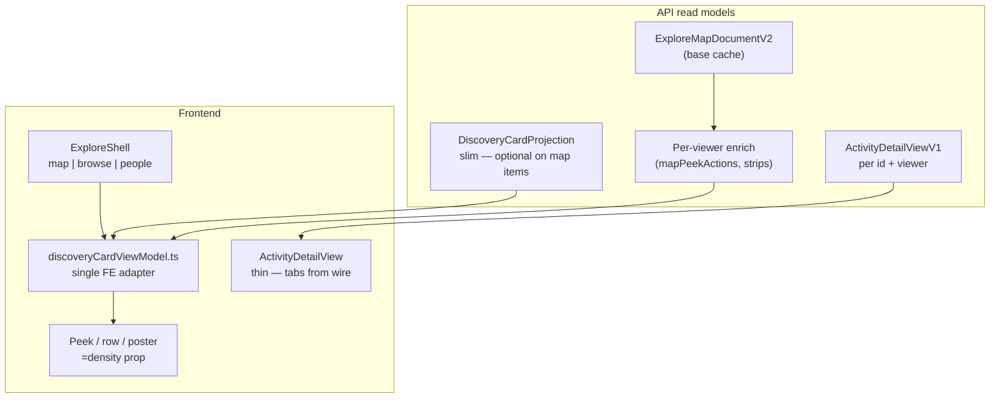

# System refactor plan — discovery, domains, surfaces

**Status:** **S8 implementation wave closed (R0–R6, R4 read, R8 guards + facades)** — **R5** vNext built; **promote** via [`EXPLORE_MAP_RUNBOOK.md`](../operations/EXPLORE_MAP_RUNBOOK.md) only. **R8** = maintenance (new HTTP → `*ClientApi`; guards enforce). **R7** code gated on PM.  
**Prerequisite read:** [`system-structure-deep-audit.md`](./system-structure-deep-audit.md) (§1–§15)  
**Baseline (Oct 2026):** pre-refactor ~895 / ~596 / ~776 LOC — current §10  
**Gate for every phase:** `npm run verify:system:quick` minimum; phase close → `npm run verify:system`  
**Tier-1 touch:** update [`SYSTEM_COHERENCE.md`](../SYSTEM_COHERENCE.md) §7 rows **C17–C20** when a phase closes — not new audit markdown.  
**UX shell alignment (separate track):** [`consumer-detail-surfaces-plan.md`](./consumer-detail-surfaces-plan.md) (**S9**) — place/area/shop/agency; does **not** extend R-phases.

---

## 1. Executive summary

The product **domain model is sound** for a high-engagement outdoor social app (Area → Place → Activity, Host capabilities, Participation, Chat, Goals, Relationships). The **implementation drift** is in three places:

1. **Discovery** — one cached map blob + **four client projections** (`exploreCardModel`, list poster enrich, peek engagement, detail presentation).
2. **Orchestration** — `ExploreExperience` owns map, list, discover browse, people panel, compose, and host sheets in one file.
3. **Seeking** — runtime is **M2d** (activities-only write); **read paths** still branch on intent ids, demand pins, and `exploreMapItemIsSeeking` across ~80+ files.

This plan **does not** rewrite Mongo, split micro-frontends, or add a Programme entity until product commits. It **does** sequence refactors so each PR strengthens **one bounded context** and removes parallel logic.

---

## 2. Deep audit — findings (code-backed)

### 2.1 Severity matrix

| ID | Finding | Evidence | User impact | Scale impact |
|----|---------|----------|-------------|--------------|
| **F-D1** | Fat map read model | `buildExploreMapPayload` caps ~250 activities / ~1200 locations; items embed full `ActivityDTO` | Slow mobile parse; stale join counts | Redis stampede on cold cache |
| **F-D2** | Four discovery projections | `buildExploreCardModel` → `buildListFeedCards` → `enrichListFeedCard`; peek uses `activityPeekEngagement`; detail uses `buildActivityPresentationForDetail` / `resolveActivityDetailWirePresentation` | Same outing feels different on map vs list vs detail | Every CTA change touches 3+ modules |
| **F-D3** | God explore orchestrator | `ExploreExperience.tsx` ~895 LOC | Hard to ship browse vs map features safely | Merge conflicts, regression risk |
| **F-D4** | Seeking read branches | `exploreMapItemIsSeeking`, `participantIntentId` on `ExploreCardModel`, intent join aliases | Wrong join target if id drifts | Test matrix explosion |
| **F-D5** | Place detail duplication | `TrailDetail`, `CampDetail`, venue routes — C4 | Inconsistent tabs/SEO loading | Duplicate fixes per kind |
| **F-D6** | Detail view weight | `ActivityDetailView.tsx` ~776 LOC | Tabs/footers hard to evolve | Coupled to host sheets |
| **F-D7** | Map vs detail policy inputs | `explore-map-viewer-access.ts` builds engagement input separately from `build-activity-presentation.ts` | Subtle peek/detail mismatch | Support burden |
| **F-D8** | Programme absent | No `programmes` collection | N/A until product | Future campaign work blocked |
| **F-D9** | Pull-only freshness | `invalidateExploreMapCache()` only | “Who’s going” lags | Engagement loop weak |
| **F-D10** | Browse ≠ separate API | Discover browse / `/list` / search client-side on map pool | Correct at UAE scale | Breaks at directory-scale search |

### 2.2 What is already healthy (do not refactor away)

| Area | Why leave it |
|------|----------------|
| `collections.ts` manifest | Single storage vocabulary |
| `member-host-status.ts` | One host tier resolver |
| `composeActivityViewerAccess` + L1 `resolveActivityEngagementPolicy` | Right auth + engagement split |
| `activity_requests` / `activity_participants` | Clear participation states |
| `GET /me/coordination-attention` | Plan “Attentions” read model |
| Chat: inbox UI + dual transport | Documented; merge storage only with product decision |
| `executeActivityMapPeekAction` | Single peek action executor (keep; extend to card VM) |
| M2d write path | `isParticipantIntentStubWriteEnabled()` default **false** — writes seeking **activities** |

### 2.3 Your surfaces → refactor tracks

| Surface | Primary debt IDs | Phases |
|---------|------------------|--------|
| **Explore** (map, `list=1`, peek) | F-D1, F-D2, F-D3, F-D7, F-D9 | R1, R2, R4, R5 |
| **Browse** (`browse=1`, `/list`, search) | F-D2, F-D10 | R1, R5 (spec) |
| **My Plans** | Low — wire to coordination attention | R4 (join invalidation helps attentions indirectly) |
| **Chat** | Intentional dual transport | Out of scope unless outbox needed |
| **Profile** | C1/C2 naming only | S4–S5 parallel |
| **Entity detail** | F-D5, F-D6, F-D7 | R1 (wire), R3 |
| **Area / Place / Operator** | C4, map projection in `explore-map.ts` | R3, R4 |

---

## 3. Target architecture (end state)

**Rules after refactor:**

- **No new business rules** in React for join/host/peek — L1 policy + wire only (L3).
- **ExploreCardModel** becomes a **deprecated alias** of `DiscoveryCardViewModel` or a thin re-export.
- **ExploreExperience** only composes shells; **< 250 LOC**.
- **Seeking** map identity = **`activity:{id}`** only; intent id is manage/storage legacy.
- **Place** pages share **`PlaceDetailCore`**; routes unchanged for SEO.

---

## 4. Refactor phases (ordered)

Phases are **sequential within each track**; **R1** and **R3** can run in parallel by different owners.

### R0 — Baseline & guards (1–2 days)

| Work | Detail |
|------|--------|
| Snapshot metrics | LOC on `ExploreExperience`, `explore-map.ts`, count of `buildExploreCardModel` call sites |
| Acceptance tests | Extend `activityDetailAcceptance.test.ts` with **RF-01**: “no new `switch` on join id in list feed actions” (grep guard) |
| Manifest | Add `discovery` projection files to `bounded-context-manifest.json` when R1 adds modules |

**Exit:** CI green; metrics table in this doc §10 updated.

**Status (Oct 2026):** **R0 exit** — §10 metrics refreshed; `discovery` in `bounded-context-manifest.json`; **RF-01** in `activityDetailAcceptance.test.ts` (list feed footers → `resolveActivityPeekEngagement`, no `switch` / `participantIntentId` in `listFeedFooterActions.ts`).

---

### R1 — Discovery card unification (2–3 weeks, discovery context)

**Maps to:** C17 · F-D2 · F-D7  
**Bounded context:** `discovery` (+ shared-types)

| Step | Deliverable | Key files |
|------|-------------|-----------|
| R1.1 | **`DiscoveryCardProjection`** type in `packages/shared-types` (slim: title, meta, chips, image, `wireActions`, `entityRef`) | `discovery-card-projection.ts` |
| R1.2 | API builder **`buildDiscoveryCardFromMapItem(item, viewerEnrich)`** used by map enrich OR documented as FE-only phase-1 | `apps/api/src/lib/discovery-card-projection.ts` |
| R1.3 | FE **`buildDiscoveryCardViewModel(item, user)`** — replaces direct `buildExploreCardModel` in peek, `list=1` row, poster | `src/discovery/discoveryCardViewModel.ts` |
| R1.4 | **`buildEngagementPolicyInputFromMapItem`** shared helper (API) — single bag for map + detail parity tests | `activity-engagement-policy-input.ts` |
| R1.5 | Migrate consumers incrementally: `ExploreItemPeekParts`, `ExploreListRow`, `ListFeedPosterCard`, `ExploreBrowsePanel` | delete duplicate meta in `listPosterPresentation` where redundant |
| R1.6 | Tests: matrix test **RF-02** — same `ExploreMapItemDTO` fixture → same primary CTA across peek, row, poster |

**Do not:** Change `GET /explore/map` payload shape in R1.1 (additive fields OK with version comment).

**Exit:** `npm run test:explore-alignment` + new `discovery-card-projection.test.ts` (API + FE).

**Status (Oct 2026):** **R1 exit (FE)** — R1.1–R1.3 shared-types + API projection, `discoveryCardViewModel`; R1.4 — `activity-engagement-policy-input.ts` (map peek + detail L1 bag, API tests). R1.5 — `buildDiscoveryEnrichedCard` unifies list row + poster base enrich; consumers via `src/discovery`; `discoveryCardBuilderGuard`. R1.6 — RF-02 matrix + `mapDetailEngagementParity` (AD-CTA A–E); peek join-context (`activityPeekEngagement.ts`). Host/pricing — `activity-pricing.ts` business tier gates.

---

### R2 — Explore shell decomposition (2 weeks, discovery FE)

**Maps to:** C18 · F-D3  
**Bounded context:** `discovery`

| Extract | Responsibility | New module (suggested) |
|---------|----------------|------------------------|
| `ExploreMapShell` | Map viewport, pins, selection, peek host | `src/explore/shell/ExploreMapShell.tsx` |
| `ExploreBrowseChrome` | URL state, filters, taxonomy pills | `src/explore/shell/ExploreBrowseChrome.tsx` |
| `ExplorePeoplePanelHost` | `view=people` panel only | `src/explore/shell/ExplorePeoplePanelHost.tsx` |
| `ExploreComposePortal` | FAB / compose query handling | `src/explore/shell/ExploreComposePortal.tsx` |
| `ExploreExperience` | Compose children, providers (`ListFeedActionsProvider` for map list) | shrink to wiring |

**Exit:** `ExploreExperience.tsx` **< 280 LOC** (~100 LOC wiring); `memberSurfacesAcceptance` / explore routing tests green; no behavior change (screenshot/manual QA map + browse=1 + list=1).

**Status (Oct 2026):** `useExploreExperienceModel`, `ExploreMapShell`, `ExploreExperienceBrowsePanels`, `ExploreExperienceOverlays` shipped; R2 exit LOC met on `ExploreExperience.tsx`.

---

### R3 — Place detail core (2–3 weeks, places context)

**Maps to:** C4 · F-D5  
**Bounded context:** `places`

| Step | Deliverable |
|------|-------------|
| R3.1 | `PlaceDetailCore` — load location, tabs, reviews, map block, viewer access |
| R3.2 | `TrailDetail` / `CampDetail` / venue page → thin wrappers (SEO title, canonical kind) |
| R3.3 | One test suite `place-detail-core.test.tsx` |

**Exit:** S6 row in SYSTEM_COHERENCE can move to “in progress”; `verify:system` green.

**Status (Oct 2026):** **R3 exit** — `PlaceDetailCore` + `usePlaceDetailPage` / `placeDetailClientApi`; thin `TrailDetail` / `CampDetail` / `EventDetail` → `PlaceDetailPage`; `placeDetailCore.test.ts` (R3.1–R3.3). Shim `usePlaceDetailCore.ts` re-exports hook.

---

### R4 — Seeking read-path retirement (2 weeks, compose + discovery)

**Maps to:** F-D4  
**Bounded context:** `compose`, `participation`, `discovery`

M2d already makes **activities** the write root. R4 removes **read** ambiguity:

| Step | Deliverable |
|------|-------------|
| R4.1 | Map build: stop emitting legacy `source: demand` items except migration window — feature flag `EXPLORE_MAP_DEMAND_PINS=0` |
| R4.2 | FE: `exploreMapItemSharePath` / pin selection — **activity id only** for seeking |
| R4.3 | Remove `participantIntentId` from `ExploreCardModel` / Discovery VM when unused on wire |
| R4.4 | API tests: `participant-intent-*` keep manage routes; map projection tests assert no demand-only pin when flag off |
| R4.5 | Docs: `CREATE_FLOW.md` one paragraph — Find creates seeking **activity** |

**Exit:** Grep `pin=demand:` only in redirects/tests; `explore-map-seeking-projection.test.ts` updated.

**Status (Oct 2026):** **Exit criteria met** for product read paths — activity-primary pins, `exploreMapPinResolve`, `seekingPinHygieneGuard`, `CREATE_FLOW` § Find, API seeking projection tests, demand pins off by default. Legacy `demand:` id parsing remains in `explore/routing.ts` + notification rewrite (6‑month compat per §6 risk register).

---

### R5 — Map read model evolution (3–6 weeks, discovery API — **design + optional slice**)

**Maps to:** C19 · F-D1 · F-D9 · F-D10  
**Bounded context:** `discovery`

| Step | Deliverable |
|------|-------------|
| R5.1 | **Spec** `docs/experiment/explore-map-vnext-spec.md` — bbox query, slim card DTO, cursor, cache keys per region |
| R5.2 | Refactor `explore-map.ts` → `explore-map-base.ts` (cacheable) + `explore-map-enrich.ts` (already partly `explore-map-viewer-access.ts`) |
| R5.3 | **Slice (optional):** `GET /explore/map?bbox=` behind flag — returns subset + same enrich |
| R5.4 | **Freshness:** on join approve, patch viewer’s enriched slice OR invalidate + `react-query` `setQueryData` optimistic join count |

**Exit:** Load test note (p95 payload); no regression on default `GET /explore/map` without bbox.

**Status (Oct 2026):** R5.1–R5.4 shipped (spec, base/enrich split, bbox API + FE flags, engagement freshness). **Promotion** not default — staging p95 + smoke in [`EXPLORE_MAP_RUNBOOK.md`](../operations/EXPLORE_MAP_RUNBOOK.md) § vNext; production still full `GET /explore/map` unless both flags on.

---

### R6 — Activity detail slimming (1–2 weeks, participation + discovery)

**Maps to:** F-D6 · F-D7  
**Bounded context:** activity detail (cross-cut)

| Step | Deliverable |
|------|-------------|
| R6.1 | Move tab panel bodies to `src/components/activity/detail/tabs/*` (already started) |
| R6.2 | `ActivityDetailView` — layout + tab state only; footers from `resolveActivityDetailWirePresentation` exclusively |
| R6.3 | Host sheets stay in `useHostActivitySheetBundle` — no second manage path |

**Exit:** `ActivityDetailView.tsx` **< 400 LOC**; activity detail acceptance tests green.

**Status (Oct 2026):** **R6 exit** — tab bodies under `detail/tabs/*`; `useActivityDetailViewModel` + wire `footerByTab` / `wireTabs`; `ActivityDetailView` shell &lt; 400 LOC; embedded preview + manage sheet use `resolveActivityDetailWirePresentation`; explore `useHostActivitySheetBundle` only (`activityDetailAcceptance` R6-01–03).

---

### R7 — Programme (product gate — **spec only**)

**Maps to:** F-D8

Deliverable: 1-page spec in experiment folder — aggregate fields, URL pattern, relation to activities — **no code** until PM approves. Prevents polluting `activities` with campaign flags.

**Status (Oct 2026):** Shipped — [`programme-aggregate-spec.md`](./programme-aggregate-spec.md).

---

### R8 — Client data layer (maintenance, cross-cut)

**Maps to:** S4 · F-D9

| Step | Deliverable |
|------|-------------|
| R8.1 | Vitest guards + ESLint `uaetrail/no-direct-api-facade-*`: no `apiRequest` / `api.` in UI layers; facades in `src/hooks/*{Api,ClientApi}.ts` only |
| R8.2 | Standard keys: `['explore','map']`, `['activity', id]`, `['coordination-attention']` |
| R8.3 | Mutations: `joinActivity` invalidates activity + patches map query |

Runs in parallel with R1–R2; do not block R1.

**Status (Oct 2026):** **R8 wave exit** — R8.1–R8.3 as below; legacy re-export shims removed (`activityJoinSubmit`, `reviewSubmit`, `contentReportSubmit`); `PlanSuggestedRail` on wishlist tab; `placeCatalogApi` for registry hook. Further work is incremental only (no phase gate).

R8.1 **done** — Vitest + ESLint (`apiGuardPatterns.ts`, `domainImportGuard`, `componentsApiIndexGuard`, `pagesApiIndexGuard`, `pagesApiGuard` incl. admin → `adminConsoleApi` / `notificationInboxApi`, `utilsListApiIndexGuard`, `consoleApiIndexGuard` — no `api/index` in UI/shared layers; DTOs via `api/types` or hook type re-exports). R8.2 — `clientQueryKeys.ts` (+ wishlist, joined activities, join requests, area hub, participant hub, inbox/badge, signup gate re-export); `useMeWishlist`, `useMyJoinedActivities`, `useMyActivityJoinRequests`, `useMyParticipantIntents` for Plan surfaces. R8.3 — join/withdraw + host join-decision engagement refresh (incl. joined + join-request plan queries); explore wishlist toggle invalidates `meWishlistQueryKey`; entity-follow toggle invalidates `entityFollowsQueryKey`; participant-intent mutations + `afterOrganizeActivityPublishClientRefresh` (map, coordination, hosted/joined strip, intent link); explore “view on map” skips legacy double `reloadExploreMap` when vNext off. Facades: `areaHubClientApi`, `accountAuthClientApi` (AuthContext), etc. `contextApiGuard` — no raw `apiRequest` in `src/context`. `useMemberCoordinationAttention` on React Query. R1.5 — RF-02 owns primary CTA parity; `exploreCopy.test` card block trimmed to list/section copy; Trips `ActivitiesSuggestedList` uses `buildDiscoveryMapListRowCard` (map list parity).

#### R8.1 — Client boundary vs React hooks (same for admin and members)

The folder `src/hooks/` is a **client data boundary**, not “everything must be a React hook.”

| Piece | What it is | When to add |
|-------|------------|-------------|
| `*ClientApi.ts` / `*Api.ts` | Plain `async` functions wrapping `api.*` | **Every** new HTTP call used from pages, components, explore, utils, services, or console |
| Naming | Prefer **`*ClientApi.ts`** for new facades | Legacy `*Api.ts` (e.g. `memberProfileApi`) stays until a touch migration — **no** repo-wide rename sprint |
| `useSomething.ts` | React hook (often React Query) | Same data needed in **multiple** components, or you need cache, `isLoading`, refetch, or mutation invalidation (R8.2–R8.3) |
| Page `useEffect` + facade | Imperative load | Admin tables, one-off screens, fire-and-forget actions — **prefer facade only**, not a wrapper hook |

**Admin and members use the same pattern:** e.g. `adminConsoleApi.fetchAdminMembers()` and `activityJoinClientApi.fetchMyJoinRequests()` — neither is special-cased. Admins have fewer `use*` modules because screens are mostly load-on-mount CRUD, not because the architecture differs.

**Do not:** one mega-hook per role, or force React Query on every button click. **Do:** keep `api.*` inside facades only (`hooksApiFacadeGuard` + ESLint); add `use*` when shared server state justifies it.

**Legacy re-export shims** (`activityJoinSubmit`, `reviewSubmit`, `contentReportSubmit`) are removed — import `*ClientApi` modules directly.

---

## 5. PR slicing rules (anti-regression)

1. **One bounded context per PR** when possible (manifest row in PR description).
2. **Remove list** — if adding `discoveryCardViewModel`, migrate **one** consumer and delete old branch in same PR.
3. **No** new `isHostRole` / role matrices in FE.
4. **Activity engagement** changes → update L1 tests in `shared-types`.
5. **User-facing route changes** → `NAVIGATION.md` + `routingCatalog.ts` in same PR.
6. Feature flags for map breaking changes (`EXPLORE_MAP_*`).
7. New HTTP from UI → add or extend `src/hooks/*{Api,ClientApi}.ts`; add `use*` + `clientQueryKeys` only when multiple consumers or invalidation need it (§ R8.1).

---

## 6. Risk register

| Risk | Mitigation |
|------|------------|
| R1 big-bang migration | One surface per PR (peek → row → poster) |
| R2 shell split breaks URL state | No changes to `useExploreBrowseUrlState` contract in R2.0 |
| R4 breaks old shared demand links | Keep redirect `pin=demand:` → resolve activity id server-side or client resolver 6 months |
| R5 bbox duplicates cache logic | Single builder function; two cache keys only after load test |
| Programme scope creep | R7 spec-only gate |

---

## 7. Success metrics

| Metric | Now (~) | After R1+R2 | After R4+R5 |
|--------|---------|-------------|-------------|
| `ExploreExperience` LOC | **97** (Oct 2026) | < 280 | < 280 |
| Card builder entry points | **1 VM** (`discoveryCardBuilderGuard`) | 1 VM | 1 VM |
| `exploreMapItemIsSeeking` FE branches | many | fewer | minimal |
| Map payload | full region | full region | bbox optional |
| Time-to-visible join count after RSVP | TTL-bound | patched query | < 5s target |

---

## 8. Suggested timeline (single team)

| Month | Focus |
|-------|--------|
| M1 | R0, R1 (peek + row), R8.1 |
| M2 | R1 (poster), R2, R4.1–R4.2 |
| M3 | R3, R4 complete, R6 |
| M4 | R5 spec + optional bbox slice; R7 spec |

Adjust if **S7b** activity-detail polish still active — **do not** duplicate engagement policy work; R1.4 feeds both.

---

## 9. Relationship to other plans

| Doc | Relationship |
|-----|----------------|
| [`activity-detail-tabs-implementation-plan.md`](./activity-detail-tabs-implementation-plan.md) | **Complete** for CTAs; R6 is **structure** only |
| [`member-surfaces-implementation-plan.md`](./member-surfaces-implementation-plan.md) | Plan hub — consume R4 seeking clarity |
| [`HOST_CLEANUP_ROADMAP.md`](../HOST_CLEANUP_ROADMAP.md) | Parallel C1–C2; no conflict |
| [`system-structure-deep-audit.md`](./system-structure-deep-audit.md) | Evidence; this doc is **execution** |

---

## 10. Metrics changelog

| Date | ExploreExperience | explore-map.ts | ActivityDetailView |
|------|-------------------|----------------|-------------------|
| 2026-10-12 | 895 | 596 | 776 |
| 2026-10-12 R1 start | peek via `buildDiscoveryCardViewModel` | — | — |
| 2026-10-12 R1.1 | `list=1` rows + `buildListFeedCards` poster path | — | — |
| 2026-10-12 R1.4 | `activity-engagement-policy-input.ts` map + detail L1 bag | — | — |
| 2026-10-12 R2 start | `ExploreExperience` ~589 LOC — `src/explore/shell/*` | — | — |
| 2026-10-13 R2 exit | **~97** (`explore/shell/*`) | **~42** shell (+ `explore-map-base`) | **~172** |
| 2026-10-13 R0 | RF-01 list feed guard; card builders = `discoveryCardBuilderGuard` (2 allowlisted) | — | R6 acceptance R6-01–03 |

---

## 11. Changelog

| Date | Note |
|------|------|
| 2026-10-12 | Initial plan from deep audit + domain lens |
| 2026-10-13 | R0 exit (RF-01, §10 metrics); R1/R6 status; vNext map invalidation on approval/withdraw/host approve |
| 2026-10-13 | Places manifest + `npm run verify:system` green (explore-alignment); `exploreCardSeeking` uses `legacyDemandExploreMapItem` |
| 2026-10-13 | S8 wave closed in docs — R8 maintenance; R5 promote = ops runbook only |
