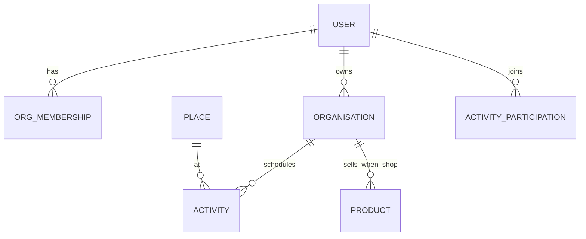

# Schema & Data Model Audit

**Status:** Phase 4 complete · **Last updated:** 2026-09-22

> **Scope:** MongoDB collections, indexes, and DTO alignment — **not** member publish gates or consumer routes. For **who can Organize** and `/me` vs `/host`, see [`MEMBER_MODEL.md`](./MEMBER_MODEL.md) and [`API_ROUTING.md`](./API_ROUTING.md). Doc tiers: [`DOCS_INDEX.md`](./DOCS_INDEX.md).

This document is the source of truth for UAE Trail's MongoDB schema, entity relationships, permissions, and the phased plan to unify them.

---

## Problem statement

The platform grew through migrations (`event` → `activity`, `location` → `place`, `organizer` → `host`, `merchant` → `shop`). The result is a **functional but fragmented** data layer:

- Three permission models (global role, tenant membership, shop `adminIds`)
- Two shop entities (`tenants` + `merchant_profiles`)
- Three frontend fetch patterns (explore map, per-entity APIs, legacy catalog mappers)
- Incomplete collection registry and missing indexes
- DTO mismatches between API and `packages/shared-types`

---

## Target entity model

**Organisation** (`tenants`) is the hub for scheduled activities and shop commerce.

| Product term | Mongo collection | Public route | API |
|---|---|---|---|
| Person | `auth_users` | `/member/:id` | `/users/:id/public-profile` |
| Place | `locations` | `/trail/:id`, `/camp/:id`, `/event/:id` | `/places/:id` |
| Activity | `activities` | `/activity/:id` | `/activities/:id` |
| Organisation | `tenants` | `/operator/:slug` | `/tenants/:slug` |
| Shop | `merchant_profiles` (+ shop tenant) | `/shop/:id` | `/shop/shops/:id` |
| Explore index | aggregate | `/explore` | `/explore/map` |

Glossary: `src/config/platform.ts` (`DOMAIN_GLOSSARY`).

---

## Permission target

| Action | Check |
|---|---|
| Host console | Active org membership for `x-organisation-id` |
| Publish / cancel activity | Membership role ∈ `{owner, admin}` |
| Edit draft activity | Membership role ∈ `{owner, admin, guide}` |
| Shop manage | Org membership when `businessMode = shop` |
| Platform admin | `user.role = platform_admin` |

Today: org membership gates host console and sensitive mutations; shop also accepts `adminIds` during transition.

---

## Implementation phases

### Phase 0 — Stabilize ✅

- [x] Expand `apps/api/src/lib/collections.ts` — single registry
- [x] Add missing indexes (`location_unlocks`, `media_assets`, `audit_logs`, `product_clicks`, `order_line_items`)
- [x] Fix `slotsAvailable` — use `participantSlotsUsed` counter (+ backfill migration)
- [x] Fix admin `business_host` / `guide_host` filters for Mongo
- [x] Align `OrderStatus` in shared-types (`paid`, `refunded`)
- [x] Normalize tenant profile enums to lowercase at API boundary

### Phase 1 — Shop identity convergence ✅

- [x] Explore map uses **shop tenants only** — merchants joined via `tenantId` (no duplicate pins)
- [x] Migration provisions shop tenants for orphan `merchant_profiles`
- [x] Dual-write: merchant PATCH → tenant (`syncShopTenantFromMerchantProfile`) and tenant write → merchant (`syncMerchantProfileFromShopTenant`)
- [x] Shop profile create allowed for **shop tenant owners** (not only `MERCHANT_ADMIN`)
- [x] New merchant profiles auto-link to shop tenant when present

### Phase 2 — Permission model ✅

- [x] `requireOrgRole` + role groups in `org-permissions.ts`
- [x] Organisation scope via `x-organisation-id` (legacy `x-tenant-id` accepted)
- [x] Host console gated by **org membership**, not global role alone
- [x] Publish/cancel/delete activities: org owner/admin only
- [x] Create/edit/join decisions: owner/admin/guide
- [x] Host approval skips global role elevation when user already hosts another org
- [x] Shop manage via org membership on linked tenant (plus legacy `adminIds`)
- [x] Frontend sends both organisation headers on host API calls

### Phase 3 — Type & fetch unification ✅

- [x] `EntityRef` + `resolveEntityPath` in `packages/shared-types/src/entity-path.ts`
- [x] `deriveActivityAvailability` + `isActivityFull` in shared-types; frontend uses `ActivityDTO` instead of `ActivityListing`
- [x] `TenantPublicDTO` in shared-types; `TenantProfile` is a deprecated alias in `src/api/types.ts`
- [x] Unified `fetchEntity(ref)` in `src/api/entities.ts`
- [x] Explore map + frontend path utils delegate to shared resolver

### Phase 4 — Schema normalization ✅

- [x] Order fulfillment collapsed into embedded `shop_orders.items` (merchant list, status updates, analytics)
- [x] Migration merges legacy `order_line_items` into parent orders
- [x] `participant_intents` use string UUID `_id` (migration converts ObjectId docs)
- [x] Removed deprecated tenant profile fields (`merchantId`, `organizerDetails`) from API responses
- [x] Removed `/organizer` API route alias (frontend `/organizer/*` pages still redirect to `/host`)

---

## Key files

| Area | Path |
|---|---|
| Collection registry | `apps/api/src/lib/collections.ts` |
| Indexes | `apps/api/src/lib/mongo-indexes.ts` |
| Migrations | `apps/api/src/lib/mongo-migrations.ts` |
| Domain types | `apps/api/src/domain/types.ts`, `enums.ts` |
| Activity reads | `apps/api/src/lib/activity-read-assembler.ts` |
| Activity writes | `apps/api/src/lib/entity-builders.ts`, `entity-sync.ts` |
| DTO mappers | `apps/api/src/lib/mappers.ts` |
| Permissions | `apps/api/src/middleware/tenant.ts`, `apps/api/src/lib/org-permissions.ts` |
| Shop | `apps/api/src/lib/shop-store.ts` |
| Wire DTOs | `packages/shared-types/src/index.ts` |
| Frontend glossary | `src/config/platform.ts` |

---

## Collection registry

All Mongo collection names are defined in `apps/api/src/lib/collections.ts`. New collections must be added there before use.

Legacy collections (`events`, `users`, etc.) are migrated on startup via `mongo-migrations.ts`.
